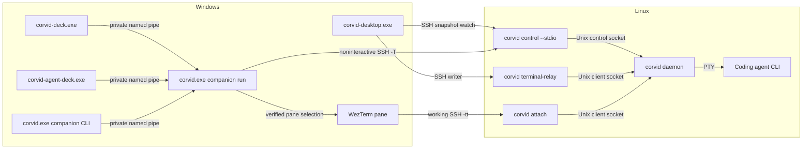
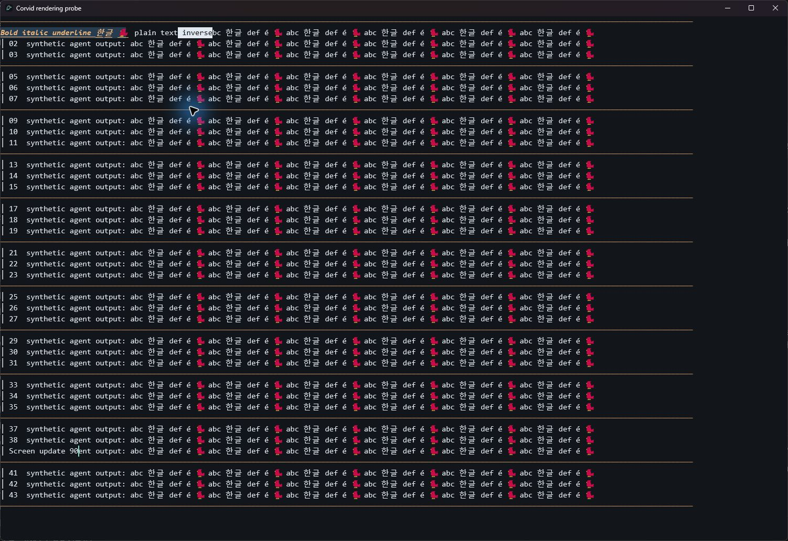

# Local Companion

The companion connects to one configured Linux Corvid daemon and maintains
virtual slots. It serves framed Protobuf to the local CLI and desktop board
over a private Unix socket on Linux or a current-user named pipe on Windows.

The desktop GUI and TUI share daemon workspaces, tabs, panes, and writer
leases. A Stream Deck integration daemon is planned for the desktop
distribution. See [planned desktop convergence](#planned-desktop-convergence)
for the remaining parity and hardware work.

- [Linux Desktop quick start](#linux-desktop-quick-start)
- [Windows quick start](#windows-quick-start)
- [Windows process and state ownership](#windows-process-and-state-ownership)
- [Windows diagnostics](#windows-diagnostics)

## Configure and Run

### Linux

Read the daemon's `host_id` with `corvid control host` on the execution host.
For a local daemon, initialize the companion with that ID. The global
`--runtime-dir` flag selects a local daemon's socket directory when needed.

```sh
corvid companion init --host-id "$HOST_ID" --count 8
corvid companion run
```

For a remote daemon, add `--ssh-alias work-host` to `init`. Configure the alias
in OpenSSH and establish host-key trust and noninteractive authentication first.
Install `corvid` on the remote command PATH and start its daemon. The companion
opens a separate `ssh -T` link with the fixed remote command `corvid control --stdio`.
The relay finds the daemon's sockets through the default XDG runtime path or
the remote command environment's `CORVID_RUNTIME_DIR`.

Defaults are `$XDG_RUNTIME_DIR/corvid-companion` for the presentation socket and
`$XDG_STATE_HOME/corvid/companion` for state, with `$HOME/.local/state` as the
state base fallback. Override with `companion --socket-dir` and `--state-dir`.
Point subsequent commands at the same socket directory.

### Linux Desktop quick start

Build the Desktop app with the repository's pinned Rust toolchain and a C/C++
toolchain. On Debian or Ubuntu, install `build-essential`, `ncurses-bin`, `libxcb1-dev`,
`libxkbcommon-dev`, `libxkbcommon-x11-dev`, and `openssh-client`. Run it in an
X11 or XWayland session with Fontconfig and a working Vulkan driver.

```sh
cargo build --locked -p corvid-agent-deck
cargo run --locked -p corvid-desktop
```

Desktop opens a local shell through the local daemon. It reuses a running daemon
or starts its own daemon process from the Desktop executable. It uses the same
runtime directory as the TUI. Open **Settings → Connections** (Ctrl+,) to select
an SSH alias
from `~/.ssh/config` or enter one. Pass `-- --ssh-alias work-host` to the Cargo
command to open SSH directly. When an alias matches the companion configuration,
Desktop checks its expected Corvid host ID.

An explicit connection starts an installed daemon if needed. Desktop asks for
confirmation before installing or updating an SSH daemon. Put the target bundle
in `daemon/` alongside the built
`corvid-desktop` binary. Build the Linux x86_64 bundle with
`bash deploy/linux/package-corvid.sh` from a clean checkout and copy the
generated `x86_64-unknown-linux-musl/` directory. Copy the Windows x64 bundle
from the Windows Desktop ZIP. Desktop uses the sessions, tabs, split panes,
and Corvid Agent Deck described in the Windows quick start.

The workspace pins `libc` to 0.2.189 while GPUI's HTTP client transitively uses
`xattr` 0.2.3, which needs the Linux `ENOATTR` constant.

### Windows quick start

Install the Windows OpenSSH Client and configure an SSH alias with host-key
trust and noninteractive authentication. For example:

```sshconfig
Host work-host
    HostName linux.example.com
    User corvid-user
```

Open `corvid-desktop.exe` to attach to the local Corvid daemon and open its shell.
Open **Settings → Connections** (Ctrl+,) to browse **Local Terminal**, SSH hosts,
and WSL distributions in a separate window. The list shows concrete
`Host` aliases from `%USERPROFILE%\.ssh\config` and static, unconditional
`Include` files. Use **Refresh** after editing the config, or enter an alias
manually.

Open the workspace picker with the host/workspace button or Ctrl+Shift+P. It
groups workspaces under Local, configured SSH aliases, and installed WSL
distributions. Connections already known to Desktop appear alongside configured
ones. Expand a machine to look up its workspaces through a read-only connection
to its running Corvid daemon. **Open terminal…** uses the normal connection and
setup flow when there are no workspaces to select.

Desktop watches up to eight detached hosts for session and agent changes. If a
watch loses the connection, Desktop marks its last workspace list **Cached**.
The watch checks the previously verified host ID and holds no writer lease.
Select a workspace to open it directly. Switching connections detaches the
current view and keeps its daemon's terminals running.
You can also launch with `--ssh-alias work-host` or use `corvid companion open work-host`.

On Windows, **Settings → Connections → WSL** lists installed distributions.
Select a distribution
to connect as its default Linux user, or launch with
`corvid-desktop.exe --wsl-distribution Ubuntu`. **Refresh** reloads the distribution
list. Desktop runs the terminal relay and control watch through `wsl.exe` stdio.
Tabs, split panes, Corvid Agent Deck, detach, and daemon-replacement reconnection use the
same session behavior as other connections.

WSL setup reuses the Linux daemon bundle beside Desktop. It asks before installing
at `~/.corvid/corvid` or upgrading an incompatible managed installation. Daemon
metadata stays in the distribution's Linux state directory. Existing PATH
installations are reused. Installation requires the Linux x86_64 bundle described
above. `--wsl-distribution` and `--ssh-alias` select mutually exclusive destinations.

An explicit Desktop connection detects the host OS and starts an installed
Corvid daemon if needed. When Desktop finds a fresh Linux x86_64 or Windows x64
host and has the matching bundle, it shows the SSH alias and asks before
installing and connecting. The transfer uses SSH stdin, verifies size and
SHA-256 on both sides, and checks that the installation is still absent.
Canceling the dialog ends the connection attempt.

Desktop can update an older managed SSH installation from its matching bundle
when the daemon is stopped or the connection reports a version problem.
The confirmation shows the installed and bundled versions. On Linux and Windows,
a running daemon with terminal-host support preserves live shells and screen state
through the replacement. Clients detach and establish fresh input routes.
An active paste or unfinished view operation must finish first.
After a successful update, Desktop
connects to the updated daemon. For a PATH installation, use its existing
installation method and reconnect.

Linux provisioning uses a POSIX shell and Linux core utilities. The binary
is installed at `~/.corvid/corvid`. Windows provisioning uses Windows PowerShell
5.1 and the system `tar.exe` through OpenSSH. It installs at
`%LOCALAPPDATA%\Corvid-SSH\corvid.exe` with an ACL for the SSH user. The Windows
daemon runs outside the SSH session job and uses the same runtime and state
paths as the local Windows TUI.

Linux SSH and WSL bootstrap validation uses the `C` locale internally, then
restores the incoming `LC_ALL` before launching or upgrading Corvid. This keeps
the daemon's shells in the user's configured locale. Older clients could leak
`LC_ALL=C` into the daemon: with a Unicode prompt and zsh autosuggestions, cursor
width calculations could leave duplicated-looking characters even though the
command buffer contained each character only once. Updating the client does not
change the environment of an existing daemon or retained shell. If `LANG` already
names a UTF-8 locale and `LC_ALL=C` came from this bug, run `unset LC_ALL; exec zsh`
at an idle zsh prompt to repair that shell. Start or upgrade the daemon from an
environment with the intended locale so future shells also inherit it.

On Linux, the SSH launch commands use `CORVID_RUNTIME_DIR` or `XDG_RUNTIME_DIR` when
configured. Otherwise Desktop uses a private directory under
`~/.corvid/` scoped to the current Linux boot. An existing installation
is reused. An older daemon without terminal-host support needs one initial idle
upgrade or manual restart. Subsequent terminals can survive planned replacements.
For deployments that need the daemon to survive the host's last-login policy,
see [systemd deployment](02_daemon_foundation.md#run-under-systemd).

Desktop connects to the daemon through `corvid terminal-relay` and uses
`corvid control --stdio` for the authoritative layout and agent watch.
The initial attach joins a live pane in the default session or opens its shell.

Use **+ → New workspace** under the active connection. **+ → New tab** creates
a shell within the selected workspace. Click a pane to focus it. Other live
panes in the same tab show read-only previews. Desktop and
TUI clients using pane writers can operate different panes in the same
workspace. An active pane has one writer. Select a workspace in Desktop's picker
and use **Open in new tab**, or run `corvid attach --new-tab NAME` in the TUI,
to open a separate tab while another client is writing. **⋯ → Detach** and window close
release the writer and keep PTYs running while the daemon survives.
Use `exit` in a shell to end that PTY.

Desktop automatically restores its terminal windows. Each window remembers its last
successful Local, SSH, or WSL connection and the selected workspace, tab, and pane
for each connection. **⋯ → New window** opens a workspace picker without changing
another window's selection. **⋯ → Quit Corvid Desktop** (Ctrl+Shift+Q) exits the current
Desktop process and preserves all its terminal windows. Closing an individual window
removes it from restoration; closing the last terminal window exits and preserves it.
Settings windows are not restored. No named profile or extra workspace concept is needed.

Relaunching Desktop reopens saved windows that are not already open in another process.
Launching again while all saved windows are open creates a new picker window. An explicit
`--ssh-alias` or `--wsl-distribution` opens only that destination, using an available saved
window for it when possible. Other saved windows remain available for the next normal launch.
The saved host ID must match the new authenticated daemon connection. A failed remote
connection remains selected so it can be retried or changed through Settings.

Restoration reads a fresh layout snapshot. If the pane was deleted, Desktop chooses
the first remaining pane in its tab; if the tab was deleted, it chooses the first tab
in the same workspace. A removed workspace, an empty terminal, or an occupied pane opens
the workspace picker. Restoration never takes input away from another writer.
Selecting a workspace there explicitly may open a shell, but restoration
itself never launches a shell or agent. Live terminals keep their existing processes
and receive fresh client identities and input routes on reattach.

These preferences are independent of TUI navigation and daemon metadata. Desktop
stores a private, schema-versioned window list in `desktop-view/windows.json` and
navigation in `desktop-view/windows/<internal-id>/view.json` below its `--state-dir`
(by default `%LOCALAPPDATA%\Corvid\companion` on Windows or
`$XDG_STATE_HOME/corvid/companion`, falling back to `~/.local/state/corvid/companion`,
on Linux). Writes are coalesced for 250 ms off the UI thread and flushed on clean
disconnect or exit. The previous valid file is retained as `view.json.bak`; corrupt
files recover from that backup, and unsupported schemas remain untouched. Only
connection labels, host identity, and layout IDs are stored, never terminal content
or input routes. Up to 32 windows and 64 connection targets per window are retained.
The previous shared `desktop-view/view.json` is imported into the first window once
and left intact. Per-window process locks prevent simultaneous launches from restoring
the same window. An interrupted process leaves its windows available for the next launch.
Window size, position, and monitor restoration remain deferred to #49.

Ctrl+Shift+N creates a workspace, Ctrl+Shift+T creates a tab, Ctrl+Shift+D splits
right, and Ctrl+Shift+E splits down. Ctrl+Tab and Ctrl+Shift+Tab cycle tabs in
the selected workspace.

Each pane follows its terminal's OSC 0/2 title in real time and uses `Pane N`
until the terminal supplies a title. An automatic tab follows its only pane's
title, or uses `Tab N` for a split tab, where N is the tab's workspace position.
Ctrl+Shift+R and **⋯ → Rename tab…** set the current tab's name. That name
survives splits and restarts. Save an empty name or choose **Use automatic title**
to restore the tab's automatic name. Renaming requires a daemon advertising
`view_titles.v1`.

On 2026-11-12, isolated Linux Desktop GUI checks verified the previous rename shortcuts,
manual-name precedence during subsequent OSC changes, split-tab numbering,
single-pane title restoration after closing a split, and the automatic-title
button. Opening the editor preserved the PTY dimensions. Native Windows ConPTY
tests covered typed Korean and emoji, pasted newlines, title overrides, splitting
and closing, and manual-name/title recovery through daemon replacement. Native
Windows Desktop GUI and IME composition were not exercised in these checks.

Desktop keeps navigation in one compact row. A single pane has no extra title
bar or border, and normal attachment does not add a bottom status bar.
Reconnection, synchronization, and error states remain visible. The workspace
picker and action menus overlay the terminal without resizing its PTY; Escape
returns focus to the terminal. Type to filter by machine and workspace name.
Use Up/Down to move, Left/Right to collapse or expand a machine, and Enter to
activate a row. The list also scrolls with the mouse.

Ctrl+Shift+F hides/restores the tab bar; **Show tabs** also exits focus mode.
Ctrl+Shift+Z expands the selected pane and restores its split layout without
changing the daemon's layout. Settings opens a reusable separate window with
Connections, Terminal, Shortcuts, Agents, and About & updates. Closing
settings keeps the terminal attached; closing the terminal window also closes
its settings window. View preferences currently last for that window's lifetime.

On 2026-11-12, the terminal-first layout was exercised under Linux Xvfb with
an isolated real daemon. Settings creation, reuse, close/reopen, workspace
search (including empty results), split, pane expansion/restoration, and focus
mode were checked. Closing the picker restored terminal input; opening settings
and the picker kept the selected PTY at the same dimensions. Closing the terminal
window also closed settings. The Windows
workspace tests and Linux routing and interactive TTY suites passed. Native
Windows GUI interaction for this layout has not yet been verified.

Open an existing pane in Desktop, or run `corvid attach` from another machine,
to continue typing in the same terminal. An ordinary attach selects the most
recently connected writer's pane in the selected workspace; pass `--workspace`,
`--tab`, and `--pane` to target a specific pane. Desktop pane clicks also resume
panes held by another client. The previous client detaches, the shell and agents
keep running, and the new client's viewport becomes the terminal size. Retry
if a paste is in progress. `--takeover` remains an explicit alias for attaching
to an existing terminal without creating a shell.
Automatic resume requires a daemon advertising `attach.resume.v1`; older daemons
retain their attach behavior and may require `--takeover` or an upgrade.

There is no Observe mode, read-only attach, or writer-handoff preference.
Different panes remain independently editable by different clients. A pane has
one input owner at a time, and the daemon rejects input from retired routes.
Automatic Desktop reconnection does not take a pane back from another client.
External agent-focus controls cannot transfer input ownership.

A writer can use **⋯ → Disconnect other clients** in Desktop or
Ctrl-] then uppercase D in the TUI. This detaches other interactive clients
currently viewing that session. Shells, agents, and clients viewing other
workspaces continue running.

Open **Agents** in the top bar (or **Settings → Agents → Open Agents**)
to see the daemon's observed Codex and Claude Code activity, including
**Working**, **Input needed**, and **Response observed**.
The toolbar keeps the **Agents** label and includes an input-request count when
needed. Activity lists, notification preferences, and card management stay in
the separate Agents window. Open **Notifications** there to choose
notification types, sound, and pauses. Click a live agent's key to open its pane
in Desktop. See the
[provider setup](03_provider_qualification.md) for hook coverage.

For native Windows process observation, launch the agent in a new Corvid tab:

```powershell
corvid attach --new-tab Codex --agent codex
corvid attach --new-tab Claude --agent claude
```

The daemon resolves `codex.exe` or `claude.exe` on its PATH. The Deck can
show the run and its exact pane once Desktop attaches to the workspace.
The Windows adapter also observes native `codex.exe` and `claude.exe`
processes started inside a Corvid shell, including through a launcher that
keeps the process ancestry intact. It checks ancestry back to the owned ConPTY
child and keeps a handle to each observed agent. The host samples once a
second, so a process that starts and exits between samples may be missed.
The adapter reports process state and exit status. Configure
[Windows provider hooks](03_provider_qualification.md#windows-hook-setup-and-fixture-coverage)
for activity, requests, and response notifications.

Use `corvid-deck.exe` for the standalone companion deck and WezTerm pairing.
Open a working TUI with `ssh -tt work-host corvid`, press Ctrl-] then r, and
use **Pair WezTerm…** in the standalone deck to register that terminal.

### Windows state and pipe settings

State defaults to `%LOCALAPPDATA%\Corvid\companion` and the pipe instance to
`main`. With a custom `--state-dir`, give `open` or `init` a new absolute
directory on a local fixed drive with persistent ACLs. Use the same path
with `open`, `run`, and `doctor`. The state directory and files require a
protected DACL granting access only to the current user.

For a second instance, use a different state directory and `--pipe-instance`
value. Pass that pipe instance to the companion, its CLI clients, and the
board. Both ends check the pipe owner and DACL before exchanging frames.
[Named pipe access controls](https://learn.microsoft.com/en-us/windows/win32/ipc/named-pipe-security-and-access-rights)

### Windows package and login startup

For published packages and update behavior, use the
[release distribution guide](05_release_distribution.md). The current packaging
command produces versioned Desktop and TUI archives with installation metadata.

Windows source builds require the pinned MSVC Rust toolchain and the Windows
SDK for the GUI. Cargo builds the Protobuf schema using `protox`. Set
`$env:GPUI_FXC_PATH` to the full path of the SDK's `fxc.exe` if GPUI
cannot find it.

From the repository root on Windows x64, run `cargo build-desktop` to build
both runtime payloads and the Windows packages. Python 3.11 or later must be
available as `python`; the Linux runtime is built in the `Ubuntu` WSL
distribution by default. Select another distribution with
`cargo build-desktop Ubuntu-24.04`.

In WSL, install Rust with rustup and the native build tools, then add the
static Linux target:

```sh
sudo apt-get update
sudo apt-get install build-essential git ncurses-bin binutils musl-tools python3
rustup target add x86_64-unknown-linux-musl
```

The packager writes versioned `corvid-desktop-VERSION-x86_64-pc-windows-msvc.zip`
and `corvid-tui-VERSION-x86_64-pc-windows-msvc.zip` archives under
`target/windows-dist`, or the corresponding `CARGO_TARGET_DIR`. The Desktop
archive contains `corvid.exe`, `corvid-desktop.exe`, `corvid-deck.exe`, the
license, launchers, package metadata, and `Set-CorvidStartup.ps1`. Corvid Agent Deck
is under `plugins/agent-deck/`; `-WithoutAgentDeck` is available for local
packaging through `Package-Corvid.ps1`.

Both Linux and Windows daemon bundles are under `daemon/TARGET/`, with manifests
containing version, target, source revision, size, and SHA-256. Keep these
directories beside Desktop for SSH and WSL provisioning. Packaged Desktop
starts its adjacent native `corvid` runtime when a local daemon is needed.
Source builds retain the Desktop executable helper path.

For a separate Linux build host, run `bash deploy/linux/package-corvid.sh`
from the same source revision. Pass the resulting
`target/linux-dist/x86_64-unknown-linux-musl/` directory to
`Package-Corvid.ps1 -LinuxDaemonDirectory PATH`. An already built Windows
runtime can also be supplied with `-WindowsDaemonDirectory PATH`.

The **Package Corvid** workflow builds both runtimes before assembling the
four Desktop/TUI packages. Main-branch and manual runs produce the
`release-assets` workflow artifact. Version tags publish a GitHub Release only
after all platform checks and package assembly succeed. See the
[distribution guide](05_release_distribution.md#build-and-publish) for details.

Extract the archive to a stable directory and use `companion open` to check
the connection. Run one of the following commands from the extracted
directory to manage the current user's startup shortcut.

```powershell
powershell -File .\Set-CorvidStartup.ps1 -Mode Enable
powershell -File .\Set-CorvidStartup.ps1 -Mode Status
powershell -File .\Set-CorvidStartup.ps1 -Mode Disable
```

At the next login, the enabled shortcut starts `corvid.exe companion run`
with the default state directory and pipe instance in a minimized console.
Open the deck to pair the newly attached TUI when
ready. Rerun `-Mode Enable` after moving the package.

## Windows process and state ownership

Desktop attaches to the Linux daemon as an interactive writer and watches its
layout and agent observations through a separate control connection.



| Component | Responsibility | Source |
| --- | --- | --- |
| Linux daemon | Owns PTYs, workspaces, writer leases, agent state, and the authoritative snapshot. Issues and consumes TUI pairing codes. | [corvid-daemon](../crates/corvid-daemon/src/lib.rs) |
| SSH client and relay | Carry the interactive TUI and the companion's separate control connection. The control connection runs the fixed `corvid control --stdio` command. | [corvid-client](../crates/corvid-client/src/lib.rs) |
| Windows companion | Watches one configured daemon, assigns slots, serves the private named pipe, and verifies local WezTerm registrations before remote focus. | [corvid-companion](../crates/corvid-companion/src/lib.rs) |
| Desktop app | Attaches as a writer to the daemon, displays its tabs and split panes, and opens agent panes requested by Corvid Agent Deck. | [corvid-desktop](../crates/corvid-desktop/src/main.rs) |
| Deck | Shows agent slot buttons and requests focus for a paired WezTerm target. | [corvid-deck](../spikes/deck/src/main.rs) |
| Corvid Agent Deck | Displays slots and queue, independently watches attention, and owns Windows tray/toasts/settings. Its pairing dialog lists verified local panes. | [corvid-agent-deck](../plugins/agent-deck/src/main.rs) |
| Windows CLI and deployment | Expose setup, inspection, diagnosis, and CLI pairing. The deployment scripts package the applications and manage optional login startup. | [CLI](../crates/corvid-tui/src/companion.rs) · [deployment](../deploy/windows/) |
| Wire contract | Defines the bounded Protobuf messages shared by the presentation and control connections. | [corvid.proto](../crates/corvid-protocol/proto/corvid.proto) |

The companion stores its host and controller identity in `config.json` and
its slot layout, pins, and last-known observations in `slots.json`. Local
terminal registrations live in a private volatile registry key scoped to the
Windows logon. A companion restart in the same logon can restore a binding
when the TUI and pane are still live. A Windows logoff or reboot keeps the
saved slot layout and requires a fresh TUI pairing. The Linux PTYs and
agents survive the loss of either Windows connection while the daemon and
its host remain alive.

### Planned desktop convergence

The former Agent Board is now **Corvid Agent Deck**, with independent background
operation, a Windows system tray, native notifications, and a packaged icon. See
[Agent Deck](06_agent_deck.md) for implemented behavior, source consolidation,
notification policy, and platform qualification limits.

The GUI is the graphical presentation of the same multiplexer behavior as the
TUI. Tabs and panes must share creation, selection, split, resize, and close
semantics, even when their controls or shortcuts differ. Closing a presentation
window and explicitly ending a terminal must remain distinct operations under
the daemon ownership contract.

Both clients create tabs and split or select panes on the daemon. Use the
[shared behavior contract](00_project_design.md#77-shared-tui-and-gui-behavior)
and acceptance case A32 to verify parity across the full operation set.

### Desktop terminal selection and history

Drag across terminal cells and press **Ctrl+Shift+C** to copy the selection.
The selected cells stay stable while new output arrives. Escape or typing
returns a live selection to the current screen.

Scroll up or press **Shift+Page Up** to review a snapshot of the focused pane.
Use the wheel, arrows, or Page Up and Page Down to move through the snapshot.
**Ctrl+Shift+F** opens case-sensitive text search within rendered rows. Enter
and Shift+Enter cycle through matches. Escape returns to the live terminal
after clearing any selection. The history view consumes terminal input locally
and uses the same drag-and-copy control.

History is plain text from the daemon's in-memory terminal screen and scrollback.
Corvid retains up to 128 scrolled rows for a live PTY. A response includes the
newest rows within 2,048 rows and 192 KiB, and the view reports when that response
omits older rows. History is read over the attached session using its view
revision. Opening the view does not resize the PTY or interrupt the program.
The history controls are currently implemented in Desktop.

### Desktop redraw performance

Desktop batches terminal backgrounds and glyphs into two scene layers, with the
cursor and IME composition above them. This avoids inserting a separate GPUI
bounds-tree layer for every short text span on each redraw. Font fallback,
cell positions, colors, and underline styling still come from the terminal cells.

Run the native, synthetic redraw probe on Windows or an X11 display:

```sh
cargo test --locked --release -p corvid-desktop native_agent_redraw -- --ignored --nocapture
```

The probe opens an isolated window with ASCII, Korean, combining text, emoji,
box-drawing characters, and styled backgrounds. It updates one row for 90 frames
and reports CPU preparation/paint times after five warm-up frames. Set
`CORVID_RENDER_PROBE_PREVIEW=1` to leave the window open for visual inspection;
close it after the updates finish. It never connects to a daemon or sends input.

On 2026-11-13, Windows release-build comparisons of the 3,371-span fixture measured
median/p95 CPU preparation and paint times of 3.02/3.31 ms before batching and
1.61/1.91 ms after batching. The native preview verified Korean, combining marks,
emoji, colored backgrounds, inverse text, bold, italic, underline, and the cursor.
These measurements exclude GPU presentation and SSH latency; they do not establish
the cause or resolution of the original Claude Code SSH freeze in
[issue #23](https://github.com/DosangGu/corvid/issues/23).



The future desktop distribution will include a Stream Deck integration daemon
that uses companion slots and focus captures, with no authority to own PTYs or
answer provider requests. The current standalone USB adapter is the prototype
for this integration. Bundling, startup/shutdown ownership, last-window behavior,
and login startup remain planned work; the current package does not include
`corvid-streamdeck`. Physical-device qualification and acceptance case A33 are
also pending. See the [integration plan](00_project_design.md#114-bundled-stream-deck-integration-daemon--planned).

## Windows diagnostics

Run `corvid.exe companion doctor` to check system OpenSSH, private state, the
named pipe, the configured remote host, and saved local registrations. Use
the same `--state-dir` and `--pipe-instance` as `run`. The command exits with
an error if a check fails. When the companion is unavailable or syncing, the
command can open a read-only SSH snapshot watch to test the configured host.

| Symptom | What to check |
| --- | --- |
| Named pipe missing | Start `companion run` and use the same pipe instance in the CLI and board. |
| Remote host unavailable | Run `ssh -T -oBatchMode=yes -oStrictHostKeyChecking=yes work-host corvid control host` and compare the returned `host_id` with the configured host. |
| Empty slots while the host is ready | Start a managed agent and use `corvid control agents` on Linux to check its run state. |
| Local registration unavailable | Refresh the WezTerm pane list, generate a new code in the attached TUI, and pair that pane again. |
| Pane selected with foreground unknown | Bring the registered WezTerm window forward manually. The remote TUI and pane were selected. |

## Inspect the Configured Host

Run `corvid companion hosts` against the running companion. The `ListHosts`
presentation request returns one configured HostId, the endpoint type (`local`
or `ssh` with its alias), and the control connection state with any issue code.
When the watch is ready, the row also includes the verified remote epoch and
snapshot sequence. The query reads the companion's current state without opening
an additional control connection. The presentation capability is `list_hosts.v1`.

## Built-in Agents window

Open a local or SSH terminal in Desktop and choose **Agents** in the top bar
(or **Settings → Agents → Open Agents**). The Deck opens in an independent
process and stays alive when Desktop detaches or switches
hosts. Desktop checks the companion host and controller IDs before opening the
window. A matching configured companion keeps its existing state. Other hosts
get their own companion state below `slot-board/` in Desktop's state directory.
When Deck starts a companion service, it uses the same Corvid daemon
as the attached terminal. On Linux Agent Deck requires `XDG_RUNTIME_DIR`.

Desktop archives include Agent Deck as a built-in feature. For source builds, run
`cargo build --locked -p corvid-agent-deck` and place the resulting executable
under `plugins/agent-deck/` next to the Desktop executable. You can also launch
Deck directly using its configured `--state-dir` and `--socket-dir` on Linux
or `--pipe-instance` on Windows. It starts or reuses the companion service.
The window uses the workspace GPUI version and connects directly to the private
Protobuf endpoint. Linux uses the same X11 or XWayland and Vulkan requirements
as Corvid Desktop.

When launched from Desktop, click a key in **Deck** or an agent in **Queue** to
focus its pane and bring Desktop forward. With a working tray and Always on top
disabled, a successful focus hides the Deck. Linux keeps its window available.
When running Agent Deck directly,
choose a paired TUI in **Target terminal**, then click the agent's key.
The result bar reports the outcome.
**Acknowledge alert** marks that alert seen. Answer questions and grant
permissions in the terminal. Completed agents retain their cards until their
pane, tab, or workspace/session is explicitly closed. Additional agents queue
in arrival order. Closing a pane shifts all following cards forward and fills
vacancies from the queue. Pins follow their cards. **Closed panes** shows recent
removed run IDs. Older manually suppressed runs can still be re-added.

On Windows, closing the Deck window hides it to the tray. **Notifications &
settings** controls categories, sound, pause, and optional login startup. Use
**Quit Corvid Agent Deck** to exit. Linux currently supports `notify-send`
notifications without a tray; closing its window exits. Details and limits are
in [Agent Deck](06_agent_deck.md).

On disconnection the board keeps the last snapshot visible and disables its
actions. Reconnection loads a fresh snapshot. Standalone mode requires another
terminal choice. A gesture uses the slot and terminal revisions that were visible when
it began. A stale action is rejected and can be retried as a new click after
reviewing the refreshed board.

### Live Stream Deck

The standalone Windows GPUI deck uses the
running companion's private presentation pipe.
It displays assigned Claude Code and Codex slots, activity, pending requests,
unseen alerts, and whether the companion and host are available. The 5 × 3
layout shows 14 slots per page. The lower-right key advances the page, and the
side panel shows unassigned runs separately. Use Corvid Agent Deck to edit slots
and manage overflow.

Run the deck from the repository root to use the same first-run flow during
development. The default pipe instance is `main`.

```powershell
cargo run --locked -p corvid-deck
```

Use **Pair WezTerm…** to pair the working TUI directly in the deck. Choose a
previously paired **Target terminal** if needed. Click a slot key or use its
keyboard shortcut to select that agent in the existing TUI. The result panel
reports remote selection and the separate local window activation result.
Answer questions and approve requests in that terminal. A new connection or
changed registration requires a fresh target selection. Pass
`-- --state-dir DIR --pipe-instance NAME` to isolate another companion
configuration. Use `-- --connect-only --pipe-instance NAME` to attach the
deck to an independently managed pipe, or `-- --demo` for the isolated
virtual button simulator.

The USB adapter uses the same live key model and focus captures without a GPUI
window. It uses [Elgato's USB HID protocol](https://docs.elgato.com/streamdeck/hid/stream-deck-classic/)
for the Stream Deck 2019, MK.2, MK.2 Scissor Keys, and 15-Key Module. The 2017
Stream Deck Original uses a separate legacy report format. Quit Elgato's
Stream Deck app before attaching a supported 15-key unit.
Get the exact client ID from `corvid companion slots`, then pass it as the
target. With no target the adapter displays live slots and accepts page
navigation. Use `--list` to enumerate devices, `--serial SERIAL` to select
one when several are connected, or `--demo` for local test keys.

```powershell
cargo run --locked -p corvid-deck --no-default-features --features stream-deck --bin corvid-streamdeck -- --target CLIENT_ID
```

The USB adapter reconnects to the same serial after USB loss. Its tests cover
HID report bytes, synthetic key transitions, stale captures, and 72 × 72 LCD rendering.
Physical image upload, button orientation, and reconnect remain to be qualified.

## Pair and Focus

In the intended attached TUI, press Ctrl-] then r. Run `corvid companion pair`
and enter its private code on stdin. The code expires in 60 seconds. Dismiss
the modal with Enter or Esc and keep that TUI attached.

```sh
corvid companion slots --count 8
corvid companion focus-slot --slot "$SLOT_CAPTURE" --binding "$BINDING_CAPTURE"
```

Copy `capture=` from the desired `slot=` line and the explicitly chosen
`binding` line. The TUI must already hold the target workspace's writer lease.
`remote_selection=Applied local_activation=ManualRequired` means the existing
TUI selected the run. Bring that terminal forward manually. Refresh the
captures after reconnect, restart, or reassignment. A stale click is rejected.

To acknowledge one alert, use the displayed `control_capture`, `run`, and
`latest_attention_id` with `companion ack --control`, `--run`, and
`--attention-id`. An input request stays pending until the provider reports a
matching result. Use `companion unpair --binding "$BINDING_CAPTURE"` to revoke
one registration.

### WezTerm on Windows

Keep the SSH TUI attached in WezTerm. In the desktop board, open **Pair
WezTerm…**, choose the pane by its GUI, window, tab and pane IDs, and enter the
one-time code from Ctrl-] then r in that TUI. The pane title helps identify the
pane. The companion checks the exact process, socket file, and pane location
shown in the chooser before sending the code to the configured host. After a
pane moves, refresh the list and pair it again. Choose the new binding under
**Target terminal** before focusing a slot.

Keep the ordinary SSH session and its Corvid TUI open. In a separate local
shell in the same WezTerm GUI, the CLI can also list panes and pair the
selected numeric ID. Read its pairing code as above and use the chosen ID in
`$PaneId`.

```powershell
wezterm --skip-config cli --no-auto-start list --format json
corvid.exe companion pair --wezterm-pane $PaneId
```

Use `--wezterm-socket` with that GUI's `WEZTERM_UNIX_SOCKET` value when the
pairing shell is outside the target WezTerm instance. The companion checks
the running GUI's user, process, and socket peer and records the exact
window, tab, and pane IDs. It uses its pairing record before and after remote
focus. If the pane moves, closes, or belongs to a replacement process,
pair the intended pane again. [WezTerm CLI instance selection](https://wezterm.org/cli/cli/index.html)

The same `focus-slot` command selects the registered WezTerm pane after
remote focus succeeds. `Activated` means Windows reported the registered
window in the foreground. `PaneSelectedForegroundUnknown` means the pane
selection succeeded and Windows foreground activation could not be confirmed.
The slot output shows the registered PID and window/tab/pane IDs to locate
it. Windows activation is attempted only for a single unambiguous GUI window
with WezTerm's default window class.
`Unavailable` after `Applied` means the remote selection succeeded but the
local activation could not be completed. [WezTerm pane activation](https://wezterm.org/cli/cli/activate-pane.html)
[Windows foreground restrictions](https://learn.microsoft.com/en-us/windows/win32/winmsg/window-features)

Local WezTerm and manual registrations are kept in a protected, volatile registry key
for the current Windows logon. After a companion restart, refresh the slot
and binding captures once the daemon synchronizes. A matching remote binding
can recover automatic activation in the same logon. Before remote focus the
companion checks the process creation time, socket file identity and peer PID,
and the exact window, tab, and pane. If the local record is missing or
unreadable, focus returns `LocalTerminalUnavailable` before changing the
remote view. Pair again after a failed identity check, logoff, or reboot.
Manual bindings created by older versions require a fresh pairing once.
If the registry is unavailable, a new pairing works for the current
companion process.
[Volatile registry keys](https://learn.microsoft.com/en-us/windows/win32/api/winreg/nf-winreg-regcreatekeyexw)
[Windows logon identity](https://learn.microsoft.com/en-us/windows/win32/api/winnt/ns-winnt-token_statistics)

## Slot Management and Recovery

- `slots --overflow-page 0` shows the first overflow page. Use `pin` and `unpin`
  with `--slot "$SLOT_CAPTURE"` to reserve or release an empty placement.
- `remove --slot "$SLOT_CAPTURE"` suppresses that run. Use `remove-overflow --run`
  for an overflow entry and `readd --run` to make a current suppressed run
  eligible again. `place --slot "$EMPTY_CAPTURE" --run "$RUN_KEY"` assigns a
  current overflow run to an explicitly selected empty slot.
- The companion keeps stable IDs and slot revisions in private JSON files.
  Windows flushes a same-directory temporary file before replacing the
  destination with `MoveFileExW`. The optional cache in `slots.json` stores
  up to 512 last-known observations, with assigned slots first and overflow
  in eligibility order. It stores badges, evidence, counts, and timestamps.
  The companion groups observation saves on a one-second timer and flushes
  pending observations on clean exit. Existing placement files load with an
  empty cache. A new daemon epoch makes old slots historical until there is
  end evidence or explicit removal.
  [Windows file replacement flags](https://learn.microsoft.com/en-us/windows/win32/api/winbase/nf-winbase-movefileexw)
- During a control outage, desktop cards show the last known badge and
  observation age. `companion slots` prints `last_observed_unix_ms`. A fresh
  snapshot revalidates surviving registrations and enables focus and alert
  acknowledgment with new captures. A TUI detach retires its registration.
  Pair the replacement TUI after reattaching.

## Verification

The workspace integration test verifies separate placements for two managed
agents with the same working directory, followed by exit and slot reuse.
The Claude Code 2.1.318 fixture verifies pairing, companion restart, exact
question focus and acknowledgment, and rejection of a stale click after
`/clear`. The OpenSSH 10.6p1 loopback fixture kills the companion's SSH process
and verifies full resync under the same daemon epoch while the separate TUI
and its PTY remain active. These checks ran on Linux.

The A10 wire fixture uses two attached TUIs and a real companion. A focus
request with no registrations returns `NoAttachedClient`. Two registrations
without an explicit choice return `AmbiguousClient`. A wrong revision or
retired capture returns `StaleBinding`. After one TUI detaches, a request
still needs an explicit choice. These failures leave the daemon's snapshot
and sequence unchanged.

The A25 offline restart fixture holds a question open in Claude Code 2.1.318
while the control socket is unavailable. A new companion restores the slot,
badge, counts, and observation time. Attempts to focus or acknowledge return
`ConnectionRequired`. The original TUI selection and pending question survive.
After the control socket returns, a fresh capture focuses the same question.

```sh
PYTHONDONTWRITEBYTECODE=1 python3 crates/corvid-tui/tests/claude_qualification.py \
  --corvid target/debug/corvid --scenario offline-restart
```

Linux desktop verification used Xvfb 21.1.25 with a synthetic Protobuf companion.
The GUI retained the captured run and revisions above 2^53 across a slot
replacement during a mouse press. A fresh click used the replacement's
revision. Dropping the IPC connection during a press produced no replay
after reconnect. A desktop pin also persisted through the real Linux companion.
The A29 version-skew fixture sent an unknown focus activation result and
then an unknown run availability. The desktop kept the last valid snapshot
as a cache and disabled actions. A compatible snapshot restored the link,
and the user had to select the terminal again before focusing.
`cargo test --locked -p corvid-agent-deck -p corvid-presentation` checks capture, connection fencing,
and input-frame behavior without a display. The Windows desktop binary
cross-linked for `x86_64-pc-windows-gnu`. Wine 11.21 ran its four tests and
rendered the offline window.

The CLI and companion tests cross-link for `x86_64-pc-windows-gnu` with
Rust 1.93. Wine 11.21 ran CLI help, private pipe I/O, and rejection of default
pipe and state-directory ACLs. Its pipe implementation accepted a duplicate
first instance, and reopening a freshly created state directory returned a
DACL with an extra ACE. The storage tests fail closed in that environment.

Windows PE build `10.0.26100.9457` from the Windows 11 Enterprise 26H2
evaluation ISO ran these cross-built tests in QEMU 11.1.3. With the
temporary directory on a dedicated NTFS volume, both named-pipe integration
tests and all four slot-storage tests passed. The tests covered exclusive
pipe ownership, two presentation clients, private directory ACLs, and state
replacement and recovery. The library passed nine tests, including exact
file identity and cross-process registry restore, with `SystemTemp` on the
NTFS volume for the SYSTEM account. The Windows PE image lacked
`afunix.sys` and the peer PID test returned socket error 10047. The desktop
test executable exited before running its tests with `0xc0000135`.

The three registration tests also passed in Windows PE after the schema
update. A new process restored both explicit manual and WezTerm records.
The tests checked legacy WezTerm records, exact revisions, and rejection of
missing pane fields and unsupported versions.

Wine read a protected registry key prepared by the test and cleared it on
session restart. Wine discarded the security descriptor when creating a new
key, so the companion rejected the key.

On 2026-11-09, Windows x64 build `26300.9711` (26H2) ran 66 tests across the
CLI, client, companion, core, desktop, and protocol packages using MSVC Rust
1.93.1 and `protoc` 36.1. A non-elevated account used an NTFS temporary
directory. Named-pipe ownership and client access, private state ACLs, slot
replacement and recovery, and same-logon registry restore across processes
passed. The AF_UNIX test also passed after accounting for Winsock reporting
zero output bytes while writing the peer PID.

The WezTerm adapter follows the per-process socket layout and CLI options in
WezTerm `20240203-110809-5046fc22`.
[WezTerm GUI socket source](https://github.com/wezterm/wezterm/blob/20240203-110809-5046fc22/wezterm-gui/src/main.rs)
[WezTerm CLI option source](https://github.com/wezterm/wezterm/blob/20240203-110809-5046fc22/wezterm/src/cli/mod.rs)

On an interactive Windows desktop, point the native WezTerm fixture at the
installed GUI executable and record the Windows and WezTerm versions. Use its
absolute path if `wezterm-gui.exe` is outside `PATH`.

```powershell
$env:CORVID_WEZTERM_GUI = (Get-Command wezterm-gui.exe -ErrorAction Stop).Source
& (Join-Path (Split-Path $env:CORVID_WEZTERM_GUI) 'wezterm.exe') --version
Get-CimInstance Win32_OperatingSystem | Select-Object Caption,Version,BuildNumber
cargo test --locked -p corvid-companion --lib native_wezterm_activation_keeps_exact_gui_and_pane -- --ignored --nocapture
```

The fixture starts separate WezTerm instances with its own test panes and
checks that a colliding pane ID in another GUI keeps its selection. It checks
rejection after a pane move, closure, or GUI replacement and the foreground
fallback when the registered GUI owns multiple windows. On Windows build
`26300.9711` the fixture passed with WezTerm `20240203-110809-5046fc22`. It
reported `Activated` for the single-window case and
`PaneSelectedForegroundUnknown` for the multiple-window case.
[WezTerm new-process option](https://wezterm.org/cli/start.html)

Windows system OpenSSH `9.5p2` reached the expected host and epoch on an
Ubuntu 26.04.1 WSL daemon over loopback SSH. A WezTerm SSH TUI with a
synthetic agent paired successfully. `focus-slot` selected the original
Corvid tab and reported `Activated`. Restarting the companion restored the
pin and exact WezTerm registration, and fresh captures still focused the
original terminal. The old captures were rejected. After the WezTerm pane
moved, focus returned `LocalTerminalUnavailable` before changing the remote
selection. The desktop board opened against the same named pipe. Desktop
button interactions and the Windows reboot case remain open.

The desktop pairing request also passed against the loopback SSH fixture
using a test client and a live WezTerm pane. `companion doctor` verified the
original registration, reported it unavailable after the pane moved, and
verified the new revision after re-pairing. The packaged startup script
created and removed the expected shortcut in an isolated Startup directory.
The packaged `companion open` command also pinned the loopback daemon's
HostId on first use, reused the saved configuration, and opened the board
against a separately running companion. A mismatched pipe and state
identity was rejected.

### Local PC reboot reproduction

Use a dedicated Linux daemon on a separate machine and a Windows companion
with its own state directory and pipe instance. Leave a verified Claude Code
question pending in the only attached TUI. Create a second Corvid tab with
Ctrl-] then t and return to the question with Ctrl-] then p. Pair that TUI
to its WezTerm pane and pin the question's slot using `companion pin --slot`.
From another shell in that WezTerm GUI, capture the starting state. Use
the actual slot number and put the checkpoint outside the repository.

```powershell
$checkpoint = Join-Path $env:LOCALAPPDATA 'corvid-a25-reboot.json'
wezterm --version
& "$env:SystemRoot\System32\OpenSSH\ssh.exe" -V
py -3 crates/corvid-tui/tests/local_reboot.py before $checkpoint --ssh-alias work-host --pipe-instance a25 --slot 1
```

Restart Windows manually. From PowerShell, start the same companion with
the same pipe instance and state directory. Keep WezTerm closed and run
`recovered` with the same checkpoint, alias, and pipe instance. The fixture
checks the new local boot time, the saved pin and slot, the unchanged remote
daemon and pending request, and rejection of the retired registration.

Open WezTerm and run `ssh -tt work-host corvid attach`. Pair the new TUI to
its pane. If the question is visible, switch to the existing second tab
with Ctrl-] then n. From a shell in that GUI, run `repaired` with the same
arguments. The fixture checks that the old identity cannot change the TUI
and the new registration selects the original run, terminal, and WezTerm
pane. It checks the pane inventory and pending request again after focus.
Record the reported activation outcome and the Windows build and boot times
from the checkpoint. Keep the checkpoint local.

On a Linux controller, use `python3` and `--socket-dir` in place of the
Windows launcher and pipe option. Pair the TUI without a WezTerm target.
A25 recovery case C passed with a Debian 13.7 controller in QEMU 11.1.3
using OpenSSH 10.0p2. Only the controller guest rebooted. The separate
Linux execution host used OpenSSH 10.6p1 and Claude Code 2.1.318. The saved
pin, slot revision, agent PID, and pending RequestId survived. A newly
paired SSH TUI selected the original question. The request resolved after
the answer was entered in that TUI.

## Deferred Platform Verification

### Installed Windows

Use the desktop board with a paired SSH TUI to verify focus, held-gesture
fencing, overflow, and restart recovery. Capture the activation outcome and
confirm that focus preserves the open terminal inventory and a pending remote
provider question. Follow the [local reboot procedure](#local-pc-reboot-reproduction)
with a separate Linux execution host to confirm that a new Windows logon
restores slots and requires a new pairing.

### macOS

When the separate macOS execution work is scheduled, record the OS build,
CPU architecture, terminal emulator, and SSH version. Exercise the pinned
terminal compatibility suite (A19) on that combination. Qualify private
local IPC and peer identity (A24), SSH loss and last logout with the chosen
service manager (A21), and input fencing across resize and reattach (A20).
Run the local companion, desktop, and recovery suites on macOS after their
platform paths are implemented.
