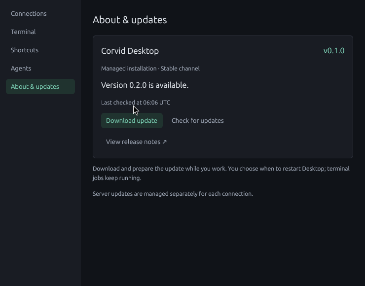
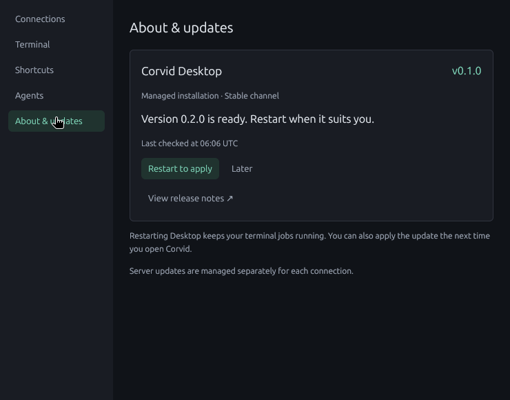
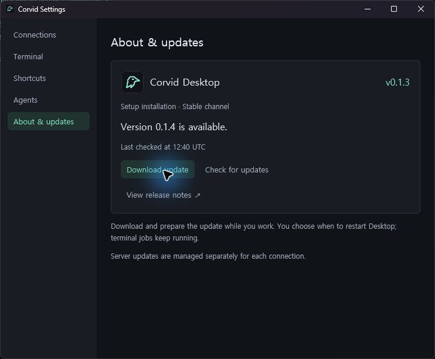
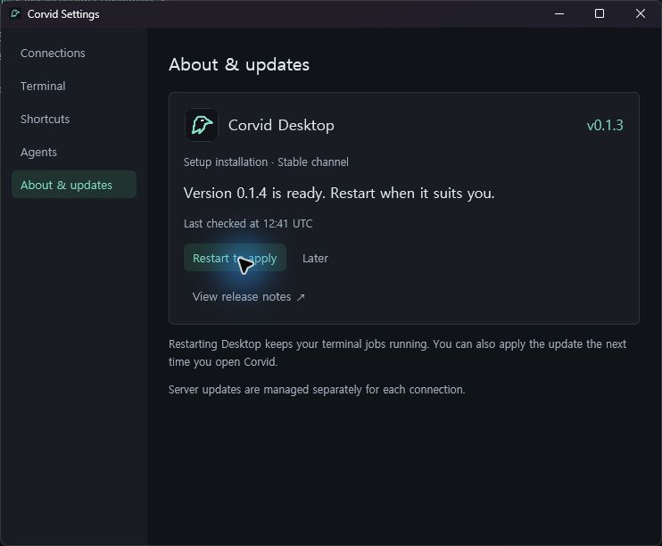

# Release distribution and updates

Corvid distributes versioned Desktop and TUI packages through the public
[`DosangGu/corvid` GitHub Releases](https://github.com/DosangGu/corvid/releases).
The root Cargo workspace version is the release version. A `vX.Y.Z` tag must
match that version. Prerelease versions use tags such as `v0.2.0-rc.1`.
The GitHub Release title is exactly the version tag, with no product name or
other text (for example, `v0.1.2`, not `Corvid v0.1.2`).

## Release assets

| Product | Target | Asset |
| --- | --- | --- |
| Linux TUI | `x86_64-unknown-linux-musl` | `corvid-tui-VERSION-x86_64-unknown-linux-musl.tar.gz` |
| Windows TUI | `x86_64-pc-windows-msvc` | `corvid-tui-VERSION-x86_64-pc-windows-msvc.zip` |
| Linux Desktop | `x86_64-unknown-linux-gnu` | `corvid-desktop-VERSION-x86_64-unknown-linux-gnu.tar.gz` |
| Windows Desktop | `x86_64-pc-windows-msvc` | `corvid-desktop-VERSION-x86_64-pc-windows-msvc.zip` |
| Windows Desktop Setup | Windows x64 | `corvid-desktop-VERSION-x86_64-pc-windows-msvc-setup.exe` |

Linux TUI and daemon binaries are statically linked. Linux Desktop is built on
Ubuntu 24.04 and requires X11 or XWayland, Fontconfig, and a Vulkan driver.
Other distributions require separate runtime qualification. WSL uses the Linux
TUI and daemon package. macOS and ARM64 are outside this release's support scope.

The `corvid` executable contains the TUI, daemon, terminal host, and relays.
Actions builds this runtime once for each execution platform. TUI packages reuse
it directly. Both Desktop packages include both runtime payloads under
`daemon/TARGET/`, each with its own identity and integrity manifest. Packaged
Desktop starts its adjacent native `corvid` for local daemon use; development
builds retain their executable-based helper path.

Desktop packages include the built-in Agents window, implemented by Corvid Agent Deck.
It ships and updates with Desktop. Windows Desktop retains the standalone
Deck and optional login-startup script. Windows packages contain small stable
launchers used by the installer; portable users run the actual app executables.

Each package contains `package.json`, identifying its product, version, target,
and source revision, plus `files.sha256` for its files. Each archive has an
adjacent `.sha256` asset, as does Windows Setup. `release-manifest.json` records
the application archives, Windows Setup, and installation scripts with their
sizes and SHA-256 digests. The Setup `.provenance.json` links it to its source
Desktop archive. Each daemon payload has its own `manifest.json`.

Downloads trust the public repository over HTTPS and verify the expected asset
identity and checksums. SHA-256 detects changed bytes; it is not a publisher
signature independent of GitHub. The repository's release assets and tags should
be immutable after publication. Corrections require a new version.

## Install on Linux or WSL

The installer requires a Linux x86_64 environment with `curl`, GNU `tar`, and
standard core utilities including `sha256sum`.

```sh
curl -fsSL https://github.com/DosangGu/corvid/releases/latest/download/install.sh | sh
```

For Desktop, download the script and select its product:

```sh
curl -fsSL https://github.com/DosangGu/corvid/releases/latest/download/install.sh -o install.sh
sh install.sh --product desktop
```

Default storage is `$XDG_DATA_HOME/corvid/PRODUCT`, using `~/.local/share` when
`XDG_DATA_HOME` is unset. Versions live under `versions/VERSION/`; an atomic
`current` symlink selects the active installation. Entry points in `~/.local/bin`
refer to that symlink. Add this bin directory to PATH when the installer requests
it. Shell startup files are not edited automatically.

Options include `--version VERSION`, `--install-root ABSOLUTE_DIR`, and
`--bin-dir ABSOLUTE_DIR`. Use the original bin directory when updating a custom
installation. A bin directory already owned by a different Corvid product or
installation is not overwritten; use separate bin directories to keep both.

Re-running the script performs an update through the same installation path.
Existing version directories are verified and retained. A damaged version is
reported instead of overwritten while its processes may still use it. Linux
installation uses a directory lock; after an interrupted installer, remove the
reported stale lock only after verifying that no installer remains running.

Linux Desktop installations register per-user application menu entries and
hicolor icons under `$XDG_DATA_HOME` (or `~/.local/share`). Entries follow the
stable `current` link, and files owned by another installation are preserved.
Portable and development Desktop windows also provide their icon directly to
X11, including the Settings window. See the [shared icon assets](../assets/icons/).

## Install on Windows

Download `install.ps1` from the release and run it with Windows PowerShell 5.1
or later. The installer uses `curl.exe`, supplied by supported modern Windows
installations.

```powershell
Invoke-WebRequest https://github.com/DosangGu/corvid/releases/latest/download/install.ps1 -OutFile install.ps1
powershell -NoProfile -ExecutionPolicy Bypass -File .\install.ps1
# Or install the whole Desktop distribution:
powershell -NoProfile -ExecutionPolicy Bypass -File .\install.ps1 -Product desktop
```

Default storage is `%LOCALAPPDATA%\Corvid\PRODUCT`. Add its `bin` directory to
PATH. Options include `-Version VERSION` and `-InstallRoot ABSOLUTE_DIR`.
The installer does not require elevation or modify the machine PATH.

Windows executables and stable launchers carry the shared Corvid icon. Windows
Setup uses it for Start menu entries, the optional Desktop shortcut, and the
uninstaller; its Desktop shortcuts share the running app's `Corvid.Desktop`
identity. Script installations also keep `corvid.ico` at the installation root
for user-created shortcuts. Existing stable launcher EXEs remain unchanged when
updating an older installation, while the selected app carries the new icon.

Stable launchers in `bin` read `current.txt` and start the selected executable
under `versions\VERSION`. Updating atomically replaces this pointer, not a running
EXE. Launchers are installed once and retain the v1 pointer contract. Previous
application versions are retained; no automatic cleanup removes files that a
terminal host or other process might still need. A future launcher-protocol change
must include its own migration, rather than overwrite a live launcher.

## Check and install updates

```sh
corvid update --check
corvid update
corvid update --version 0.2.0-rc.1
```

The default channel checks GitHub's latest published stable release and compares
SemVer precedence. It never implicitly downgrades. An explicit `--version` can
select a prerelease or an older package; it does not downgrade a running daemon.
The check command changes neither installed files nor daemon state. Network,
rate-limit, missing-release, and validation errors are reported as failures,
not as evidence that the installation is up to date.

Desktop provides **Settings → About & updates → Check for updates**. One compact
panel keeps the running version, installation type, stable channel, and last check
time visible. Check results and actionable errors stay in that page; technical
error details can be expanded. Release notes open the selected release page.

For installations from Windows Setup, the scripts, or a portable archive,
**Download update** downloads, verifies, and installs the selected release in
the background. The panel shows the current stage. Checking and installation continue when
Settings is closed. Reopening Settings restores the current result or progress.
Repeated clicks cannot start concurrent checks or installations.

Once prepared, the update offers **Restart to apply** and **Later**. Later closes
Settings and keeps the prepared update available in the current app session.
The managed installation's next launch also uses the new version. A restart
failure leaves the app open, restores its terminal connection, and permits a retry.
Terminal jobs remain owned by their existing daemon throughout this flow.




Both clients use `corvid-update`. For script and portable installations, the
updater selects a release once, validates its manifest, and runs that exact
tag's verified installer with the expected archive digest. The updater
downloads that tag's archive, verifies its exact size
and SHA-256, and supplies the verified local assets to the installer. The installer
also checks archive and package integrity before switching the current version.
A CLI inside a script-installed Desktop distribution updates the entire Desktop
package. The CLI reports download, verification, and installation stages, and
`corvid update --check` explicitly reports whether a newer release is available.

Source builds and externally managed binaries without Corvid package metadata
are not overwritten. Desktop offers the release page for those builds. Updating
a portable release installs a managed copy in the default product directory;
the original extracted directory remains intact. The CLI prints the installed
path and Desktop's restart action opens the new copy. Future launches of the
original portable executable still use that original copy.

The installers also accept local assets for offline installation and validation:
`--source-dir DIR --version VERSION` on Linux or
`-SourceDirectory DIR -Version VERSION` on Windows. The directory must contain
the archive and its `.sha256` file from the same trusted release.

## Daemon lifecycle

Package installation does not start, stop, or replace a daemon. Installed and
running versions can differ while their protocol remains compatible.

`corvid upgrade`, invoked through the newly installed executable, separately
replaces an automatically started local daemon. The existing authenticated
handoff protocol preserves supported terminal hosts, maintains host identity,
and establishes a new daemon epoch and new client input routes. Unsupported old
terminal hosts retain the existing idle-only/manual-upgrade restriction.

Foreground and systemd-managed daemons use their existing supervisor procedure.
The updater never forces a supervisor restart. SSH and WSL daemon provisioning
retains Desktop's explicit host-specific installation and upgrade prompts.
An app update does not update all connected hosts.

## Build and publish

`deploy/package.py` separates runtime manifest generation, package assembly,
and release manifest generation. It validates runtime version, source revision,
size, and checksum before including a payload. It rejects dynamic Linux daemon
binaries and binaries exceeding the existing 32 MiB provisioning limit.

| Changes or trigger | Corvid Checks | Package Corvid |
| --- | --- | --- |
| PR limited to `AGENTS.md`, `README.md`, Markdown under `docs/`, or JPEG, PNG, and SVG under `docs/images/` | Run lightweight validation | — |
| PR editing existing Rust source under `crates/`, `plugins/`, or `spikes/`, optionally with documentation | Run Linux and Windows builds, tests, and lints. This includes comment-only source edits. | — |
| PR with dependencies, schemas, build scripts, new or removed Rust paths, packaging inputs, CI configuration, other paths, or an uncertain diff | Run builds, tests, lints, and package integration | — |
| Push to `main` | Run lightweight validation | Run package integration when a packaging input changes |
| Version tag or manual **Run workflow** | — | Run package integration and upload release assets |

Lightweight validation checks the version, shared icons, Rust formatting, change
classification, and whitespace in the event diff. **Corvid Checks** compares the
checked-out PR merge commit with its first parent.
On `main` it compares the previous and pushed tips. The packaging path filter
covers workspace code and Cargo configuration, release and installer inputs,
assets, the bundled license, Git checkout rules, and the packaging workflows.
Checks inspect both sides of a move and run package integration if the push
comparison is unavailable or the path filter may miss a packaging input. Use
the always-reported **Corvid checks** job as a required PR status check.

Both workflows call **Build and Test Corvid** for cross-platform validation.
After version, icon, and formatting checks, the TUI/daemon and Desktop builds
and tests run in parallel. TUI integration tests launch a daemon from the binary
built by Cargo. Desktop packaging uses the Desktop build and both runtime
artifacts. Its integration checks cover installation with a live daemon,
Desktop terminal input and reattachment under Xvfb, and Windows Setup.

Full packaging runs assemble the archives, Setup, checksums, installation
scripts, and release manifest. A version tag push then creates a draft, uploads
and checks the asset inventory, and publishes the release. Only publication
receives repository write permission. Re-running publication may repair an
unpublished draft and refuses to overwrite an already published release.

For Windows source packaging, `cargo build-desktop` builds the Linux runtime in
WSL and assembles the Windows packages. `Package-Corvid.ps1` also accepts prebuilt
`-LinuxDaemonDirectory` and `-WindowsDaemonDirectory` inputs. Python 3.11 or later
must be available as `python`. The optional `-WithoutAgentDeck` is for local
packaging; official release packages include Corvid Agent Deck.
Commit build inputs before packaging so a source revision identifies the actual
payload. Packaging rejects uncommitted Cargo, crate, plugin, spike, or deployment
inputs.

## Windows Setup

Setup includes Desktop, the Corvid CLI, Agent Deck, and remote daemon payloads.
Run the x64 Setup executable for a per-user install. The default directory is
`%LOCALAPPDATA%\Programs\Corvid`. Start menu entries open Corvid Desktop
and the Corvid Terminal. For CLI access from your own shells, add its `bin`
directory to your user PATH. Setup builds are currently unsigned.

Use **Settings → About & updates → Check for updates** to find available releases.
**Download update** downloads the selected release's Windows Setup executable and
verifies its exact size and SHA-256 against the release manifest. Desktop runs
Setup in the background in the existing installation directory. When the new
version becomes active, Desktop offers **Restart to apply**. Setup keeps older
version directories and running terminal jobs continue through the update.
`corvid update` also supports forward updates for Setup installations.




Agent Deck registers its notification shortcut when started
and offers an opt-in login startup setting. Those shortcuts follow the selected
version. Use **Settings → Apps → Installed
apps** to uninstall Corvid Desktop. The uninstaller removes Setup's shortcuts
and Agent Deck shortcuts that target this installation. Setup preserves per-user
settings and daemon state.

Run `python deploy/native_package.py --archive PATH --output DIRECTORY` with
the Windows Desktop ZIP and adjacent SHA-256 file. Pass `--iscc PATH` with
the path to the Inno Setup compiler.

## Validation boundary

The Settings screenshots above use synthetic release metadata in an isolated
Linux Xvfb session. On 2026-11-12, UI checks verified closing and reopening Settings
during a check and installation, retrying after a failed check or corrupted archive,
minimum-width layout, deferred restart, and restart failure with the same retained
shell PID. The real Linux installer ran with verified local fixture assets in a
private installation directory containing spaces. A replacement-process fixture
verified restart dispatch while the daemon and original shell remained alive;
this does not establish compatibility between two published Desktop versions.
The Windows updater also rejected a corrupted fixture archive before mutation,
then ran the real PowerShell installer successfully with verified local assets
and an installation path containing spaces. Desktop, updater, and CLI checks
passed on Windows (30 tests, one WSL-profile test ignored) and Linux (49 tests),
along with builds, Clippy, formatting, and whitespace checks.
On 2026-11-13, the Windows Settings screenshots above were captured using
local release fixtures in a separate Setup installation. The app rejected a
checksum mismatch, then verified and ran the real Setup. Restart opened the
updated Desktop and restored the existing terminal screen.

`deploy/test_install.py` exercises the actual installers with isolated paths,
including spaces, a synthetic older version, repeat installation, concurrent
installation rejection, corrupted downloads, and a running foreground daemon.
The older executable is a version-probe fixture: this tests installation
transactions, not historical daemon compatibility. Existing daemon handoff tests
cover the protocol. Every subsequent release should also qualify an upgrade from
the previous published release with live terminal sessions.

`deploy/test_native.py` checks Windows Setup install, upgrade from a synthetic earlier
version with a running daemon, and uninstall with retained user state.
`deploy/test_desktop.py` checks that the packaged Linux Desktop opens an X11 window.
Visible menu behavior and native Windows Desktop startup require separate UI
verification; archive checks and compilation alone do not establish those results.
On WSL, run Unix integration tests from a Linux filesystem checkout: fixtures
under a Windows mount can fail the runtime's parent-directory permission checks.
