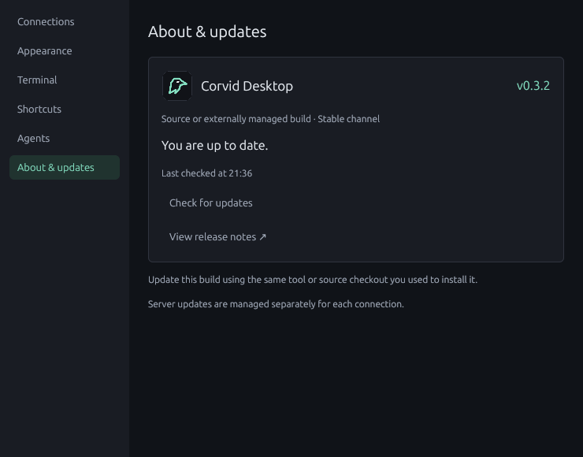
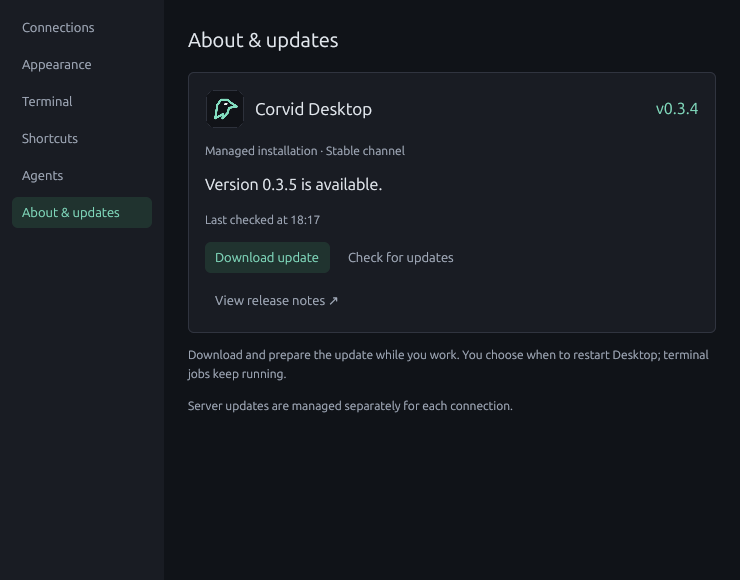
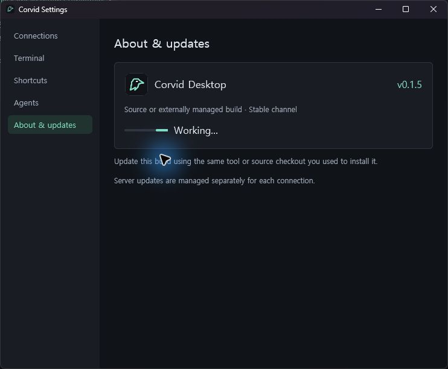
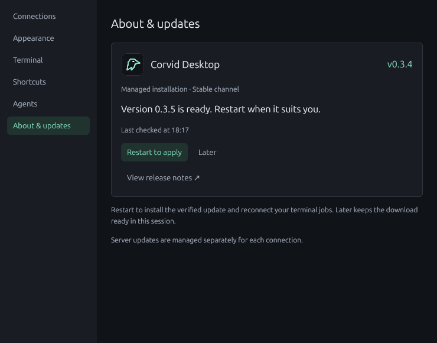
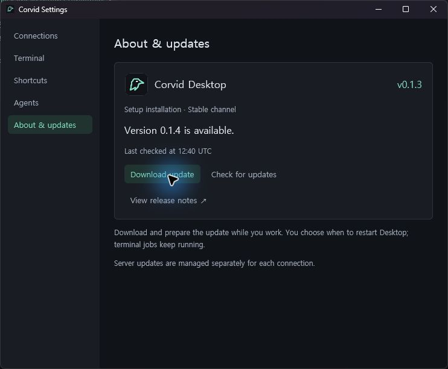
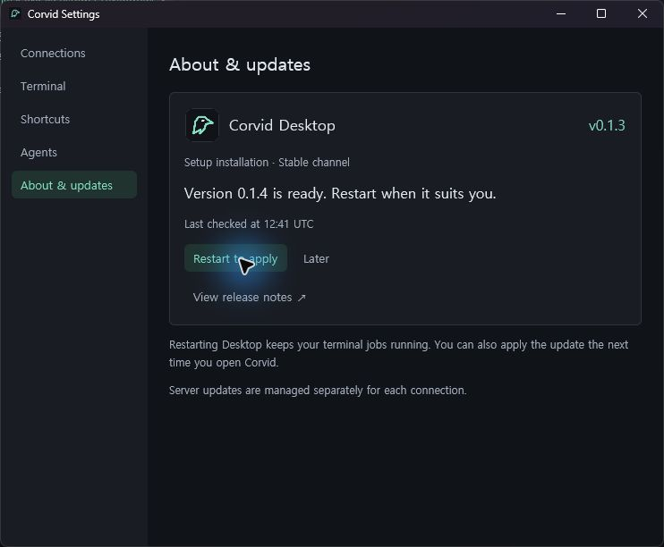

# Release distribution and updates

Corvid distributes versioned Desktop and TUI packages through the public
[`DosangGu/corvid` GitHub Releases](https://github.com/DosangGu/corvid/releases).
The root Cargo workspace version is the release version. A `vX.Y.Z` tag must
match that version. Prerelease versions use tags such as `v0.2.0-rc.1`.
The GitHub Release title is exactly the version tag, with no product name or
other text (for example, `v0.1.2`, not `Corvid v0.1.2`).

## Release assets

| Product | Target | Asset |
| --- | --- | --- |
| Linux TUI | `x86_64-unknown-linux-musl` | `corvid-tui-VERSION-x86_64-unknown-linux-musl.tar.gz` |
| Windows TUI | `x86_64-pc-windows-msvc` | `corvid-tui-VERSION-x86_64-pc-windows-msvc.zip` |
| Linux Desktop | `x86_64-unknown-linux-gnu` | `corvid-desktop-VERSION-x86_64-unknown-linux-gnu.tar.gz` |
| Windows Desktop | `x86_64-pc-windows-msvc` | `corvid-desktop-VERSION-x86_64-pc-windows-msvc.zip` |
| macOS TUI | `aarch64-apple-darwin` | `corvid-tui-VERSION-aarch64-apple-darwin.tar.gz` |
| macOS Desktop | `aarch64-apple-darwin` | `corvid-desktop-VERSION-aarch64-apple-darwin.tar.gz` |
| macOS Desktop installer | Apple Silicon, macOS 15+ | `corvid-desktop-VERSION-aarch64-apple-darwin.dmg` (unsigned) |
| Windows Desktop Setup | Windows x64 | `corvid-desktop-VERSION-x86_64-pc-windows-msvc-setup.exe` |
| Linux ARM64 TUI | `aarch64-unknown-linux-musl` | `corvid-tui-VERSION-aarch64-unknown-linux-musl.tar.gz` |
| Linux ARM64 Desktop | `aarch64-unknown-linux-gnu` | `corvid-desktop-VERSION-aarch64-unknown-linux-gnu.tar.gz` |
| Windows ARM64 TUI | `aarch64-pc-windows-msvc` | `corvid-tui-VERSION-aarch64-pc-windows-msvc.zip` |
| Windows ARM64 Desktop | `aarch64-pc-windows-msvc` | `corvid-desktop-VERSION-aarch64-pc-windows-msvc.zip` |
| Windows ARM64 Desktop Setup | Windows 11 ARM64 | `corvid-desktop-VERSION-aarch64-pc-windows-msvc-setup.exe` |

Linux TUI and daemon binaries are statically linked. Linux Desktop builds and
installer tests use the Ubuntu runners listed in [CI coverage](08_ci_validation.md).
The resulting binaries require X11 or XWayland, Fontconfig, and a Vulkan driver.
Older Ubuntu releases and other distributions require separate runtime
qualification. WSL uses the Linux TUI and daemon package for its architecture.
Linux and Windows support x64 and ARM64. Windows ARM64 targets Windows 11.
Apple Silicon packages target macOS 15 and later. See the [macOS guide](07_macos.md)
for Gatekeeper, app layout, installation paths, and validation limitations.

The `corvid` executable contains the TUI, daemon, terminal host, and relays.
Actions builds this runtime once for each execution platform. TUI packages reuse
it directly. All Desktop packages include Linux, Windows, and macOS runtime payloads under
`daemon/TARGET/` (inside `Contents/Resources` on macOS), each with its own identity and integrity manifest. Packaged
Desktop starts its adjacent native `corvid` for local daemon use; development
builds retain their executable-based helper path.

Desktop packages include the built-in Agents window, implemented by Corvid Agent Deck.
It ships and updates with Desktop. Windows Desktop retains the standalone
Deck and optional login-startup script. Windows packages contain small stable
launchers used by the installer; portable users run the actual app executables.

Each package contains `package.json`, identifying its product, version, target,
and source revision, plus `files.sha256` for its files. Each archive has an
adjacent `.sha256` asset, as does Windows Setup. `release-manifest.json` records
the application archives, Windows Setup, and installation scripts with their
sizes and SHA-256 digests. The Setup `.provenance.json` links it to its source
Desktop archive. Each daemon payload has its own `manifest.json`.

The native build matrix also stages `corvidd-<version>-<target>`
(`.exe` on Windows) for each of the five runtime targets. Release assembly
checks the daemon's target, source revision, size, and SHA-256 before adding
it to the release manifest. TUI and Desktop packages include the
local daemon alongside the client. The client looks for that daemon before
checking the per-user versioned installation. The TUI installed with
`cargo install --locked corvid-tui` builds the client. On first use, the
client reuses a compatible daemon if one is running. When neither a bundle
nor an installed daemon is available, both clients ask before downloading
the daemon for their exact release version. The release manifest verifies the
download before the executable is installed in the private daemon state
directory. Source builds can use a sibling `corvidd` or set
`CORVID_DAEMON` to an absolute executable path.

Packaged and source-built `corvidd` use libghostty-vt for new terminals.
Running terminal hosts keep their current emulator through daemon handoff.
Building the daemon from source requires the [pinned Zig toolchain](01_terminal_qualification.md#libghostty-vt-runtime).
The Desktop and TUI production builds are independent of Zig and libghostty-vt.

Downloads trust the public repository over HTTPS and verify the expected asset
identity and checksums. SHA-256 detects changed bytes; it is not a publisher
signature independent of GitHub. The repository's release assets and tags should
be immutable after publication. Corrections require a new version.

## Install on Linux or WSL

The installer requires a Linux x64 or ARM64 environment with `curl`, GNU `tar`, and
standard core utilities including `sha256sum`.

```sh
curl -fsSL https://github.com/DosangGu/corvid/releases/latest/download/install.sh | sh
```

For Desktop, download the script and select its product:

```sh
curl -fsSL https://github.com/DosangGu/corvid/releases/latest/download/install.sh -o install.sh
sh install.sh --product desktop
```

Default storage is `$XDG_DATA_HOME/corvid/PRODUCT`, using `~/.local/share` when
`XDG_DATA_HOME` is unset. Versions live under `versions/VERSION/`; an atomic
`current` symlink selects the active installation. Entry points in `~/.local/bin`
refer to that symlink. Add this bin directory to PATH when the installer requests
it. Shell startup files are not edited automatically.

Options include `--version VERSION`, `--install-root ABSOLUTE_DIR`, and
`--bin-dir ABSOLUTE_DIR`. Use the original bin directory when updating a custom
installation. A bin directory already owned by a different Corvid product or
installation is not overwritten; use separate bin directories to keep both.

Re-running the script performs an update through the same installation path.
The selected version is verified. Unused earlier packages are collected after activation. A damaged selected version is
reported instead of overwritten while its processes may still use it. Linux
installation uses a directory lock; after an interrupted installer, remove the
reported stale lock only after verifying that no installer remains running.

Linux Desktop installations register per-user application menu entries and
hicolor icons under `$XDG_DATA_HOME` (or `~/.local/share`). Entries follow the
stable `current` link, and files owned by another installation are preserved.
Portable and development Desktop windows also provide their icon directly to
X11, including the Settings window. See the [shared icon assets](../assets/icons/).

## Install on Windows

Download `install.ps1` from the release and run it with Windows PowerShell 5.1
or later. The installer uses `curl.exe`, supplied by supported modern Windows
installations.

```powershell
Invoke-WebRequest https://github.com/DosangGu/corvid/releases/latest/download/install.ps1 -OutFile install.ps1
powershell -NoProfile -ExecutionPolicy Bypass -File .\install.ps1
# Or install the whole Desktop distribution:
powershell -NoProfile -ExecutionPolicy Bypass -File .\install.ps1 -Product desktop
```

Default storage is `%LOCALAPPDATA%\Corvid\PRODUCT`. Add its `bin` directory to
PATH. Options include `-Version VERSION` and `-InstallRoot ABSOLUTE_DIR`.
The installer does not require elevation or modify the machine PATH.

Windows executables and stable launchers carry the shared Corvid icon. Windows
Setup uses it for Start menu entries, the optional Desktop shortcut, and the
uninstaller; its Desktop shortcuts share the running app's `Corvid.Desktop`
identity. Script installations also keep `corvid.ico` at the installation root
for user-created shortcuts. Existing stable launcher EXEs remain unchanged when
updating an older installation, while the selected app carries the new icon.

Stable launchers in `bin` read `current.txt` and start the selected executable
under `versions\VERSION`. Updating atomically replaces this pointer, not a running
EXE. Launchers are installed once and retain the v1 pointer contract.
The installer removes obsolete packages it owns. A retained terminal host,
foreground daemon, or open client can pin a package until it exits. A background
worker retries under the installation lock. A pending record also resumes cleanup
on a subsequent Desktop or interactive CLI launch. Directories containing
unrecognized files are reported and preserved.

## Install with Cargo

For releases published to crates.io, use Rust 1.100 or newer and a native
linker. Install `tic` on Linux and macOS (the `ncurses-bin` package on Debian
and Ubuntu). On Windows, use the MSVC Rust toolchain and the Windows SDK.

```sh
cargo install --locked corvid-tui
corvid --version
```

Run the same Cargo command to update this installation. To select a specific
release, add `--version VERSION`. Use `corvid upgrade` separately for a
running autostarted daemon.

## Check and install updates

```sh
corvid update --check
corvid update
corvid update --version 0.2.0-rc.1
```

The default channel checks GitHub's latest published stable release and compares
SemVer precedence. It never implicitly downgrades. An explicit `--version` can
select a prerelease or an older package; it does not downgrade a running daemon.
The check command changes neither installed files nor daemon state. Network,
rate-limit, missing-release, and validation errors are reported as failures,
not as evidence that the installation is up to date.

Desktop provides **Settings → About & updates → Check for updates**. The panel
shows the running version, installation type, stable channel, and last check time
in the system time zone. Check results and actionable errors stay in the panel,
with expandable technical details. Release notes open the selected release page.



For installations from Windows Setup, the scripts, or a portable archive,
**Download update** downloads and verifies the selected release in
the background. The panel shows a loading indicator during checks and installation.
Work continues when Settings is closed. Reopening Settings shows the current status.
Repeated clicks cannot start concurrent checks or installations.

Once prepared, the update offers **Restart to apply** and **Later**. Later closes
Settings and keeps the prepared update available in the current app session.
**Restart to apply** runs the verified installer. On macOS a background helper accepts the
window IDs, waits for the old Desktop to exit, and refreshes the installed bundle's
Launch Services registration. It retries a failed open for up to five seconds.
After launch, it checks that the new Desktop restored its windows
and reports a launch or restore failure. On Linux and Windows, the previous
Desktop waits for the replacement to restore its windows and reclaims them if
startup fails. Managed Desktops also follow an
external installation change. Existing Agent Deck instances refresh in their
original scopes, including Decks hidden in the tray.
Stopped Decks remain stopped. See [Deck lifetime](06_agent_deck.md#launch-and-lifetime).





Both clients use `corvid-update`. For script and portable installations, the
updater selects a release once, validates its manifest, and runs that exact
tag's verified installer with the expected archive digest. The updater
downloads that tag's archive, verifies its exact size
and SHA-256, and supplies the verified local assets to the installer. The installer
also checks archive and package integrity before switching the current version.
A CLI inside a script-installed Desktop distribution updates the entire Desktop
package. The CLI reports download, verification, and installation stages, and
`corvid update --check` explicitly reports whether a newer release is available.

Source builds and externally managed binaries without Corvid package metadata
are not overwritten. Desktop offers the release page for those builds. Updating
a portable release installs a managed copy in the default product directory;
the original extracted directory remains intact. The CLI prints the installed
path and Desktop's restart action opens the new copy. Future launches of the
original portable executable still use that original copy.

The installers also accept local assets for offline installation and validation:
`--source-dir DIR --version VERSION` on Linux or
`-SourceDirectory DIR -Version VERSION` on Windows. The directory must contain
the archive and its `.sha256` file from the same trusted release.

## Daemon lifecycle

After activation, the installer identifies processes by their installed executable.
It requests authenticated handoff for older autostarted daemons, checks the replacement
version and host epoch, and preserves live terminal hosts. Running companions and Decks
refresh in their existing scopes. Windows Setup can also request a graceful exit from
older Desktop releases. On Unix, a Desktop predating the update watcher finishes
its switch the next time the user restarts it. Desktop also attempts handoff when it
connects directly to an older local daemon. If the daemon declines the handoff or requires a
service manager, Desktop connects using the capabilities that daemon supports.

`corvid upgrade`, invoked through the newly installed executable, separately
replaces an automatically started local daemon. The existing authenticated
handoff protocol preserves supported terminal hosts, maintains host identity,
and establishes a new daemon epoch and new client input routes. Unsupported old
terminal hosts retain the existing idle-only/manual-upgrade restriction.

Foreground and systemd-managed daemons use their existing supervisor procedure.
SSH and WSL daemon provisioning retains Desktop's explicit host-specific
installation and upgrade prompts.

## Build and publish

`deploy/package.py` separates runtime manifest generation, package assembly,
and release manifest generation. It validates runtime version, source revision,
size, and checksum before including a payload. It rejects dynamic Linux daemon
binaries and binaries exceeding the existing 32 MiB provisioning limit.

| Change or trigger | Workflow and result |
| --- | --- |
| Any PR | **Checks / Basics** validates formatting, whitespace, and workspace version consistency. |
| PR changes component or packaging inputs | Matching workflows run the [component or packaging checks](08_ci_validation.md#pull-requests). |
| PR to `main` updates `deploy/release-notes.md` | **Checks / Release** builds the five release targets and runs live runtime and installer tests. |
| Manual **Run workflow** on **Checks / Release** | The same release qualification runs for the selected ref. |
| Push of a `v*` tag | **Publish Corvid Release** builds and publishes the assets for the tagged revision. |

Release qualification and publication share **Package Corvid**, which calls
the native build workflow. Desktop packages bundle all five standalone daemon targets for SSH and WSL.
Managed remote installs keep the existing on-disk filename so an older client
can still find the daemon it installed. The client accepts version banners
from both executables.
The native workflow caches Cargo dependencies and build outputs separately for
Runtime and Desktop on each runner and target. Commits with the same lockfile,
toolchain, and CI build configuration can share the cache.

The version preparation PR runs live daemon, PTY, SSH, Desktop, and native
installer checks. The Cargo source package jobs build the extracted crates and
check `corvid --version` on Linux, Windows, and macOS.

Publication builds the actual release binaries and installers from the tag
and validates their version, source revision, checksums, and asset inventory.
The publication job creates a draft, uploads and verifies the asset inventory,
and publishes the release. Only the publication job receives repository write
permission. Re-running publication may repair an unpublished draft and refuses
to overwrite an already published release.

### Publish TUI source packages to crates.io

When preparing a release, update the workspace version and the exact version
requirements for the local dependencies in `Cargo.toml`. Regenerate
`Cargo.lock` with `cargo update --workspace` and update
`deploy/release-notes.md` in the same PR. Review the release qualification
results before tagging the merged release.

The published set consists of `corvid-tui` and its internal dependencies,
marked by `publish = ["crates-io"]` in their manifests. Cargo packages these
crates in dependency order. Verify the set locally with
`python deploy/crates_io.py verify`.

For the first publication through GitHub Actions, store a token with the
`publish-new` scope as `CARGO_REGISTRY_TOKEN` in the `crates.io` environment.
Push a tag such as `crates-io-v0.3.6` on a commit containing the
**Publish Corvid to crates.io** workflow. The job checks out the existing `v0.3.6`
release and verifies a Cargo installation after uploading the crates. If
crates.io reaches its new-crate publishing limit, the job waits until the
registry's retry time and resumes with the remaining crates. To resume after
another failure, rerun the job.

For a local first publication, check out the release tag on Linux,
authenticate with `cargo login`, and run `python deploy/crates_io.py publish`.

After the first publication, configure
[Trusted Publishing](https://crates.io/docs/trusted-publishing) on each published
crate for `DosangGu/corvid`, workflow `release.yml`, and environment
`crates-io`. Set the GitHub repository variable `PUBLISH_CRATES_IO` to `true`
after all the publishers are configured.

On subsequent tags, the crates.io job runs after the GitHub release publishes.
It uses a short-lived token. If some crates were uploaded before a failure,
rerun the failed job to publish the remaining versions.

For Windows source packaging, `cargo build-desktop` builds the Linux runtime in
WSL and assembles the Windows packages. `Package-Corvid.ps1` also accepts prebuilt
`-LinuxDaemonDirectory`, `-WindowsDaemonDirectory`, `-LinuxArm64DaemonDirectory`,
and `-WindowsArm64DaemonDirectory` inputs. It builds native Windows and WSL runtimes;
supply the other architecture and macOS as revision-matched artifacts.
`cargo build-desktop` forwards `CORVID_LINUX_X64_RUNTIME`, `CORVID_WINDOWS_X64_RUNTIME`,
`CORVID_LINUX_ARM64_RUNTIME`, `CORVID_WINDOWS_ARM64_RUNTIME`, and `CORVID_MACOS_RUNTIME`.
The macOS helper takes Linux x64, Windows x64, Linux ARM64, and Windows ARM64 runtime
directories in that order. Python 3.11 or later
must be available as `python`. The optional `-WithoutAgentDeck` is for local
packaging; official release packages include Corvid Agent Deck.
Commit build inputs before packaging so a source revision identifies the actual
payload. Packaging rejects uncommitted Cargo, crate, plugin, spike, or deployment
inputs.

## Windows Setup

Setup includes Desktop, the Corvid CLI, Agent Deck, and remote daemon payloads.
Run the Setup executable matching your CPU (x64 or ARM64) for a per-user install.
The default directory is
`%LOCALAPPDATA%\Programs\Corvid`. Start menu entries open Corvid Desktop
and the Corvid Terminal. For CLI access from your own shells, add its `bin`
directory to your user PATH. Setup builds are currently unsigned.

Use **Settings → About & updates → Check for updates** to find available releases.
**Download update** downloads the selected release's Windows Setup executable and
verifies its exact size and SHA-256 against the release manifest. **Restart to
apply** runs Setup in the existing installation directory. The installer collects
unused versions and schedules cleanup for images that still serve active sessions.
`corvid update` also supports forward updates for Setup installations.




Agent Deck registers its notification shortcut when started
and offers an opt-in login startup setting. Those shortcuts follow the selected
version. Use **Settings → Apps → Installed
apps** to uninstall Corvid Desktop. The uninstaller removes Setup's shortcuts
and Agent Deck shortcuts that target this installation. Setup preserves per-user
settings and daemon state.

Run `python deploy/native_package.py --archive PATH --output DIRECTORY` with
the Windows Desktop ZIP and adjacent SHA-256 file. Pass `--iscc PATH` with
the path to the Inno Setup compiler.

## ARM64 validation

Linux and Windows ARM64 assets are produced by `ubuntu-26.04-arm` and
`windows-11-arm` runners. They run runtime and workspace tests, Clippy,
installer lifecycle checks, and native package assembly. Linux ARM64 also runs
the PTY, SSH reconnect, and Xvfb Desktop checks. Release assembly requires both
architectures and checks daemon manifests and Setup provenance.

Desktop probes the execution host's architecture before selecting a daemon for
installation or upgrade, including ARM64 WSL. Existing working connections do not
need a new architecture probe. Windows installers detect the native OS architecture
even from an emulated PowerShell process. Updates preserve the installed package's
architecture; `install.ps1 -Target` supports that choice explicitly.

This support applies to builds from this revision and future releases. It does not
add assets to already published releases. Physical ARM64 GPU rendering and interactive Windows ConPTY behavior still
need device qualification.

## Validation boundary

The Settings screenshots above use synthetic release metadata in an isolated
Linux Xvfb session. On 2026-11-12, UI checks verified closing and reopening Settings
during a check and installation, retrying after a failed check or corrupted archive,
minimum-width layout, deferred restart, and restart failure with the same retained
shell PID. The real Linux installer ran with verified local fixture assets in a
private installation directory containing spaces. A replacement-process fixture
verified restart dispatch while the daemon and original shell remained alive;
this does not establish compatibility between two published Desktop versions.
The Windows updater also rejected a corrupted fixture archive before mutation,
then ran the real PowerShell installer successfully with verified local assets
and an installation path containing spaces. Desktop, updater, and CLI checks
passed on Windows (30 tests, one WSL-profile test ignored) and Linux (49 tests),
along with builds, Clippy, formatting, and whitespace checks.
On 2026-11-19, a Linux Xvfb test with a local release fixture verified that
**Later** closed Settings while the same Desktop PID and selected package stayed
active. Reopening Settings preserved the prepared update. **Restart to apply**
then ran the fixture installer, opened the replacement Desktop, and closed the
previous process. The available and prepared screenshots show this test.
An isolated Windows integration test used the published 0.3.2 and 0.3.4 runtime
binaries. After handoff, the host ID, terminal ID, and PowerShell PID survived.
The old package was collected after the last shell exited.

On 2026-11-13, the Windows Settings screenshots above were captured using
local release fixtures in a separate Setup installation. The app rejected a
checksum mismatch, then verified and ran the real Setup. Restart opened the
updated Desktop and restored the existing terminal screen.

`deploy/test_install.py` exercises the actual installers with isolated paths,
including spaces, a synthetic older version, repeat installation, concurrent
installation rejection, corrupted downloads, and a running foreground daemon.
The older executable is a version-probe fixture: this tests installation
transactions, not historical daemon compatibility. Existing daemon handoff tests
cover the protocol. Every subsequent release should also qualify an upgrade from
the previous published release with live terminal sessions.

`deploy/test_native.py` checks Windows Setup install, upgrade from a synthetic earlier
version with a running daemon, and uninstall with retained user state.
`tests/ui/run.py` exercises the packaged Desktop and Agent Deck on Linux,
Windows, and macOS before publication. See the
[UI test commands](08_ci_validation.md#desktop-and-agent-deck-ui).
On WSL, run Unix integration tests from a Linux filesystem checkout: fixtures
under a Windows mount can fail the runtime's parent-directory permission checks.
