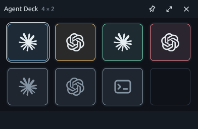
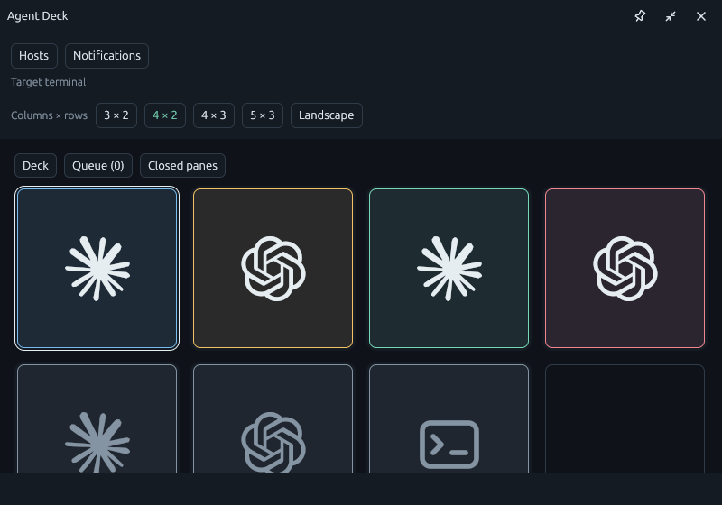
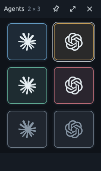
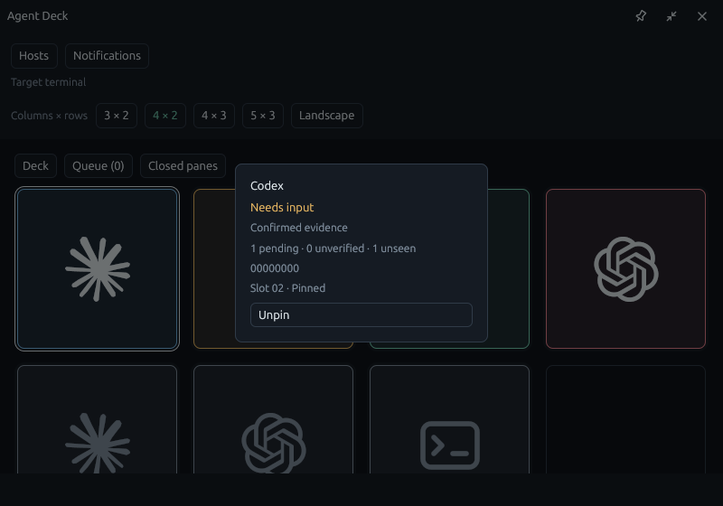
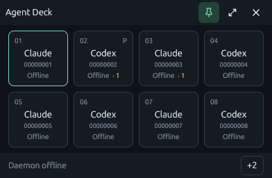
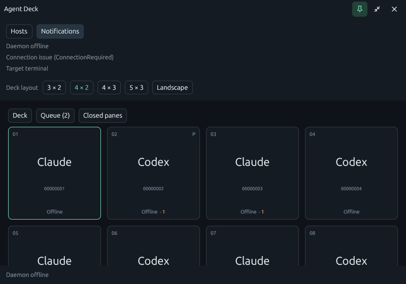
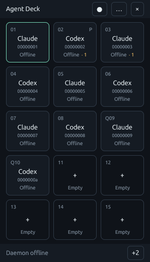

# Corvid Agent Deck

For Apple Silicon paths, native behavior, building, and distribution, see
[macOS support](07_macos.md). macOS uses the shared Unix daemon/client boundary.

Corvid Agent Deck is Corvid Desktop's built-in **Agents** surface. It ships and
updates with Desktop and extends the former Agent Board. Agent status, cards,
notifications, and navigation live in this separate app; the terminal toolbar
provides a compact **Agents** entry point with an input-request count when needed.
**Settings → Agents** provides access and explains notification preferences.

The executable and its UI, launch, background, notification, and OS integration
code remain in [`plugins/agent-deck`](../plugins/agent-deck/) for source and package
compatibility. This is an internal module boundary, not a user-installable plugin
or a public plugin API. Desktop and the Windows CLI delegate to that package.
The daemon remains authoritative for PTYs and agent state; `corvid-companion`
owns the shared slot policy and presentation service. Desktop/TUI start that
headless service when verifying a host, before this UI opens. The UI and its
Hosts overview only read the companion; closing or reopening a display does
not restart monitoring. The service retains the verified remote launcher.
Agent Deck renders its floating grid and management views with GPUI, sharing the
workspace UI framework with Desktop. Background workers notify the foreground
executor through a coalesced channel so hidden windows can reopen or quit.
Linux uses X11 or XWayland with Vulkan.
The physical Stream Deck/GPUI prototype in `spikes/deck` remains separate.

On 2026-11-12, Linux Xvfb checks verified the Settings → Agents page, opening and
reactivating the same Agents window from Settings and the toolbar, access to
Notifications & settings, and unchanged terminal dimensions. Desktop and Agent
Deck built on Windows and Linux; Windows workspace Clippy, formatting, and
whitespace checks passed. Native Windows GUI interaction was not exercised in
this pass.

## Launch and lifetime

Open **Agents** in the top bar (or **Settings → Agents → Open Agents**)
in Desktop. Build source installations with
`cargo build --locked -p corvid-agent-deck`; Desktop finds the binary beside itself
or in `plugins/agent-deck/` in an installed package. Direct launches discover
existing monitored hosts in the default companion state directory. Use
`--state-dir` to choose a particular host scope; its saved presentation address
is reused unless overridden by `--pipe-instance` or `--socket-dir`.

Each companion controller has one Deck instance. Reopening activates it. A private
named pipe on Windows or private Unix socket on Linux carries bounded Protobuf
activation and Desktop focus requests. Host/controller identity and the connection
generation are checked. The OS supplies the registering Desktop peer's process ID.
Closing or switching Desktop retires its focus registration without ending Deck.
A reopened Desktop can register again. Each Deck currently watches one configured
host; a unified multi-host window is future work.

On Windows, starting an updated Desktop checks the running Decks in its saved
controller scopes, including hidden tray instances. It replaces an older Deck
with the bundled executable and retains whether its window was visible. Opening
Agents or launching Deck directly performs the same version check. Equal or
newer Deck versions are reused; a stopped Deck is not started by the startup
check. Replacement uses the existing GPUI quit loop, waits for process exit, and
then reopens the same state directory, preserving controller identity, slots,
window preferences, notification settings, and history. It also handles older
Deck releases that have no lifecycle IPC. Failure to exit is reported without
force-killing the process. Linux and macOS retain their existing reuse behavior.

Windows lifecycle qualification on 2026-11-16 replaced a published v0.1.4 GPUI
Deck with a local build in an isolated controller scope. The old process exited,
the replacement accepted a connection, and controller identity was unchanged.
The automated native fixture covers hidden and visible windows, equal/newer
version reuse, concurrent refresh and activation, saved settings, and host
isolation. This qualification does not exercise mouse dragging.

Desktop/TUI start the separate companion service automatically. Deck only
subscribes to it. Quitting Deck does not kill that shared companion or any
daemon, terminal, or agent. Existing Board
state paths under `slot-board/` are deliberately retained, preserving controller
identity, slots, and pins across the rename.

The `corvid-streamdeck` USB adapter discovers the same monitor scopes without
opening Agent Deck. Its `--state-dir` selects a host just like the UI; an explicit
`--pipe-instance` or `--socket-dir` remains supported. Status display needs no
Deck UI. Hardware focus still targets an explicitly paired TUI with `--target`;
Desktop focus registration is not yet available through this shared interface.

| Windows action | Result |
| --- | --- |
| Close the Deck window | Hide it; tray and notifications continue. |
| Click the tray icon | Reopen the existing Deck with its previous view, size, position, and pin state. |
| Pin the Deck window | Lock its current position and keep it above other windows, including after focusing a terminal. |
| Unpin the Deck window | Restore dragging and ordinary window stacking. The window stays open. |
| Open tray menu | Reopen the previous Deck view, open notifications/settings, pause/resume, or quit. |
| Click a notification | Show its captured event in Deck; batch notices open history. |
| Choose Quit | Exit Deck and clear its Windows notification-center entries. |
| Enable Start at login | Create a per-user background-launch shortcut. A pinned deck opens without taking focus. An unpinned deck starts hidden. Login startup defaults to off. |

If native tray setup fails, the window stays available and closing it exits.
Windows uses an AppUserModelID per controller, a Start Menu shortcut, native WinRT
toasts, executable/shortcut icons, and Shell tray integration. Explorer restart
reinstalls the tray icon. Notification activation is handled while Deck is running;
activation after process exit is not supported. Disable login startup in Deck
before removing an installation.

Linux currently sends notifications through `notify-send` when available. It has
no tray, login-startup backend, notification click callbacks, or Deck sound
control. Its window remains visible, and closing it exits.

On macOS, click the menu bar icon to open the Deck below it. Click it again,
click outside the panel, or press Escape to dismiss it. Right-click the icon for
notification settings, pause/resume, and quit. The panel can switch between the
mini grid and expanded views, and monitoring continues while it is dismissed.
Login startup shows only the menu bar icon. See the [macOS guide](07_macos.md)
for installation and notification permissions.

## Deck layouts

The default view is a borderless mini deck with eight keys in a **4 × 2** grid
(**392 × 256 logical pixels**). Use **Expand Deck** to choose a preset and
orientation in the **Columns × rows** controls. The preset labels update when
the orientation changes:

| Keys | Landscape | Portrait |
| --- | --- | --- |
| 6 | 3 × 2 | 2 × 3 |
| 8 (default) | 4 × 2 | 2 × 4 |
| 12 | 4 × 3 | 3 × 4 |
| 15 | 5 × 3 | 3 × 5 |

Returning to **Mini deck** applies the selected preset and orientation. The
mini header shows the resulting columns × rows next to its title. Its shape
stays fixed as agents arrive and leave; empty keys remain as quiet,
non-interactive placeholders. Extra agents scroll inside the panel.

Both views have an expand or shrink button and a close button. In a portrait mini
deck the title reads **Agents**. On Windows and Linux, drag the title to move an
unpinned deck. The upright mint pin locks the current position and keeps the
window above other windows. Click it again to restore
movement and ordinary stacking. Pinning does not move the deck.

Windows initially places Deck at the bottom-right of the work area on the
system tray's monitor, just above a bottom taskbar, with a 12-logical-pixel gap.
The primary monitor is the fallback when the shell taskbar is unavailable.
Cursor position does not choose the initial monitor. While Deck remains at this
default corner, expanding, shrinking, or changing its grid keeps the right and
bottom edges aligned. Placement is corrected after the native resize completes.

While dragging an unpinned deck on Windows, its visible edges snap flush to a
monitor's work-area edges within 12 logical pixels. This includes boundaries
between monitors and the edge above a taskbar, including secondary monitors.
Side and top taskbars are respected too. Continue dragging beyond that distance
to detach; snapping does not pin or resize the deck. The capture distance follows
the window's DPI, and invisible native resize borders are excluded from alignment.

After dragging Deck elsewhere, reopening and layout changes keep its location
within the current session; a larger window shifts only as needed to fit the
monitor work area. X11 placement and stacking depend on the window manager.
Window coordinates are not saved across restarts.

On 2026-11-16, an isolated native Windows GPUI test measured 12-pixel right and
bottom gaps at 100% scaling on initial placement and after returning to the mini
view. It also verified expansion on a smaller work area and retention of a
manually moved origin through resizing. Native move messages verified snapping
in both GPUI layouts and pin gating in an isolated Win32 fixture. Coordinate
tests cover monitor seams, negative origins, taskbar edges, detaching, and scaled
capture distances. Physical mouse dragging, multiple physical monitors, and
mixed-DPI transitions were not exercised by this qualification.

The floating windows on Windows and Linux default to unpinned. The pin state,
preset, and orientation are saved per controller in the private
`agent-deck/window.json`. A legacy fixed-position preference becomes pinned,
while a legacy movable deck starts unpinned. Unpinning, clicking elsewhere, or
focusing a terminal leaves those windows open. On Windows, closing hides the
window when the tray is available. On Linux it exits Agent Deck. Incoming agent
notifications do not open the Deck or take focus.

**Expand Deck** expands the same window for the queue, closed panes, hosts,
terminal selection, and notification preferences. **Mini deck** returns to the compact
view. Notification activation opens its history in the expanded view. Window
visibility and size do not affect daemon-owned work or the slot policy. The mini
deck shows assigned slots followed by the first 32 queued runs, so larger grids
can display more agents than the companion's configured slot count. Queued keys
show **Queued** in their tooltip and navigate through Desktop using their exact
run identity;
they do not acquire a fabricated slot or pin action. The footer's **+N** button
shows the queue count and opens the paginated queue.

## Slots and queue

The **Deck** view uses dark cards with a light selection outline. The
mini deck uses the selected grid of compact keys; the expanded view adjusts its larger
square keys from one to six columns when resized. Each occupied key shows only a
centered provider mark: Claude, OpenAI for Codex, or a generic terminal for an
unknown provider. A tinted background and colored inner border carry its status.
Selection adds a separate light outer outline, preserving the status color.
Empty keys are blank, dark, and inactive. The same design applies to queued keys.

Click anywhere on an available key to focus its existing terminal. Hover for
provider, short run ID, exact status, evidence, request and unseen-alert counts,
slot number, pin state, and queue placement; right-click assigned slots for
**Pin / Unpin** and unseen alerts for **Acknowledge alert**. Acknowledging an alert does not answer or
resolve a pending question.
Arrow keys or Tab select a card; Enter or Space activates its captured target
on release. Escape cancels a gesture or closes its action menu. The displayed
slot snapshot stays fixed throughout a mouse or keyboard press and an open
context menu, so compaction cannot change the action's captured target.

Status colors are blue for working, amber for input or interruption, mint green
for an observed response, and red for errors. Ready, ended, unknown, offline,
cached, and historical observations use gray with a muted logo. A green key means
a response was observed, not that the whole task succeeded. Availability takes
precedence over the last activity color, so stale observations never appear live.
Tooltips and the action menu retain exact text labels; unverified input requests
use amber and say **Check terminal**.
**Queue**, **Closed panes**, **Hosts**, and **Notifications** retain their separate
views; notification preferences are under **Notifications**.

The logo-card screenshots use the GPUI application with synthetic observations
in an isolated Linux Xvfb session. On 2026-11-17, visual checks covered mini and
expanded views, 2 × 3 portrait layout, keyboard selection, hover details, and
the action menu. These screenshots do not demonstrate live terminal navigation.
The Windows UI automation tool could not target the isolated preview window;
native Windows visual interaction remains unverified for this change.
The older screenshots below document window controls and layout; their
text-heavy card faces predate the logo-only design.

The screenshots use synthetic cached agents in an isolated Linux Xvfb session.
The window pin was verified under Xvfb with Openbox: dragging worked while
unpinned, pinning locked the current origin and enabled above-window stacking,
and the pin survived expansion, shrinking, and restart.
On 2026-11-13, GPUI validation covered initial rendering, expansion and return to
Mini deck, 5 × 3 and 3 × 5 layouts, 2 × 3 controls at 204 pixels wide, title
dragging, keyboard selection, the action menu, saved notification pause, and Quit.
Offline cards keep their
availability label and disable actions that require a live generation.

The scoped Agent Deck and presentation suites passed on Windows (25 tests, with
one native notification test ignored) and Linux (22 tests), together with builds,
Clippy, workspace formatting, and whitespace checks. Windows Desktop and Deck
also passed dependency checks. Native Windows GUI interaction, tray-menu clicks,
login startup, mixed-DPI dragging, and taskbar relocation remain unverified for
the GPUI migration. Earlier renderer qualification is not evidence for those
new runtime paths.

An agent's work finishing, process exiting, or provider context changing does not
remove its card. The card remains until its owning pane is removed from the daemon's
layout by closing that pane, its tab, or its workspace/session in Desktop. Closing
only the Desktop window detaches the presentation and retains the layout.

Runs beyond the configured slot count enter a FIFO queue. Initial observations use
the daemon's immutable creation sequence, with run identity as a deterministic
fallback. Removing a pane compacts every following visible card toward the front,
then fills the tail from the queue. For example, `[A, B, C] + [D, E]` becomes
`[A, C, D] + [E]` when B's pane closes. Completed queued agents remain queued too.
Pins move with their agent; they do not reserve empty holes.

Pane ownership is saved with each tracked run. Agent-history pruning, a disconnect,
or an epoch change alone cannot evict a card. A synchronized layout confirms pane
removal, including closures that happened while Deck was offline. Older saved
records learn ownership when observed again; an unobserved legacy record is kept
conservatively. The queue is bounded to 4,096 tracked runs and closed-pane history
to 256 entries. The UI does not offer manual removal or out-of-order placement;
legacy CLI layout-editing commands remain available for compatibility.

Every changed slot gets a new revision. A click captures both the run identity and
revision; compaction cannot turn a click on B into a click on C. Completed or stale
runs cannot focus a replacement terminal. Questions and approvals remain in the
existing terminal; Deck never supplies an answer or steals a writer lease.

## Notifications

The companion capability `presentation_attention.v1` exposes a bounded feed,
independent of visible slots and queue pages. It includes the newest 512 unseen
attention records, exact host/epoch/run/event identities, reason, provider, request
kind/status, source snapshot sequence, and an explicit omitted count. An older
companion reports notification support unavailable while the slot UI can still run.

Questions/approvals, observed responses, and failures are enabled by default.
Unverified input says to check the terminal. An observed response does not claim
whole-task completion. Settings control categories, sound (off by default), global
enablement, and a one-hour pause. The Deck shows sound and login startup controls
when the corresponding native services are ready. **Send test notification**
asks the OS to submit an alert. The OS controls whether and how it is displayed.
Notification text includes provider and short host/run IDs; it excludes terminal
contents, prompts, commands, and credentials.

Each Deck discovers verified host scopes every second and subscribes to their
local companion feeds, including hosts connected after the window opened. The
first synchronized snapshot imports existing work and unread attention; an agent
does not need to restart after SSH attachment. Host failures are tracked separately
so a healthy local feed cannot hide a failed SSH feed. Normal operation has no
`Daemon ready` banner; the UI shows connection progress or a problem when needed.

The background monitor owns the notification policy and waits for the adapter's
submission result. Notification clicks are separate events carrying the captured
notice. The native adapter reports icon, notification, activation, sound, and
login startup availability independently. If a status icon cannot initialize,
a background launch opens the Deck so it remains accessible. Native callbacks
use a bounded queue for settings and click events. Opening and quitting use
the application signal so a full callback queue cannot prevent either action.
Windows owns its tray window and WinRT objects on the native worker. macOS
owns the status item and notification delegate on the AppKit main thread.

The private `agent-deck/notifications.json` stores that Deck's settings, 128 history
entries, and up to 4,096 observed-event identities. The first snapshot can notify:
pending questions/approvals remain actionable regardless of age, while responses,
failures, and unverified input must be within five minutes of the local clock
(including small remote clock skew). Older events still enter history. Reconnect
and restart deduplicate saved events. Snoozed/disabled events are recorded without
a later popup burst. Deck processes sharing a companion root also use the private
`agent-deck-delivery/attempted.json` under a short exclusive lock to deduplicate
up to 4,096 OS delivery attempts across windows. The claim is saved before OS
delivery; a crash or OS delivery failure can lose a popup. More than three fresh
events in one poll become one summary. A feed overflow is reported. This bounded
snapshot feed does not claim lossless event delivery or exactly-once OS display.

Dismissal and notification activation do not acknowledge remote attention or
resolve requests. History offers an explicit navigation button only with a current
Desktop registration and matching host/epoch. Desktop revalidates the exact run.
Unavailable or ended targets remain in history without opening a new terminal.

## Assets and source map

- [`src/desktop.rs`](../plugins/agent-deck/src/desktop.rs): Desktop launch and focus adapter.
- [`src/connection.rs`](../plugins/agent-deck/src/connection.rs), `src/parent.rs`: private activation/registration protocol.
- [`src/background.rs`](../plugins/agent-deck/src/background.rs): independent observation and notification lifetime.
- [Shell](../plugins/agent-deck/src/shell.rs) and [UI](../plugins/agent-deck/src/ui.rs): native window or panel handling, GPUI content, and view controls.
- [Agent Deck core](../crates/corvid-agent-deck-core/): grid choices, notification policy, gesture capture, action tracking, and the native service contract.
- [`src/platform.rs`](../plugins/agent-deck/src/platform.rs): OS adapter selection, bounded callback delivery, and capability updates.
- [`src/ui_signal.rs`](../plugins/agent-deck/src/ui_signal.rs): coalesced worker updates and latched open/quit requests.
- [`src/platform`](../plugins/agent-deck/src/platform/): Windows tray, shortcuts, toast delivery; Linux fallback in `platform.rs`.
- [`assets`](../plugins/agent-deck/assets/): tray SVG, PNG, and multi-size ICO assets. The shared application icon lives in [`assets/icons`](../assets/icons/); `cargo run -p corvid-agent-deck --example render-icons` regenerates all raster assets.

The icon extends the existing Corvid bird silhouette. App and tray icons have a
normal state and a separate attention overlay. See the [icon preview](images/agent-deck/preview.png).

## Validation and remaining qualification

Automated coverage includes retained completed runs, FIFO compaction, persisted
pane ownership, stale slot captures, off-page attention and bounds, request metadata,
notification deduplication and snooze, cross-host rejection, Desktop reconnection,
and activation without replacing an existing registration. The Linux routing fixture
exercises real process exit, relaunch in the same pane, and explicit pane closure.

On an interactive Windows desktop, run
`cargo test -p corvid-agent-deck --test windows_tray -- --ignored --nocapture`
to check tray reopening. The fixture launches a separate Deck and delivers
the Win32 icon and menu messages. It measures the native window bounds and
styles before and after reopening the mini, moved and resized expanded, and
pinned views.

Native popup/click behavior, Explorer restart, startup after login, and installed
package behavior require interactive OS qualification. They must not be inferred
from unit tests. The explicit native test
`native_notification_reaches_windows_history` verifies delivery through WinRT into
Windows notification-center history and removes its temporary notification and
shortcut. It passed on the development Windows host; visual popup/click behavior
remains unverified because the UI tool could not access its cursor or capture its
monitor. Windows notification architecture follows the
[desktop toast sample](https://github.com/microsoft/Windows-classic-samples/tree/main/Samples/DesktopToasts).

Desktop provides [terminal selection, scrollback, and search](04_companion.md#desktop-terminal-selection-and-history).
Windows observes [native agent processes](04_companion.md#windows-quick-start)
launched directly by Corvid or from a Corvid shell.
Desktop's workspace picker watches verified hosts while their terminal views are
detached. In Agent Deck, **Hosts** lists the agents on up to eight hosts
configured by Desktop or companion setup. Newly connected hosts appear automatically,
including their existing agents. The overview checks the expected host identity before using a snapshot
and marks previously seen observations as cached when a host goes offline.
**Show host Deck** opens that host's running Deck. Slot actions and pane focus use
the individual host Deck. Notifications and history in each Deck cover all discovered
hosts; notification preferences still belong to the individual Deck window.

Windows supports [opt-in provider hooks](03_provider_qualification.md#windows-hook-setup-and-fixture-coverage).
Desktop and the TUI support read-only attach and explicit writer handoff.
Agent Deck is bundled in [Windows Setup](05_release_distribution.md#windows-setup).
