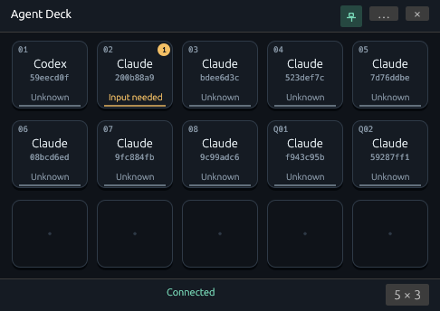
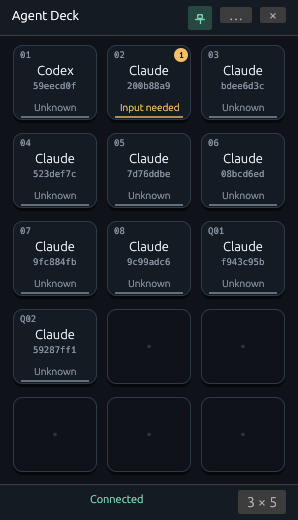

# Corvid Agent Deck

Corvid Agent Deck is Corvid Desktop's built-in **Agents** window. It ships and
updates with Desktop and extends the former Agent Board. Agent status, cards,
notifications, and navigation live in this separate window; the terminal toolbar
provides a compact **Agents** entry point with an input-request count when needed.
**Settings → Agents** provides access and explains notification preferences.

The executable and its UI, launch, background, notification, and OS integration
code remain in [`plugins/agent-deck`](../plugins/agent-deck/) for source and package
compatibility. This is an internal module boundary, not a user-installable plugin
or a public plugin API. Desktop and the Windows CLI delegate to that package.
The daemon remains authoritative for PTYs and agent state; `corvid-companion`
owns the shared slot policy and presentation service.
The physical Stream Deck/GPUI prototype in `spikes/deck` remains separate.

On 2026-11-12, Linux Xvfb checks verified the Settings → Agents page, opening and
reactivating the same Agents window from Settings and the toolbar, access to
Notifications & settings, and unchanged terminal dimensions. Desktop and Agent
Deck built on Windows and Linux; Windows workspace Clippy, formatting, and
whitespace checks passed. Native Windows GUI interaction was not exercised in
this pass.

## Launch and lifetime

Open **Agents** in the top bar (or **Settings → Agents → Open Agents**)
in Desktop. Build source installations with
`cargo build --locked -p corvid-agent-deck`; Desktop finds the binary beside itself
or in `plugins/agent-deck/` in an installed package. Direct launches require an
existing companion `--state-dir` and the matching `--pipe-instance` (Windows) or
`--socket-dir` (Linux).

Each companion controller has one Deck instance. Reopening activates it. A private
named pipe on Windows or private Unix socket on Linux carries bounded Protobuf
activation and Desktop focus requests. Host/controller identity and the connection
generation are checked. The OS supplies the registering Desktop peer's process ID.
Closing or switching Desktop retires its focus registration without ending Deck.
A reopened Desktop can register again. Each Deck currently watches one configured
host; a unified multi-host window is future work.

Deck starts or reuses a separate companion service when needed. Quitting Deck does
not kill that shared companion or any daemon, terminal, or agent. Existing Board
state paths under `slot-board/` are deliberately retained, preserving controller
identity, slots, and pins across the rename.

| Windows action | Result |
| --- | --- |
| Close the Deck window | Hide it; tray and notifications continue. |
| Click the tray icon | Open the existing instance as a mini deck. |
| Turn Always on top on | Keep the deck visible above other windows, including after focusing a terminal. |
| Turn Always on top off | Hide to the tray immediately. Reopened popups hide when focus leaves or terminal navigation succeeds. |
| Open tray menu | Open Deck, notifications/settings, pause/resume, or quit. |
| Click a notification | Show its captured event in Deck; batch notices open history. |
| Choose Quit | Exit Deck and clear its Windows notification-center entries. |
| Enable Start at login | Create a per-user background-launch shortcut. Always on top shows the deck without taking focus; tray mode starts hidden. Login startup defaults to off. |

If native tray setup fails, the window stays available and closing it exits.
Windows uses an AppUserModelID per controller, a Start Menu shortcut, native WinRT
toasts, executable/shortcut icons, and Shell tray integration. Explorer restart
reinstalls the tray icon. Notification activation is handled while Deck is running;
activation after process exit is not supported. Disable login startup in Deck
before removing an installation.

Linux currently sends notifications through `notify-send` when available. It has
no tray or login-startup backend: its window remains visible, and closing it exits.
Windows background parity is not claimed for Linux.

## Floating window

The default view is a borderless mini deck with eight keys in a **4 × 2** grid
(**392 × 256 logical pixels**). The layout button in its footer opens a visual
preset picker. Dimensions always mean **columns × rows**:

| Keys | Landscape | Portrait |
| --- | --- | --- |
| 6 | 3 × 2 | 2 × 3 |
| 8 (default) | 4 × 2 | 2 × 4 |
| 12 | 4 × 3 | 3 × 4 |
| 15 | 5 × 3 | 3 × 5 |

Changing the preset or orientation immediately resizes the window. Its selected
shape stays fixed as agents arrive and leave; empty keys remain as quiet,
non-interactive placeholders. Extra agents scroll inside the panel. Portrait
windows have compact header controls, including an **Always on top** pin button.
Windows places it near the bottom-right corner of the current monitor's work
area, clear of the taskbar. Reopening in tray mode uses the cursor's monitor;
native pixel coordinates account for negative monitor origins and DPI changes.
Drag the **Agent Deck** title to move it. Linux placement is window-manager dependent.

**Always on top** defaults to on and is saved per controller in the private
`agent-deck/window.json`, together with the preset and orientation. Existing saved
preferences retain their visibility choice and default to the 4 × 2 grid. With
Always on top off, the tray or Desktop's **Agents** entry opens
the panel temporarily. Clicking elsewhere, successful terminal navigation, or
Escape hides it. Closing explicitly hides even an always-on-top deck. Without a
working tray, automatic hiding is disabled and closing exits, preserving access
on Linux and after Windows tray setup failure. Incoming agent notifications do
not open the deck or take focus.

**More** (the **…** button) expands the same window for the queue, closed panes, hosts, terminal
selection, and notification preferences. **Mini deck** returns to the compact
view. Notification activation opens its history in the expanded view. Window
visibility and size do not affect daemon-owned work or the slot policy. The mini
deck shows assigned slots followed by the first 32 queued runs, so larger grids
can display more agents than the companion's configured slot count. Queued keys
are marked **Q** and navigate through Desktop using their exact run identity;
they do not acquire a fabricated slot or pin action. If more queued runs remain,
the footer's **+N** button opens the paginated queue.

## Slots and queue

The **Deck** view uses keys with a raised rim and dark face. The
mini deck uses the selected grid of compact keys; the expanded view adjusts its larger
square keys from one to six columns when resized. Keys show their number, provider,
short run ID, current status, unseen alert count, and a pin indicator (**P** in the
mini deck, **PIN** when expanded). Empty keys in the expanded view are inactive.

Click anywhere on an available key to focus its existing terminal. Hover for
evidence and request details; right-click assigned slots for **Pin / Unpin** and
unseen alerts for **Acknowledge alert**. Acknowledging an alert does not answer or
resolve a pending question.
The displayed slot snapshot stays fixed throughout a click or open context menu,
so compaction cannot change the action's captured target.

Status uses both text and color: blue for working, amber for input or interruption,
mint for ready or an observed response, and red for errors. Offline, cached, and
historical keys explicitly show their availability instead of presenting their
last activity as live. Unverified input requests say **Check terminal**.
**Queue**, **Closed panes**, **Hosts**, and **Notifications** retain their separate
views; notification preferences are under **Notifications**.

The screenshot uses synthetic agents in an isolated Linux Xvfb session. On
2026-11-12, floating-window checks verified the preset menu, 3 × 2 and 2 × 3
layouts, portrait controls at 204 pixels wide, and 5 × 3 / 3 × 5 layouts. Whole-key
navigation, including a queued run beyond the first eight slots, retains the
correct Desktop pane identity while the always-on-top deck stays open. Ten
synthetic agents were used to verify the larger grids.
Earlier Windows UI checks exercised the compact empty state, expansion, returning to the
mini deck, and hiding when Always on top was disabled; its saved setting was
verified on disk. Policy tests cover focus-loss dismissal, the no-tray fallback,
preference persistence, all preset orientations, legacy preference migration,
queued-run projection without slot mutation, and positioning within a monitor work area.
Scoped Agent Deck and presentation tests passed on Windows (24 passed, one native
notification test ignored) and Linux (22 passed), along with builds, Clippy,
workspace formatting, and whitespace checks. Linux UI checks also confirmed that
turning Always on top off does not hide a window without a tray.
Native tray-click reopening, dragging, mixed-DPI monitors, and taskbar relocation
still require interactive qualification. The earlier larger-key checks verified
context-menu pinning and acknowledging an alert without resolving its input request.

An agent's work finishing, process exiting, or provider context changing does not
remove its card. The card remains until its owning pane is removed from the daemon's
layout by closing that pane, its tab, or its workspace/session in Desktop. Closing
only the Desktop window detaches the presentation and retains the layout.

Runs beyond the configured slot count enter a FIFO queue. Initial observations use
the daemon's immutable creation sequence, with run identity as a deterministic
fallback. Removing a pane compacts every following visible card toward the front,
then fills the tail from the queue. For example, `[A, B, C] + [D, E]` becomes
`[A, C, D] + [E]` when B's pane closes. Completed queued agents remain queued too.
Pins move with their agent; they do not reserve empty holes.

Pane ownership is saved with each tracked run. Agent-history pruning, a disconnect,
or an epoch change alone cannot evict a card. A synchronized layout confirms pane
removal, including closures that happened while Deck was offline. Older saved
records learn ownership when observed again; an unobserved legacy record is kept
conservatively. The queue is bounded to 4,096 tracked runs and closed-pane history
to 256 entries. The UI does not offer manual removal or out-of-order placement;
legacy CLI layout-editing commands remain available for compatibility.

Every changed slot gets a new revision. A click captures both the run identity and
revision; compaction cannot turn a click on B into a click on C. Completed or stale
runs cannot focus a replacement terminal. Questions and approvals remain in the
existing terminal; Deck never supplies an answer or steals a writer lease.

## Notifications

The companion capability `presentation_attention.v1` exposes a bounded feed,
independent of visible slots and queue pages. It includes the newest 512 unseen
attention records, exact host/epoch/run/event identities, reason, provider, request
kind/status, source snapshot sequence, and an explicit omitted count. An older
companion reports notification support unavailable while the slot UI can still run.

Questions/approvals, observed responses, and failures are enabled by default.
Unverified input says to check the terminal. An observed response does not claim
whole-task completion. Settings control categories, sound (off by default), global
enablement, and a one-hour pause. **Send test notification** checks OS delivery.
Notification text includes provider and short host/run IDs; it excludes terminal
contents, prompts, commands, and credentials.

The private `agent-deck/notifications.json` stores settings, 128 history entries,
and up to 4,096 attempted-event identities. First observation of an epoch seeds
history without replaying old popups. Reconnect/restart deduplicates saved events;
only new events at most five minutes old can notify. Snoozed/disabled events are
recorded without a later popup burst. More than three fresh events in one poll
become one summary. A feed overflow is reported. This bounded snapshot feed does
not claim lossless event delivery or exactly-once OS display across a crash.

Dismissal and notification activation do not acknowledge remote attention or
resolve requests. History offers an explicit navigation button only with a current
Desktop registration and matching host/epoch. Desktop revalidates the exact run.
Unavailable or ended targets remain in history without opening a new terminal.

## Assets and source map

- [`src/desktop.rs`](../plugins/agent-deck/src/desktop.rs): Desktop launch and focus adapter.
- [`src/connection.rs`](../plugins/agent-deck/src/connection.rs), `src/parent.rs`: private activation/registration protocol.
- [`src/background.rs`](../plugins/agent-deck/src/background.rs): independent observation and notification lifetime.
- [`src/window.rs`](../plugins/agent-deck/src/window.rs), [`src/app/floating.rs`](../plugins/agent-deck/src/app/floating.rs): floating-window policy, saved topmost preference, native placement, and compact controls.
- [`src/window/layout.rs`](../plugins/agent-deck/src/window/layout.rs): fixed grid presets, orientation, and window dimensions.
- [`src/notifications.rs`](../plugins/agent-deck/src/notifications.rs): bounded delivery policy and persistence.
- [`src/platform`](../plugins/agent-deck/src/platform/): Windows tray, shortcuts, toast delivery; Linux fallback in `platform.rs`.
- [`assets`](../plugins/agent-deck/assets/): tray SVG, PNG, and multi-size ICO assets. The shared application icon lives in [`assets/icons`](../assets/icons/); `cargo run -p corvid-agent-deck --example render-icons` regenerates all raster assets.

The icon extends the existing Corvid bird silhouette. App and tray icons have a
normal state and a separate attention overlay. See the [icon preview](images/agent-deck/preview.png).

## Validation and remaining qualification

Automated coverage includes retained completed runs, FIFO compaction, persisted
pane ownership, stale slot captures, off-page attention and bounds, request metadata,
notification deduplication and snooze, cross-host rejection, Desktop reconnection,
and activation without replacing an existing registration. The Linux routing fixture
exercises real process exit, relaunch in the same pane, and explicit pane closure.

Native popup/click behavior, Explorer restart, startup after login, and installed
package behavior require interactive OS qualification. They must not be inferred
from unit tests. The explicit native test
`native_notification_reaches_windows_history` verifies delivery through WinRT into
Windows notification-center history and removes its temporary notification and
shortcut. It passed on the development Windows host; visual popup/click behavior
remains unverified because the UI tool could not access its cursor or capture its
monitor. Windows notification architecture follows the
[desktop toast sample](https://github.com/microsoft/Windows-classic-samples/tree/main/Samples/DesktopToasts).

Desktop provides [terminal selection, scrollback, and search](04_companion.md#desktop-terminal-selection-and-history).
Windows observes [native agent processes](04_companion.md#windows-quick-start)
launched directly by Corvid or from a Corvid shell.
Desktop's workspace picker watches verified hosts while their terminal views are
detached. In Agent Deck, **Hosts** lists the agents on up to eight hosts
configured by Desktop or companion setup. Refresh after configuring another
host. The overview checks the expected host identity before using a snapshot
and marks previously seen observations as cached when a host goes offline.
**Show host Deck** opens that host's running Deck. Slot actions, pane focus,
and notification settings use the individual host Deck.

Windows supports [opt-in provider hooks](03_provider_qualification.md#windows-hook-setup-and-fixture-coverage).
Desktop and the TUI support read-only attach and explicit writer handoff.
Agent Deck is bundled in [Windows Setup](05_release_distribution.md#windows-setup).
