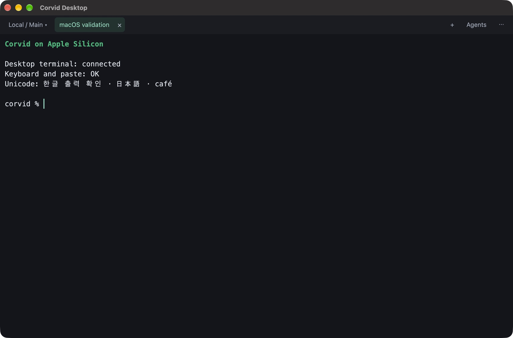
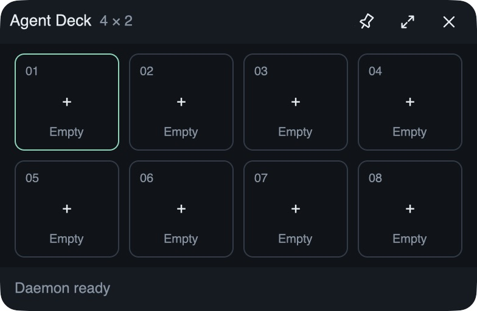
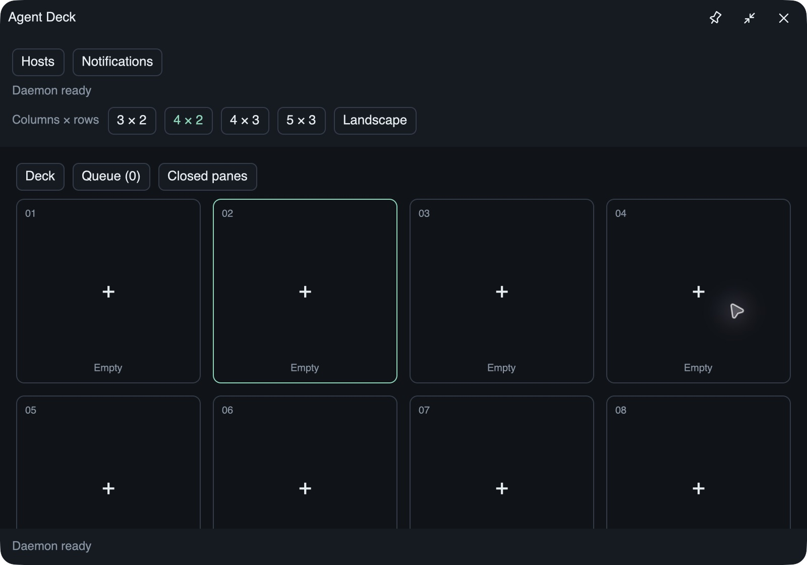
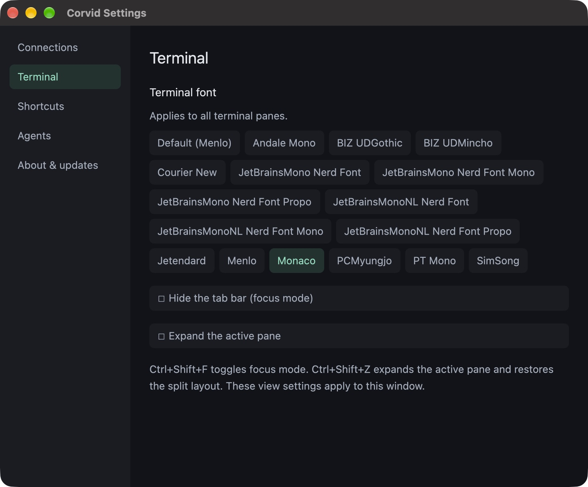
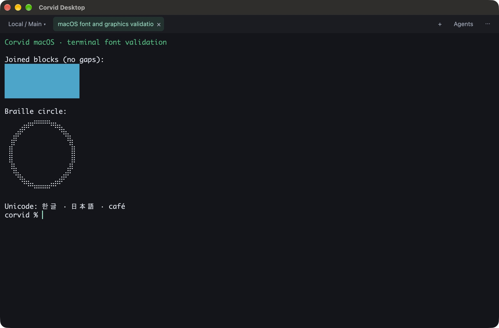

# macOS support

Corvid targets macOS 15 or later on Apple Silicon (`aarch64-apple-darwin`).
Intel Macs and universal binaries are not release targets. The daemon, TUI,
Desktop, companion, Agent Deck, terminal qualification spike, and experimental
Deck/USB binaries build on this target.

## Install

Download `corvid-desktop-VERSION-aarch64-apple-darwin.dmg`, open it, and drag
**Corvid.app** to Applications. Desktop includes the native `corvid` runtime,
the nested **Corvid Agent Deck.app**, and Linux, Windows, and macOS SSH runtimes.
Launch Desktop and open **Agents** to launch Agent Deck. The experimental
`corvid-deck` and `corvid-streamdeck` commands are in `Corvid.app/Contents/MacOS`.

These initial packages are **not Developer ID signed or notarized**. Mach-O
binaries and app bundles use ad-hoc signatures for Apple Silicon integrity.
After attempting to open the downloaded app, use **System Settings → Privacy &
Security → Open Anyway** if Gatekeeper blocks it. Only approve a package you
obtained from the project's release. No system-wide Gatekeeper changes are needed.

For the TUI, use the same user-scoped `install.sh` as Linux:

```sh
curl -fsSL https://github.com/DosangGu/corvid/releases/latest/download/install.sh | sh
```

The installer detects Darwin/arm64 and uses BSD utilities and `shasum`. Add
`~/.local/bin` to PATH. `--product desktop` installs an app into versioned storage
and creates `~/Applications/Corvid.app`. Explicit `--install-root` installations
keep their app link under that root. Desktop **About & updates** and
`corvid update` use this installer, verify the selected release's checksums, and
retain older executables. Updating a drag-installed app creates a user-managed
installation; the original Applications copy is preserved. Open the updated app
from `~/Applications` afterward. Existing CLI commands from another installation
are preserved; use a separate `--bin-dir` when needed.

Package updates do not restart the daemon. Use `corvid upgrade` separately to
replace an automatically started daemon while retaining hosted PTYs.

## Runtime and desktop behavior

| Data | Default location |
| --- | --- |
| Unix sockets | `~/.corvid/r-BOOT_PREFIX/` (changes each boot) |
| Daemon state | `~/Library/Application Support/Corvid/daemon/` |
| TUI views | `~/Library/Application Support/Corvid/clients/` |
| Companion and Desktop views | `~/Library/Application Support/Corvid/companion/` |
| Script installations | `~/Library/Application Support/Corvid/install/PRODUCT/` |
| Agent Deck login startup | `~/Library/LaunchAgents/org.corvid.agent-deck.CONTROLLER.plist` |

`CORVID_RUNTIME_DIR`, `--runtime-dir`, and explicit state paths remain available.
Socket paths must fit Darwin's Unix socket limit, and runtime directories require
private ownership and non-writable ancestors. Keep custom runtime paths short;
world-writable `/tmp` and symlinked ancestors are deliberately rejected. Sockets
verify both UID and the kernel-provided peer PID. Process observations use libproc
and sysctl with boot identity and process birth-time checks; inaccessible or
changed process evidence fails closed.
The daemon uses the shared [process observation contract](02_daemon_foundation.md#verification),
retaining Darwin's PID/birth revalidation rather than assuming a procfs handle.

Desktop imports PATH from the user's interactive login shell before starting its
workers, with a bounded timeout. This finds Homebrew and user-installed agents when
launched from Finder. It uses the user's configured login shell for new PTYs.
Command-C/V/F copy, paste, and search terminal history; Command-W closes the
window, Command-Q quits Desktop, and Command-Shift-N opens a window. Closing the
last window keeps the application running; clicking its Dock icon opens another.
Quitting Desktop leaves daemon-owned PTYs running. Existing composed-text input
and terminal Control-key encoding remain in use.

Agent Deck opens in a panel under its menu bar icon. Click the icon to toggle
it, or right-click for settings and quit. It supports native notifications and an
opt-in login LaunchAgent. Notification permission is controlled in System Settings.
Click actions are scoped to notices held by the live process and go through the
existing run/binding fences. Notifications from an exited instance cannot select
a different run. Login startup recomputes the boot-scoped socket directory.
The experimental Deck uses explicit Corvid terminal pairing on macOS; automatic
WezTerm window discovery remains Windows-only. USB support uses hidapi/IOKit.

## Build and validate

Install Rust using rustup and full Xcode, select it with `xcode-select`, and accept
its license. Desktop/Deck need the Metal compiler. New Xcode installations may
require `xcodebuild -downloadComponent MetalToolchain`. `/usr/bin/tic` compiles the
bundled terminfo, including Darwin's hexadecimal directory layout. Python 3.11+
is required for packaging and package tests.

All macOS GPUI applications enable the `font-kit` feature. Without it, GPUI
uses a placeholder text backend that opens windows but draws no glyphs. Desktop
defaults to the system-provided Menlo font for terminal cells. **Settings →
Terminal** lists installed monospaced fonts; the choice is saved privately in
`desktop-preferences/terminal.json` under the Desktop state directory. An
unavailable saved font falls back to Menlo. The `macos_text` test checks native
font metrics, font discovery, preference persistence, and fallback on the process
main thread, as required by AppKit.

```sh
export MACOSX_DEPLOYMENT_TARGET=15.0
mkdir -p "$HOME/.corvid-tests"
chmod 700 "$HOME/.corvid-tests"
export TMPDIR="$HOME/.corvid-tests"
cargo build --locked --workspace
cargo test --locked --workspace --features corvid-deck/stream-deck
cargo clippy --locked --workspace --all-targets --features corvid-deck/stream-deck -- -D warnings
cargo fmt --all -- --check
git diff --check
```

With the pinned Rust toolchain on macOS 27, disable release build-dependency
stripping (`CARGO_PROFILE_RELEASE_BUILD_OVERRIDE_STRIP=none`) to avoid
[Rust's Mach-O alignment bug](https://github.com/rust-lang/rust/issues/157750).
The macOS packaging script sets this workaround. Use the Metal toolchain's
`TOOLCHAINS` identifier if `xcrun -sdk macosx metal --version` still selects an
unavailable compiler after downloading it.

Commit the build inputs before making a release package. Obtain Linux and Windows
runtime artifacts built from **the same revision**, then run:

```sh
cargo build-desktop /path/to/linux-x64 /path/to/windows-x64 /path/to/linux-arm64 /path/to/windows-arm64
```

CI uses the `macos-latest` Apple Silicon image for runtime tests, workspace
tests and lints, installer version switching and corruption rejection, nested
code-signature checks, DMG mounting, and a Desktop window smoke test. Packages
declare macOS 15 as their deployment target. Testing on older macOS versions,
physical USB devices, OS permission prompts, multiple monitors, and non-Latin
IME interaction requires separate qualification.

## Interactive validation

On Apple Silicon with macOS 27, the packaged application was exercised with the
local GUI fixes applied. Desktop rendered ANSI colors and Korean, Japanese, and
accented Latin output; keyboard input, paste, Command-F search, and window creation
worked. Quitting and reopening Desktop reattached to the daemon-owned terminal.
The screenshots below contain synthetic terminal output and an empty controller.



Before the menu bar panel was introduced, Desktop's **Agents** button launched the
nested Agent Deck application in a floating window. Compact
and expanded views rendered, pin/unpin controls worked, and the expanded window
stayed inside the display's visible area after resizing near its bottom edge.
Hiding the window and reopening it from Desktop preserved the running controller.
Physical USB devices, notification permission prompts, multiple displays, and
non-Latin IME composition were not exercised by this session.





After integrating the terminal font and artwork changes from #64, local workspace
tests and lints passed with the Stream Deck feature enabled. Native tests verified
the Menlo default, selecting and reloading an installed font, restoring the
default, and recovering from an unavailable font. GUI checks exercised Monaco
selection, private preference storage and restoration across an app restart,
joined solid blocks, Braille dots, and Unicode output. Captures in this session
required a window resize to refresh; they establish the rendered result rather
than continuous redraw behavior.




