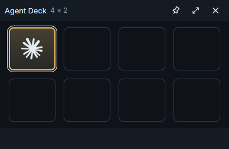
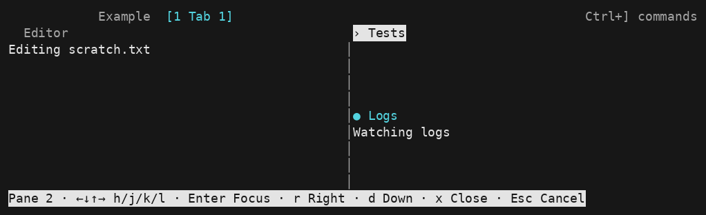
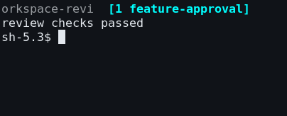
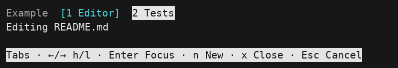

# Daemon Guide

> For Compio runtime benchmarks, verification matrices, and reproduction logs, see
> [Daemon and Runtime Qualification](../qualification/daemon-and-runtime.md).

## Run Locally

```sh
cargo build --locked -p corvid-tui -p corvid-daemon
target/debug/corvid
```

Daemon source builds use Zig 0.17.1 for libghostty-vt and the ncurses `tic`
compiler on Linux. Cargo builds the Protobuf schema
using `protox`. Running `corvid`
without a subcommand starts a background daemon if needed and joins a live
terminal in the default workspace. It opens the user's shell when the workspace
has no live terminal. To start a shell explicitly, use `corvid attach --new`.
The automatically started daemon uses the bundled terminfo entry.
Use `corvid ensure-daemon` to start or reuse the same background daemon
without attaching a TTY. It shares the startup lock with the ordinary CLI.
On Linux, macOS and Windows, `corvid list` queries the same runtime the TUI
would open. Standard output has one workspace per line, with the stable ID
and escaped name separated by a tab. An empty list from a running daemon
prints no rows. `corvid attach NAME_OR_ID` uses an exact name or ID from that
list. If a name matches multiple workspaces, attach by one of the displayed
IDs. These commands need an existing daemon to resolve workspaces. Bare
`corvid attach` starts the daemon if necessary and attaches or offers
recovery for an existing view. Without an existing terminal or a saved view,
it returns `NoTerminal`. Use `corvid` for first-time startup or
`corvid new NAME` to start a separate workspace rooted in your current
directory.

### Run the standalone daemon

Build `corvidd` and the TUI from the same checkout.

```sh
cargo build --locked -p corvid-daemon -p corvid-tui
target/debug/corvidd
```

Run `target/debug/corvid` or open Desktop from another terminal to connect to
the same default runtime. On Unix, `corvidd` supplies its bundled terminfo
profile to new PTYs when `TERMINFO` is unset. On Windows, run the corresponding
`.exe` binaries.
Use `corvidd --runtime-dir PATH --state-dir PATH` to start a foreground daemon
with separate runtime and metadata directories. Give the clients the same
runtime directory with `CORVID_RUNTIME_DIR`. The existing `corvid daemon`,
`corvid control --stdio`, and `corvid terminal-relay` commands also work.
The standalone binary provides `corvidd control --stdio` and
`corvidd terminal-relay` for relaying to that runtime.

For a daemon that must survive the host's last-login policy, follow the
[systemd setup](#run-under-systemd).

After building or installing an updated binary, run `target/debug/corvid upgrade`
or `corvid upgrade` with the updated executable. Linux and Windows use the same
planned handoff for automatically started daemons. The daemon fences terminal input,
detaches current clients, waits for metadata persistence, and records the terminal-host
identities in a private `handoff.json` in the runtime directory.
The replacement keeps the same state directory, host identity, layout, terminal IDs,
PTY processes, and terminal screen state, and starts a new daemon epoch. Reattach a TUI
after the connection closes. Desktop retries a lost connection against the same host and
terminal ID, fences queued actions, and acquires a fresh writer lease.
An active paste or unfinished view operation must finish before handoff.
If the runtime is stopped, the command starts the updated daemon.
For foreground or systemd daemons, use their existing start and stop procedure.
An older daemon without terminal-host support needs one initial idle upgrade or
manual restart before its new terminals can survive subsequent replacements.

The shared terminal backend owns input queues, VT query replies, parsing, resize,
preview, and rendering. Its versioned, bounded Protobuf protocol uses private Unix
sockets on Linux and per-user named pipes on Windows. Terminal content stays in the
terminal host's memory. A retained host continues draining output and answering VT
queries while the replacement starts. The handoff file contains terminal identities
and layout locations. Windows uses a separate executable image for terminal hosts
so they can remain alive while the daemon executable is replaced.

Client identities, writer leases, and input routes are freshly established after
handoff. Queued user input is fenced. Previous agent alerts remain in history.
Qualified Unix agents retain their observer association and process identity. The
new daemon checks the boot, process birth, executable, and retained PTY ownership,
then publishes a new run in its own epoch. Collection stays degraded until a fresh
authenticated hook arrives. Questions and plan approvals with exact IDs from the
retained prompt appear as **Check terminal** while their outcome is uncertain. A
matching result resolves the request, and reobserving the same request produces no
duplicate alert.

On Windows, the replacement keeps the original observer epoch for each recovered
ConPTY root. The daemon verifies the hook helper, provider process, and ConPTY
ancestry on every submission. A verified prompt submission or typed input request
can establish collection again when the same provider has no new `SessionStart`
event. When the handoff includes a verified Windows session, the daemon restores
its input evidence with the same Unverified status as Unix. Controller actions and
shell registrations require the current epoch on all platforms.

The Deck shows a retained Claude question after a Linux daemon handoff. The
question stays open in the original terminal until the user answers.



Linux also migrates terminal-only handoffs from v0.2.5 and earlier. It checks the saved
conversation and the surviving foreground provider, reading only Corvid's UUID scope
from its bounded process environment. This can recover a process whose monitoring was
lost during an earlier replacement. No provider is restarted and no hooks are injected
into an uninstrumented process. The observer executable must resolve to the updated
Corvid binary, as it does when the managed SSH installation is replaced in place.
Old-format migration on macOS, background jobs without foreground ownership, and
processes without saved conversation evidence remain outside this migration path.
New agent invocations from retained shells register against the current epoch.

Press Ctrl-] then d to detach and run `corvid` again to return to the shell.
The TUI remembers its last successful daemon endpoint and workspace/tab/pane selection
separately from Desktop. Plain `corvid` or `corvid attach` restores that view after
verifying the host identity and reading a fresh layout snapshot. `--runtime-dir` and
`CORVID_RUNTIME_DIR` override the saved endpoint. `corvid attach --workspace ID`
prefers the last focused live pane in that workspace. If that pane is unavailable,
it tries another live pane in the saved tab, then uses the usual workspace attach.
Explicit tab or pane selectors, new-terminal commands, and layout commands take
precedence. A TUI launched through SSH remembers the daemon on that execution host;
it does not launch SSH or WSL.

If a saved pane or tab was removed, restoration chooses the first remaining pane in
that tab or the first tab in the same workspace. If the workspace no longer exists,
choose a target explicitly with `corvid attach --workspace ID --tab ID --pane ID`.
If the saved terminal is no longer running, use an explicit launch such as
`corvid attach --new --workspace ID --tab ID --pane ID`. Restoration never starts a
replacement process; first use without a saved view retains the default-shell behavior.

TUI preferences use private JSON at `%LOCALAPPDATA%\Corvid\clients\tui\view.json`
on Windows and `$XDG_STATE_HOME/corvid/clients/tui/view.json` (or
`~/.local/state/corvid/clients/tui/view.json`) on Linux. `CORVID_VIEW_STATE_DIR`
overrides the parent of the `tui` directory, including in isolated test fixtures.
Changes are coalesced for 250 ms by a separate writer and flushed on clean exit.
An atomic replacement retains `view.json.bak`; malformed state falls back to the
backup or default startup, while unsupported schemas and oversized files are preserved.
Each target has one last saved selection for startup. The file also keeps a bounded
history of the most recently used workspaces, scoped to the target and verified
daemon host. Concurrent TUIs merge updates to different workspaces, and failed
connections leave the saved selection intact.

The top row shows the workspace and tabs, with the current tab in brackets.
The active pane takes the remaining space in a single-pane tab. Split tabs
show pane titles, a marker for the active pane, and read-only terminal previews.
A click in the layout selects the pane or tab under the pointer. A terminal
application that enables mouse reporting can receive pane-relative clicks.
Narrow terminals keep the active terminal visible.

Set `CORVID_ALLOW_CLIPBOARD_WRITE=1` in the environment of the Corvid TUI to
let programs in its current pane copy up to 64 KiB of UTF-8 text to the system
clipboard using OSC 52. The outer terminal must support and permit OSC 52
writes. Use **Applications in terminal may access clipboard** in iTerm2 or
the `compatibility.allowOSC52` profile setting in Windows Terminal. Apple
Terminal does not support OSC 52 writes.

For one invocation on a POSIX shell, run `CORVID_ALLOW_CLIPBOARD_WRITE=1 corvid`.
In PowerShell, set `$env:CORVID_ALLOW_CLIPBOARD_WRITE = '1'` before running
`corvid`.
Long workspace names and active tab titles scroll back and forth inside their
fixed columns, pausing at each end. The highlighted title in tab mode and the
selected row in the workspace picker do the same. Tab numbers and click targets
stay in place during animation.





Use `corvid attach -- program arg` to start an explicit command on the running
daemon.

New PTYs use `TERM=xterm-256color` so shells, editors, and nested SSH sessions
work without installing a custom terminfo entry on remote hosts. To pick up a
changed `TERM` after a daemon upgrade, open a new terminal.

Ctrl-] enters command mode for the next complete key. Ctrl-] twice sends one
literal Ctrl-]. An unmapped key sends the leader and the key as terminal input.
The daemon returns an idle leader to the current PTY after two seconds.
Esc or Ctrl-C cancels a pending leader without sending it to the terminal.
Ctrl-] then `?` opens a searchable command list. Type to filter, use the
arrow keys to move, Enter to execute, or Esc to cancel.

| Keys after Ctrl-] | Action |
| --- | --- |
| `w` | Filter and switch workspaces. Return to the last available pane in the selected workspace. |
| `t` | Browse the top tab bar. Use the arrow keys or `h`/`l` to preview the highlighted tab, Enter to focus, `n` to open a new tab, `x` to close the highlighted tab, or Esc to cancel. |
| `p` | Browse the pane layout with the arrow keys or `h`/`j`/`k`/`l`. Press Enter to focus, `r` to split right, `d` to split down, `x` to close the highlighted pane, or Esc to cancel. |
| Arrow keys | Focus a neighboring pane directly. |
| `[` / `]` | Previous or next tab. |
| `d` | Detach and keep terminals running. |

Tab mode starts with the current tab highlighted. Moving the highlight shows
the tab's live terminal contents in read-only mode, including its split panes
when the viewport fits them. Enter focuses the highlighted tab and enables
terminal input. Esc restores the original tab and input focus. Pressing `n`
opens a tab and focuses its shell. Pressing `x` immediately closes the
highlighted tab and all of its panes. Both commands return to terminal input
when a pane is available.



Pane mode starts with the current pane highlighted. The hint line shows the
highlighted pane number, including when the terminal is too small for split
previews. Pressing `r` or `d` splits the highlighted pane and focuses the new
shell. Pressing `x` immediately closes the highlighted pane and its terminal,
then returns to terminal input when a pane is available.

The selectors overlay the layout without resizing the active PTY. Only pane
writers resize their own terminals. The previous split aliases `%` and `"`
also work after the leader. Older peers keep the original TUI with a bottom
status bar and use `w` for the tab list, `t` to create tabs, and `n`/`p` to
cycle tabs.

A signal or connection loss also releases the writer. The shell's exit status
reaches the attach process on normal completion.

Use `corvid attach --new-workspace "Review"` to create a separate workspace and
`corvid attach --workspace WORKSPACE_ID --new-tab "Tests"` to add a tab when that
workspace has no writer. Use `corvid attach --workspace WORKSPACE_ID --tab TAB_ID
--pane PANE_ID` to reattach to an exact pane.

To choose a default folder when creating a workspace, use
`corvid attach --new-workspace "Review" --browse-directory`. Use Tab to look up
matches, the arrow keys to navigate, and Enter to choose a folder. For scripts
and known paths, use `--workspace-directory PATH` instead. The daemon resolves
paths on its host, including when you run the TUI over SSH. The first
terminal, new tabs, and splits use this folder. An explicit launch directory
or a saved pane directory still takes precedence when reopening that pane.

To move a hidden live single-pane tab, attach to a different tab in its
workspace and explicitly claim the destination for that TUI.

```sh
corvid attach --workspace "$SOURCE" --tab "$VISIBLE_TAB" \
  --claim-workspace "$DESTINATION" --move-tab "$HIDDEN_TAB" \
  --to-workspace "$DESTINATION"
```

The move retains the pane, terminal, and run IDs and keeps the visible tab
selected. It publishes the layout and new location together. A companion slot
that already points to the run can focus it in the claimed workspace.

Run `corvid attach --agent claude -- [CLI arguments]` to start the Claude Code
executable from the daemon's PATH in a dedicated PTY. The arguments after `--`
go directly to the provider. `corvid control agents` lists the resulting run and
terminal IDs with their observed process state. The Protobuf inventory includes
the exact pane location, boot ID, PID, Linux start ticks, and foreground group
when available. Corvid keeps the latest 64 retired runs in memory within the
current daemon epoch. Process probing is staggered at roughly two seconds per
managed terminal and limited to 20 procfs samples per second across the daemon.
The retained child handle supplies exit evidence, including the normal exit code.

A managed launch detects the provider release and adds observation hooks to
the new session when the release is qualified. Codex asks you to review and
trust new hooks through its own UI. `corvid control agents` shows collection
health, pending and unverified requests, and whether a response was observed.
Claude Code and Codex can run in separate tabs of the same workspace. Detach
between the following commands, then use Ctrl-] followed by n or p to switch tabs.

```sh
corvid attach --new-tab Claude --agent claude
corvid attach --new-tab Codex --agent codex
```

See [provider qualification](../qualification/providers.md) for coverage and
manual hook configuration.

The TUI recognizes split legacy VT keys, UTF-8, and bracketed paste. The
`--escape-delay-ms` option defaults to 100 ms. Network delays above this setting
can split an Alt key into literal Esc and a subsequent key. A partial bracketed
paste opener starting with `ESC [ 2` uses its own bounded deadline. If it expires
before the opener completes, the TUI reports an input error. The daemon receives
paste as a route-scoped transaction with a 1 MiB limit. The outer TTY always
captures paste and the daemon adds delimiters when the child enables that mode.
An accepted write holds the input barrier until it finishes or stalls.

Corvid command keys also match their equivalent positions on the Korean
Dubeolsik layout when the outer terminal delivers individual jamo as keystrokes.
An input method can hold a keystroke in composition until commit. Shortcut
hints use English labels.

Run `target/debug/corvid control host` to read the stable HostId and current
ServerEpoch. Run `corvid control workspaces` for workspace, tab, and pane IDs and
`corvid control status` for live terminal and save status. The binary stdio relay
runs as `corvid control --stdio` over a
non-PTY connection. Give the runtime directory a trusted absolute path through
`XDG_RUNTIME_DIR`, `CORVID_RUNTIME_DIR`, or `--runtime-dir`.

Desktop uses `corvid terminal-relay` over non-PTY SSH for the interactive
protocol. That relay reaches `client.sock` and forwards bounded structured
messages and ANSI render frames. Sibling pane previews are rate limited and
carry no input route. The control relay still carries structured control
messages through `control.sock`.

Run `corvid control capabilities` to list the negotiated control features,
command limits, writer policy, and the daemon build's exact provider profiles.
The profiles include adapter schema revisions, event and correlation fields,
and qualification levels with their reasons. A control or TUI Hello reports
the same provider profiles. A managed launch checks the provider executable,
and `corvid control agents` reports the resulting adapter and collection state
for that run.

Run `corvid control collector-status` to count current top-level managed runs
by their observed collection state. The counters for accepted and rejected
submissions, failed connections, and saturated admission reset each daemon
epoch. Late connections count toward the epoch that receives them. A connection
can fail while sending a reply after the collector has
already accepted its submission. An unattributed transport failure affects
the traffic counts only. Per-run gap evidence comes from the verified hook
or process association.

The Unix socket checks both filesystem ownership and peer UID. A rejected
peer is dropped before the handshake. Frame assembly has a five-second
deadline from its first byte. An idle attached TUI can wait between frames.

`corvid control clients` lists attached TUI clients, view revisions, writer
leases, and input mode. Each connection's keymap enables tab and pairing
commands according to its attach capabilities. A new view returns the affected
client to passthrough and keeps its negotiated keymap. Other clients retain
their own modes and keymaps. `corvid control snapshot` reads a consistent view
at one daemon sequence.
`corvid control watch` prints a summary once synchronized and after each applied
transaction. Its Rust client retains the last valid cache on disconnect and
reports the watch unavailable. Establish a fresh watch to resynchronize.

The daemon admits up to eight snapshot watches across sixteen control
connections. Each watch queues up to 1,024 deltas or 4 MiB of changes. The
daemon reports `ResyncRequired` if it detects overflow at a frame boundary.
If overflow interrupts a frame write, it closes that connection. A fresh
watch always starts with a full snapshot.

In an attached TUI, press Ctrl-] then r to display a single-use pairing code.
Use Enter or Esc to restore the terminal display. Read the current host and
epoch with `corvid control host`, then run the following command and enter the
displayed code on stdin. Keep the same controller ID for subsequent commands.

```sh
corvid controller --controller-id ID --host-id HOST --server-epoch EPOCH pair
```

`corvid control clients` shows the registered client and binding revision.
`controller ... unpair --client-id CLIENT --binding-revision REVISION` revokes
that registration. `corvid control attention` lists alert IDs and the IDs,
kinds, and statuses of associated requests.
Use `controller ... ack --run-id RUN --attention-id ALERT` to acknowledge one
alert. Its input request remains pending until the provider reports a result.

Use `corvid control agents` to find the run ID, then select it in the paired TUI.

```sh
corvid controller --controller-id ID --host-id HOST --server-epoch EPOCH \
  focus --client-id CLIENT --binding-revision REVISION --run-id RUN
```

The client must already hold the destination workspace's writer lease. Successful
focus reports the selected terminal, view revision, and daemon sequence. Bring the
local terminal window forward manually. If a paste is active, let it finish before
issuing a fresh request.

The daemon saves layout IDs, the last observed working directory, and allowlisted
run history in `state.json`. It publishes changes to a separate writer and
debounces disk writes by one second. The archive retains up to 128 runs and
keeps current top-level running agents ahead of older records when evicting.
The state directory lock allows one writer. A successful save retains the preceding
valid state in `state.json.bak`. Startup upgrades validated schema 1 through 4 files
to schema 5 and keeps the original as the backup. Schema 1 starts with an empty
archive. Schema 3 adds a process-directory observation source. Schema 4 stores
optional manual tab names and accepts older files containing pane name overrides.
Schema 5 adds a bounded pane-to-conversation map with the provider, exact session ID,
verified directory, and eligibility for explicit resume. Older files start with an
empty map; historical rows are not used to guess a pane's current conversation.
The daemon ignores those overrides. Legacy `Shell` and `Shell N` tab labels become
automatic; other labels remain manual. Older schemas did not distinguish an
explicitly chosen `Shell` label from the generated default. Startup
preserves bounded corrupt primary bytes in
`state.json.corrupt`, then loads a valid backup or opens an empty layout. Newer
schemas require a compatible binary. The status command reports the recovery source.

Run `corvid control history` after a daemon restart to inspect saved records
under their original epochs. History includes the last observed state, request
kinds and statuses, and attention acknowledgments. The current process state of
a historical run is Unknown, and an unresolved request is Unverified. Snapshot
clients request this separate archive with `include_history`. It shares the
snapshot transfer limit and stays outside the live entity and focus graph.

The next terminal is created by an explicit launch. Use `attach --new --restore-cwd`
to choose the recorded directory when it still exists. The daemon records the
launch directory and samples `/proc/<pid>/cwd` for the original PTY child, even
when its tab is detached. It checks the process start time and verifies that the
observed path names the same directory in the daemon's namespace. A valid change
is stored with its observation time on the pane's current tab. If a sample is
unavailable, Corvid keeps the last valid directory.
[Linux `/proc/<pid>/cwd` reference](https://man7.org/linux/man-pages/man5/proc_pid_cwd.5.html)

### Restore saved agent conversations

After losing terminals, explicitly restore a workspace's saved conversations:

```sh
corvid restore --workspace WORKSPACE_ID --inspect
corvid restore --workspace WORKSPACE_ID
corvid restore --workspace WORKSPACE_ID --pane PANE_ID --retry
```

Ordinary TUI startup and Desktop workspace or window recovery resume a verified
saved conversation in the selected empty pane. The daemon returns the exact pane
and its status through `attach.recovery.v1` before allocating a terminal. The
client requests resume for that pane. If recovery fails or is unavailable, the
client shows the reason and lets the user open a shell.

Run these commands on the daemon host. Desktop provides the same action over its
Local, SSH, or WSL interactive connection. The protocol capability is
`workspace.restore_agents.v1`; the read-only control and external presentation
roles cannot start restoration. Inspection never launches a process.

The daemon retains the last verified top-level conversation for each pane, including
correlated conversation changes, independently of the bounded run archive. Two panes
in the same directory remain distinct. Deleting a pane deletes its saved association.
Agent content, prompts, credentials, environment variables, and launch options are
not saved for resume. Current provider configuration and authentication still apply.

Live terminals are reused, including terminal hosts recovered through planned daemon
replacement. Empty panes with verified metadata launch `codex resume SESSION_ID` or
`claude --resume SESSION_ID` directly in the saved directory. Missing directories
produce a pane error instead of falling back to another directory. Empty shell-only
panes remain empty. A new terminal gets new terminal/run IDs and input routes; old
questions and approvals never become active in the new epoch.

Pane reservations prevent concurrent clients from launching duplicate terminals.
Accepted attempts continue if the requesting client disconnects. Each new provider
must report the exact requested session through an authenticated hook within 30 seconds.
An early exit, different session, or missing confirmation stops that attempt and leaves
a pane-specific error. Other panes continue. A normal repeat does not retry failures;
`--retry` explicitly retries them. An ordinary shell can still be opened in a failed
pane. A running terminal is never replaced by restore or retry.

Use the qualified provider versions and observation setup documented above. The
current Linux Codex adapter cannot verify an in-process `/resume` boundary, and Windows
cannot correlate every return to an earlier context. Those transitions invalidate
automatic resume eligibility; use a shell to choose the conversation explicitly.
Fresh native resume and correlated Claude boundaries have deterministic synthetic
coverage; real-provider compatibility still follows the recorded qualification versions.

## Response Notifications over SSH

Run `corvid` in an interactive SSH session, or start it with
`ssh -tt work-host corvid`. When Corvid detects an SSH TTY, it uses that
connection to send a terminal bell for the first verified response to the
current prompt of a managed Claude or Codex run. The terminal controls how
the bell is presented. For WezTerm, see its
[bell settings](https://wezterm.org/config/lua/config/audible_bell.html).

Inside a newly opened Corvid shell, run `claude` or `codex` normally. Corvid
resolves the executable on that shell's PATH, verifies that the foreground
process belongs to the Corvid PTY, and enables session-scoped observers for
qualified releases. Codex may ask you to trust the hooks in its own UI.
This works with `ssh -tt work-host corvid` on the updated Linux host. Use a new
shell after updating the daemon so the shell receives the command wrappers.

Bash and Zsh keep the two command names connected when a login profile
prepends another directory to PATH. Other shells use the private PATH
directory directly. An absolute path or an alias that runs the executable
directly bypasses the wrappers. The explicit `corvid attach --agent claude`
and `corvid attach --agent codex` commands also load the observers for
qualified releases.

A provider `Stop` observation means a response was observed. Other hooks or
background work can continue afterward. Corvid sends the signal to the live
TUI holding the workspace writer lease, including for agents in background
tabs. Only events observed while attached are eligible for delivery.

Set `CORVID_NOTIFY=osc9` on the remote `corvid` command to request a toast
through a terminal that supports OSC 9. The desktop and terminal notification
settings determine whether it is shown. Use `CORVID_NOTIFY=off` to disable
the signal or `CORVID_NOTIFY=bell` to enable it outside SSH. Both the Linux
daemon and the attach client must support the response notification capability.

## Run Under systemd

The [user unit](../../deploy/systemd/corvid.service) starts Corvid under the user's
service manager and provisions the private socket directory. Install the binary
and unit on the execution host.

```sh
cargo install --locked --path crates/corvid-tui --root "$HOME/.local"
install -Dm644 deploy/systemd/corvid.service "$HOME/.config/systemd/user/corvid.service"
systemctl --user daemon-reload
systemctl --user enable --now corvid.service
```

For a deployment that needs to outlive its last login, configure the user
manager's lifetime according to host policy. On hosts that allow lingering,
`loginctl enable-linger` keeps the manager running after logout. Check
`loginctl show-user "$(id -u)" -p Linger -p Sessions` when qualifying the host.

For A21, use a disposable systemd host with OpenSSH configured to register
sessions through PAM and `pam_systemd`. Set up the unit, Corvid, Python 3, and the
terminfo entry for a dedicated `operator` account and enable lingering for that
account with operator authorization. Configure a separate `observer` account
with noninteractive sudo and pin the host key for both SSH aliases. Run from the
repository root on the client machine.

```sh
PYTHONDONTWRITEBYTECODE=1 python3 crates/corvid-tui/tests/last_login.py ssh_config operator observer
```

The observer checks that each disconnect closes the only SSH login and that the
user manager remains lingering. It compares the daemon epoch, daemon and child
process incarnations, and PTY device while the child counter advances. The next
attach must show the same child and retained screen.

## Run Locally on Windows

Build the Windows x64 TUI and daemon together with the pinned MSVC Rust
toolchain. Open a VT-capable console such as Windows Terminal.

```powershell
cargo build --locked -p corvid-tui
.\target\debug\corvid.exe
```

`corvid` starts a detached per-user daemon as needed and attaches to its
default workspace. The daemon owns the PowerShell ConPTY and applies the same
writer lease, layout, and render protocol as on Linux. Press Ctrl-] then d to
detach, and run `corvid` again to reattach. Ctrl-] then t opens the tab list,
and Ctrl-] then p opens pane controls.

The local client and control pipes are limited to the current Windows user
and reject remote clients. Runtime coordination files are under
`%LOCALAPPDATA%\Corvid\runtime`. The daemon persists its host identity and
workspace metadata in `%LOCALAPPDATA%\Corvid\daemon`. Use
`corvid control ping` to check the daemon and `corvid control host` to inspect
its identity. For an isolated foreground instance, use
`corvid --runtime-dir PATH daemon --state-dir PATH` with separate paths on a
local drive with ACL support. Corvid creates the private directories if
needed. Pass the same runtime directory to the TUI. Ctrl+C stops that
foreground daemon.

Windows support covers local terminal sessions and Windows x64 OpenSSH
connections through Desktop. The Desktop bundle can install and start the
Windows daemon for the SSH user. See [Desktop SSH setup](../guides/desktop.md#windows-quick-start).
Managed agent observations on Windows are planned separately.

The `windows_daemon` integration tests run the Windows binary inside ConPTY
and exercise startup, input, rendering, resize, and detach and reattach.
Windows console input preserves VT sequences and bracketed-paste boundaries
before routing input to the daemon. The command-menu regression verifies that
unmapped keys and pasted shell commands stay out of the PTY, the menu remains
open past the prefix timeout, and closing it preserves terminal identity and
dimensions. UTF-16 input tests cover surrogate pairs and control characters.

```powershell
cargo test --locked -p corvid-tui --test windows_daemon
```
