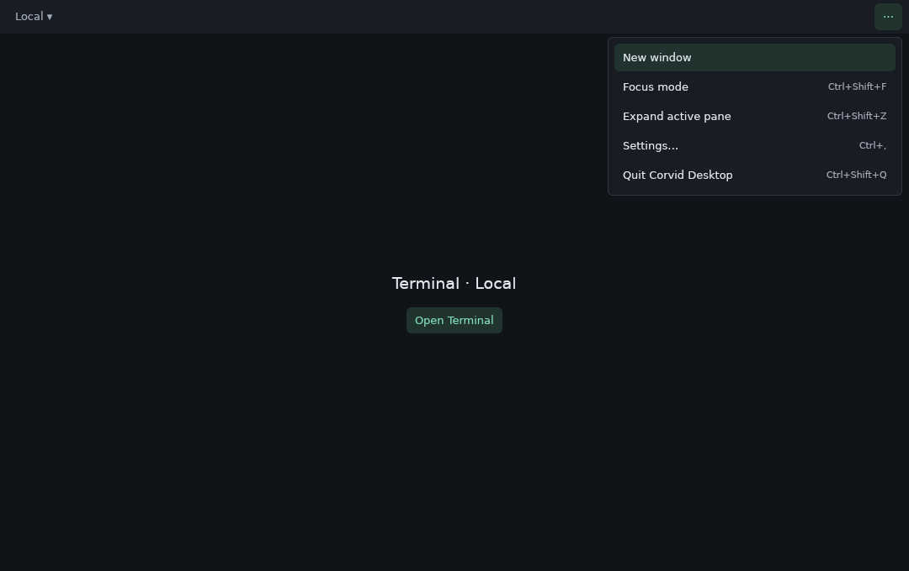
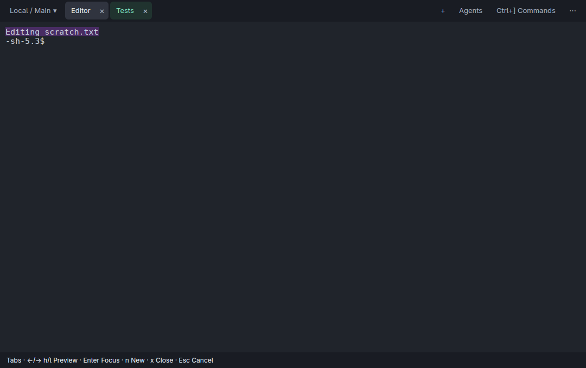
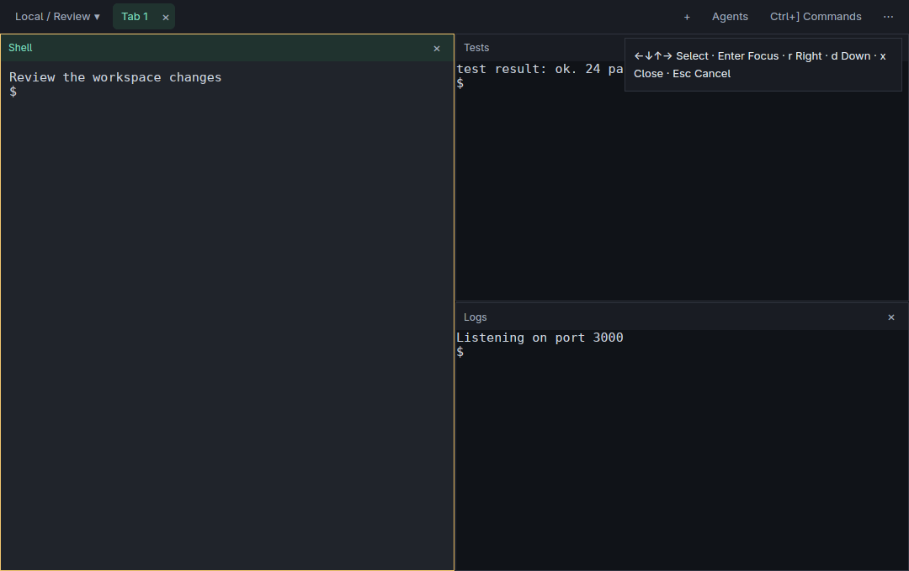
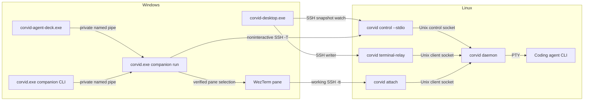
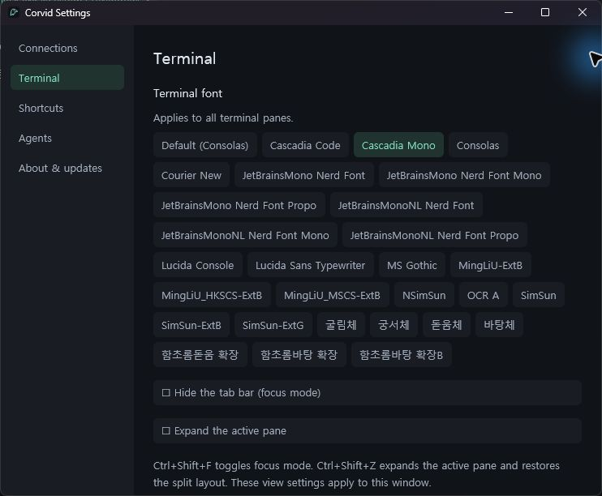
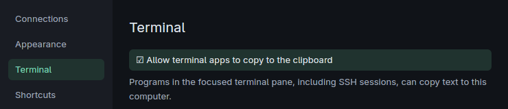
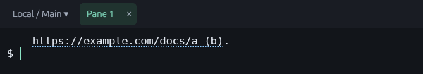
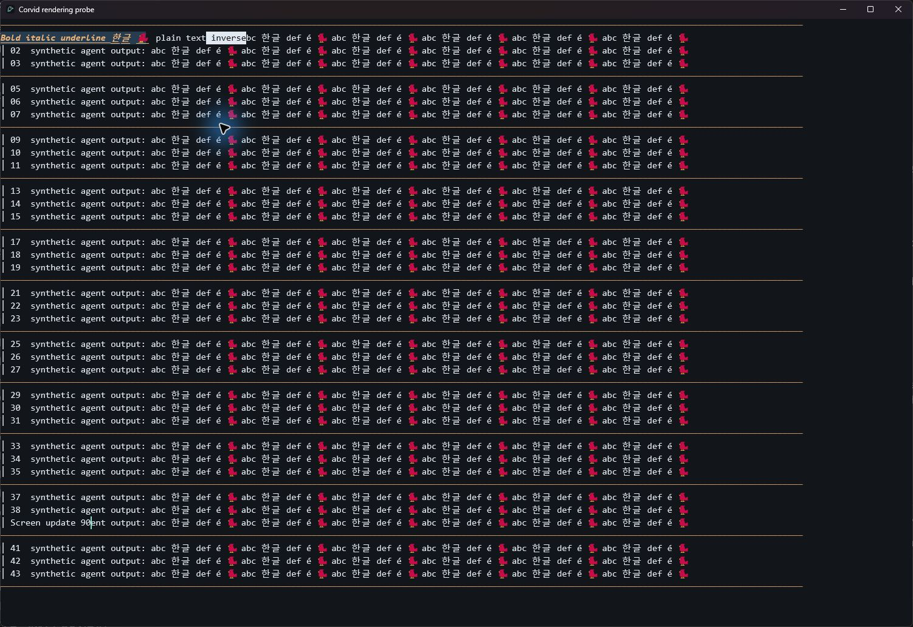

# Corvid Desktop Guide

> Covers Linux, Windows, and macOS Desktop configuration, SSH connections, terminal preferences,
> and WezTerm focus pairing. For platform verification logs and deferred checks, see
> [Platform Qualification](../qualification/platforms.md).

## Configure and Run

### Linux

Read the daemon's `host_id` with `corvid control host` on the execution host.
For a local daemon, initialize the companion with that ID. The global
`--runtime-dir` flag selects a local daemon's socket directory when needed.

```sh
corvid companion init --host-id "$HOST_ID" --count 8
corvid companion run
```

For a remote daemon, add `--ssh-alias work-host` to `init`. Configure the alias
in OpenSSH and establish host-key trust and noninteractive authentication first.
Install `corvid` on the remote command PATH and start its daemon. The companion
opens a separate `ssh -T` link with the fixed remote command `corvid control --stdio`.
The relay finds the daemon's sockets through the default XDG runtime path or
the remote command environment's `CORVID_RUNTIME_DIR`.

Defaults are `$XDG_RUNTIME_DIR/corvid-companion` for the presentation socket and
`$XDG_STATE_HOME/corvid/companion` for state, with `$HOME/.local/state` as the
state base fallback. Override with `companion --socket-dir` and `--state-dir`.
Point subsequent commands at the same socket directory.

Linux companion CLI and Agent Deck presentation endpoints use
`XDG_RUNTIME_DIR` directly. The daemon uses its `corvid` subdirectory by
default. The agent monitor can also use an existing `/run/user/<uid>` if
the session has no `XDG_RUNTIME_DIR`. If neither is available, it uses
the configured local daemon runtime or, for a remote host, the local
`CORVID_RUNTIME_DIR` override.

On macOS the default socket directories are scoped to the current boot
under `~/.corvid/`. Agent Deck's login startup configuration uses a
socket name for those endpoints so the directory is resolved again at
login. Companion state remains under `~/Library/Application Support/Corvid/companion`.

### Linux Desktop quick start

Build the Desktop app with the repository's pinned Rust toolchain and a C/C++
toolchain. On Debian or Ubuntu, install `build-essential`, `ncurses-bin`, `libxcb1-dev`,
`libxkbcommon-dev`, `libxkbcommon-x11-dev`, and `openssh-client`. Run it in an
X11 or XWayland session with Fontconfig and a working Vulkan driver.

```sh
cargo build --locked -p corvid-agent-deck-ui
cargo run --locked -p corvid-desktop
```

Desktop opens a local shell through the local daemon. It reuses a running daemon
or starts its own daemon process from the Desktop executable. It uses the same
runtime directory as the TUI. Open **Settings → Connections** from the command list (`Ctrl+]` then `?`) to select
an SSH alias
from `~/.ssh/config` or enter one. Pass `-- --ssh-alias work-host` to the Cargo
command to open SSH directly. When an alias matches the companion configuration,
Desktop checks its expected Corvid host ID.

An explicit connection starts an installed daemon if needed. Desktop asks for
confirmation before installing or updating an SSH daemon. Put the target bundle
in `daemon/` alongside the built
`corvid-desktop` binary. Build the Linux x86_64 bundle with
`bash deploy/linux/package-corvid.sh` from a clean checkout and copy the
generated `x86_64-unknown-linux-musl/` directory. Copy the Windows x64 bundle
from the Windows Desktop ZIP. Desktop uses the sessions, tabs, split panes,
and Corvid Agent Deck described in the Windows quick start.

Desktop and Agent Deck pin GPUI and its platform backends to Zed commit
`2f808b3c2de049ecfdbad0fdb26763cebfcaa3b4`. Corvid's IPC and session tasks
run on Compio, and CI checks the full native dependency graph for Tokio.
GPUI's Linux font selection
can use a text glyph for an explicit VS16 emoji request. Ordinary emoji use
the same system fallback as terminal text.

### Windows quick start

Install the Windows OpenSSH Client and configure an SSH alias with host-key
trust and noninteractive authentication. For example:

```sshconfig
Host work-host
    HostName linux.example.com
    User corvid-user
```

Open `corvid-desktop.exe` to attach to the local Corvid daemon and open its shell.
Open **Settings → Connections** from the command list (`Ctrl+]` then `?`) to browse **Local Terminal**, SSH hosts,
and WSL distributions in a separate window. The list shows concrete
`Host` aliases from `%USERPROFILE%\.ssh\config` and static, unconditional
`Include` files. Use **Refresh** after editing the config, or enter an alias
manually.

Open the workspace picker with the host/workspace button or `Ctrl+]` then `w`. It
groups workspaces under Local, configured SSH aliases, and installed WSL
distributions. Connections already known to Desktop appear alongside configured
ones. Expand a machine to look up its workspaces through a read-only connection
to its running Corvid daemon. **Open terminal…** uses the normal connection and
setup flow when there are no workspaces to select.

Desktop watches up to eight detached hosts for session and agent changes. If a
watch loses the connection, Desktop marks its last workspace list **Cached**.
The watch checks the previously verified host ID and holds no writer lease.
Select a workspace to open it directly. Switching connections detaches the
current view and keeps its daemon's terminals running.
You can also launch with `--ssh-alias work-host` or use `corvid companion open work-host`.

On Windows, **Settings → Connections → WSL** lists installed distributions.
Select a distribution
to connect as its default Linux user, or launch with
`corvid-desktop.exe --wsl-distribution Ubuntu`. **Refresh** reloads the distribution
list. Desktop runs the terminal relay and control watch through `wsl.exe` stdio.
Tabs, split panes, Corvid Agent Deck, detach, and daemon-replacement reconnection use the
same session behavior as other connections.

WSL setup reuses the Linux daemon bundle beside Desktop. It asks before installing
at `~/.corvid/corvid` or upgrading an older managed installation. Daemon
metadata stays in the distribution's Linux state directory. Existing PATH
installations are reused. Installation requires the Linux x86_64 bundle described
above. `--wsl-distribution` and `--ssh-alias` select mutually exclusive destinations.
WSL connections honor an explicit `CORVID_RUNTIME_DIR` and otherwise use
`$XDG_RUNTIME_DIR/corvid` when its directory and parents pass Corvid's checks.
If WSLg supplies an unsafe runtime path, Corvid uses its private boot-scoped
directory under `~/.corvid` for connections, startup, and upgrades.

An explicit Desktop connection detects the host OS and starts an installed
Corvid daemon if needed. When Desktop finds a fresh Linux x86_64 or Windows x64
host and has the matching bundle, it shows the SSH alias and asks before
installing and connecting. The transfer uses SSH stdin, verifies size and
SHA-256 on both sides, and checks that the installation is still absent.
Canceling the dialog ends the connection attempt.

On an explicit SSH or WSL connection, Desktop checks a managed installation's
version even when the daemon accepts the connection. It offers an update from
its matching bundle when the installed version is older. Cancel keeps the
working connection; an unavailable or invalid bundle is reported without
discarding that connection. Automatic reconnections do not prompt for updates.
Equal or newer installations are retained without an update prompt.
Desktop also offers updates when a managed daemon is stopped or reports a
version problem. Canceling those required setup dialogs ends the connection attempt.
The confirmation shows the installed and bundled versions. On Linux and Windows,
a running daemon with terminal-host support preserves live shells and screen state
through the replacement. Clients detach and establish fresh input routes.
An active paste or unfinished view operation must finish first.
After a successful update, Desktop
connects to the updated daemon. For a PATH installation, use its existing
installation method and reconnect.
Existing provider processes retain their old observer environment; restart those
agents to enable updated notification collection after a daemon upgrade.

Linux provisioning uses a POSIX shell and Linux core utilities. The binary
is installed at `~/.corvid/corvid`. Windows provisioning uses Windows PowerShell
5.1 and the system `tar.exe` through OpenSSH. It installs at
`%LOCALAPPDATA%\Corvid-SSH\corvid.exe` with an ACL for the SSH user. The Windows
daemon runs outside the SSH session job and uses the same runtime and state
paths as the local Windows TUI.

Linux and macOS bootstrap validation uses the `C` locale internally and
restores the incoming locale before launching or upgrading Corvid. Desktop's
OpenSSH process inherits the client locale, which OpenSSH can forward according
to its configuration.

New default shells on Linux and macOS keep a working UTF-8 locale. If the
inherited character encoding is unusable for UTF-8, Corvid uses an available
UTF-8 locale for the shell's character handling. This prevents zsh
autosuggestions from drawing duplicate-looking characters after a Unicode
prompt, even if SSH supplies no locale. An existing shell keeps its startup
environment. Open a new terminal after updating the remote daemon, or use
`unset LC_ALL; exec zsh` at an idle prompt if the remaining locale is UTF-8.

On Linux, the SSH launch commands use `CORVID_RUNTIME_DIR` or `XDG_RUNTIME_DIR` when
configured. Otherwise Desktop uses a private directory under
`~/.corvid/` scoped to the current Linux boot. An existing installation
is reused. An older daemon without terminal-host support needs one initial idle
upgrade or manual restart. Subsequent terminals can survive planned replacements.
For deployments that need the daemon to survive the host's last-login policy,
see [systemd deployment](../guides/daemon.md#run-under-systemd).

Desktop connects to the daemon through `corvid terminal-relay` and uses
`corvid control --stdio` for the authoritative layout and agent watch.
The initial attach joins a live pane in the default session or opens its shell.

Open the workspace picker and click **+** next to Local, an OpenSSH alias, or a
WSL distribution. The popup starts in that machine's home folder. Scroll or use
↑ and ↓ to highlight a folder. Use → to enter it and ← to go up to the parent.
Click the path field or press Shift+Tab to edit the path. Tab completes the
highlighted suggestion, and Esc returns to the picker. Home and relative paths
are resolved on the selected machine. Choose **Use default** for the usual
starting location. Desktop opens the first terminal when you choose **Create**.
A chosen folder also becomes the default for new tabs and splits, and the daemon
saves it across restarts.

**+ → New tab** creates
a shell within the selected workspace. Click a pane to focus it. Other live
panes in the same tab show read-only previews. Desktop and
TUI clients using pane writers can operate different panes in the same
workspace. An active pane has one writer. Select a workspace in Desktop's picker
and use **Open in new tab**, or run `corvid attach --new-tab NAME` in the TUI,
to open a separate tab while another client is writing. **⋯ → Detach** and window close
release the writer and keep PTYs running while the daemon survives.
Use `exit` in a shell to end that PTY.

Desktop automatically restores its terminal windows. Each window remembers its last
successful Local, SSH, or WSL connection and the selected workspace, tab, and pane
for each connection. **⋯ → New window** opens a workspace picker without changing
another window's selection. **⋯ → Quit Corvid Desktop** also appears in command search and exits the current
Desktop process and preserves all its terminal windows. Closing an individual window
removes it from restoration; closing the last terminal window exits and preserves it.
Settings windows are not restored. No named profile or extra workspace concept is needed.

Opening a connection in a window with no saved view for it tries to restore the
selection last saved for that connection across Desktop windows.

Opening a workspace from the picker prefers its last focused live pane. If that
pane is unavailable, Desktop tries another eligible pane in the same tab, then
uses the usual workspace selection. This history is shared across Desktop windows,
including after the window that last used the workspace closes.

Relaunching Desktop reopens saved windows that are not already open in another process.
Launching again while all saved windows are open creates a new picker window. An explicit
`--ssh-alias` or `--wsl-distribution` opens only that destination, using an available saved
window for it when possible. Other saved windows remain available for the next normal launch.
The saved host ID must match the new authenticated daemon connection. A failed remote
connection remains selected so it can be retried or changed through Settings.

Restoration reads a fresh layout snapshot. If the pane was deleted, Desktop chooses
the first remaining pane in its tab; if the tab was deleted, it chooses the first tab
in the same workspace. A removed workspace opens the workspace picker. When the
selected pane is empty and has a verified saved conversation, Desktop resumes that
conversation. Existing terminals keep their processes and writer ownership during
saved-window recovery.

If the selected conversation cannot be recovered, Desktop shows the pane error
and offers **Restore / retry agent session** and **Open shell**. Choose **⋯ →
Restore workspace agent sessions** to restore the verified conversations in other
empty panes. These actions use the daemon's `workspace.restore_agents.v1`
capability. See [saved conversation restoration](../guides/daemon.md#restore-saved-agent-conversations)
for provider setup, identity rules, and unsupported conversation transitions.

These preferences are independent of TUI navigation and daemon metadata. Desktop
stores a private, schema-versioned window list in `desktop-view/windows.json`,
window navigation in `desktop-view/windows/<internal-id>/view.json`, and shared
workspace focus in `desktop-view/workspace-focus/view.json` below its `--state-dir`
(by default `%LOCALAPPDATA%\Corvid\companion` on Windows or
`$XDG_STATE_HOME/corvid/companion`, falling back to `~/.local/state/corvid/companion`,
on Linux). Writes are coalesced for 250 ms off the UI thread and flushed on clean
disconnect or exit. The previous valid file is retained as `view.json.bak`; corrupt
files recover from that backup, and unsupported schemas remain untouched. Only
connection labels, host identity, and layout IDs are stored, never terminal content
or input routes. Up to 32 windows and 64 connection targets per window are retained.
The previous shared `desktop-view/view.json` is imported into the first window once
and left intact. Per-window process locks prevent simultaneous launches from restoring
the same window. An interrupted process leaves its windows available for the next launch.
Window size, position, and monitor restoration remain deferred to #49.



Press `Ctrl+]` to start a Desktop command. Use `w` for workspaces, `t` for tabs,
or `p` for panes. Press `?` after the leader and search
for **New workspace**, **Settings**, **Agents**, or window actions. Click a tab
to return to the pane you last used in it, or click inside a pane to focus it.

The keyboard modes match the TUI. Press `Ctrl+]` then `t` to highlight a tab in
the tab bar. Browse with the arrow keys or `h`/`l` to preview each tab's live
terminal contents. Enter focuses the highlighted tab and enables input. Esc
restores the original tab and input focus. Press `n` to open a tab or `x` to
close the highlighted tab and its terminals. Press
`Ctrl+]` then `p` and use the arrow keys or `h`/`j`/`k`/`l` to browse the pane
layout. Press Enter to focus, `r` or `d` to split, or `x` to close the
highlighted pane and its terminal. Esc cancels pane mode.

On the Korean Dubeolsik layout, use the same key positions for these commands.
The shortcut hints use English labels.

Tab previews over SSH are available when the remote daemon advertises
`tab_preview.v1`. Enter can still focus the highlighted tab on an older daemon.





Keyboard `x` closes the highlighted target immediately. The **×** buttons
open a confirmation. Closing the last pane also closes its tab. Use
**Detach** to keep terminals and jobs running.

Each pane follows its terminal's OSC 0/2 title in real time and uses `Pane N`
until the terminal supplies a title. An automatic tab follows its only pane's
title, or uses `Tab N` for a split tab, where N is the tab's workspace position.
`Ctrl+]` then `.` and **⋯ → Rename tab…** set the current tab's name. That name
survives splits and restarts. Save an empty name or choose **Use automatic title**
to restore the tab's automatic name. Renaming requires a daemon advertising
`view_titles.v1`.

The daemon records terminal titles and publishes them through the workspace
subscription. Desktop receives that subscription on a dedicated thread, so ANSI
parsing and writer I/O cannot stall title delivery. The bounded client queue
applies backpressure during short bursts; a persistently stalled consumer still
requires a fresh snapshot. Failed subscriptions retry after 100 ms with exponential
backoff capped at three seconds, preserving host and daemon-epoch validation.
Reattachment restores the recorded title without waiting for another OSC sequence.

On 2026-11-12, isolated Linux Desktop GUI checks verified the previous rename shortcuts,
manual-name precedence during subsequent OSC changes, split-tab numbering,
single-pane title restoration after closing a split, and the automatic-title
button. Opening the editor preserved the PTY dimensions. Native Windows ConPTY
tests covered typed Korean and emoji, pasted newlines, title overrides, splitting
and closing, and manual-name/title recovery through daemon replacement. Native
Windows Desktop GUI and IME composition were not exercised in these checks.

Desktop keeps navigation in one compact row. A single pane has no extra title
bar or border, and normal attachment does not add a bottom status bar.
Reconnection, synchronization, and error states remain visible. The workspace
picker and action menus overlay the terminal without resizing its PTY; Escape
returns focus to the terminal. Type to filter by machine and workspace name.
Use Up/Down to move, Left/Right to collapse or expand a machine, and Enter to
activate a row. The list also scrolls with the mouse.

Choose **Search terminal history** from the command list to search the focused pane.
**Expand or restore active pane** toggles the pane locally. Settings opens a reusable separate window with
Connections, Terminal, Shortcuts, Agents, and About & updates. Closing
settings keeps the terminal attached; closing the terminal window also closes
its settings window. View preferences currently last for that window's lifetime.

On 2026-11-12, the terminal-first layout was exercised under Linux Xvfb with
an isolated real daemon. Settings creation, reuse, close/reopen, workspace
search (including empty results), split, pane expansion/restoration, and focus
mode were checked. Closing the picker restored terminal input; opening settings
and the picker kept the selected PTY at the same dimensions. Closing the terminal
window also closed settings. The Windows
workspace tests and Linux routing and interactive TTY suites passed. Native
Windows GUI interaction for this layout has not yet been verified.

Open an existing pane in Desktop, or run `corvid attach` from another machine,
to continue typing in the same terminal. An ordinary attach selects the most
recently connected writer's pane in the selected workspace; pass `--workspace`,
`--tab`, and `--pane` to target a specific pane. Desktop pane clicks also resume
panes held by another client. The previous client detaches, the shell and agents
keep running, and the new client's viewport becomes the terminal size. Retry
if a paste is in progress. `--takeover` remains an explicit alias for attaching
to an existing terminal without creating a shell.
Automatic resume requires a daemon advertising `attach.resume.v1`; older daemons
retain their attach behavior and may require `--takeover` or an upgrade.

There is no Observe mode, read-only attach, or writer-handoff preference.
Different panes remain independently editable by different clients. A pane has
one input owner at a time, and the daemon rejects input from retired routes.
Automatic Desktop reconnection does not take a pane back from another client.
External agent-focus controls cannot transfer input ownership.

Desktop and the companion try to recover an SSH connection for up to 60 seconds
after a detected interruption. When retries stop, choose **Reconnect** in the
Desktop terminal window after the host is reachable. Desktop reconnects to the
same pane and uses saved conversation recovery if the host rebooted. For a
standalone companion, run `corvid companion reconnect` with the same profile
options used to start it. For a TUI launched inside a separate SSH terminal,
reopen that SSH connection and run `corvid attach`.

A writer can use **⋯ → Disconnect other clients** in Desktop or
Ctrl-] then uppercase D in the TUI. This detaches other interactive clients
currently viewing that session. Shells, agents, and clients viewing other
workspaces continue running.

Open **Agents** in the top bar (or **Settings → Agents → Open Agents**)
to see the daemon's observed Codex and Claude Code activity, including
**Working**, **Input needed**, and **Response observed**.
The toolbar keeps the **Agents** label and includes an input-request count when
needed. Activity lists, notification preferences, and card management stay in
the separate Agents window. Open **Notifications** there to choose
notification types, sound, and pauses. Click a live agent's key to open its pane
in Desktop. See the
[provider setup](../qualification/providers.md) for hook coverage.

For native Windows process observation, launch the agent in a new Corvid tab:

```powershell
corvid attach --new-tab Codex --agent codex
corvid attach --new-tab Claude --agent claude
```

The daemon resolves `codex.exe` or `claude.exe` on its PATH. The Deck can
show the run and its exact pane once Desktop attaches to the workspace.
The Windows adapter also observes native `codex.exe` and `claude.exe`
processes started inside a Corvid shell, including through a launcher that
keeps the process ancestry intact. It checks ancestry back to the owned ConPTY
child and keeps a handle to each observed agent. The host samples once a
second, so a process that starts and exits between samples may be missed.
The adapter reports process state and exit status. Configure
[Windows provider hooks](../guides/providers.md#windows-hook-setup-and-fixture-coverage)
for activity, requests, and response notifications.

To pair a WezTerm terminal, open a working TUI with `ssh -tt work-host corvid`,
press Ctrl-] then r, and use **Pair WezTerm…** in Corvid Agent Deck to register
that terminal.

### Windows state and pipe settings

State defaults to `%LOCALAPPDATA%\Corvid\companion` and the pipe instance to
`main`. With a custom `--state-dir`, give `open` or `init` a new absolute
directory on a local fixed drive with persistent ACLs. Use the same path
with `open`, `run`, and `doctor`. The state directory and files require a
protected DACL granting access only to the current user.

For a second instance, use a different state directory and `--pipe-instance`
value. Pass that pipe instance to the companion, its CLI clients, and the
board. Both ends check the pipe owner and DACL before exchanging frames.
[Named pipe access controls](https://learn.microsoft.com/en-us/windows/win32/ipc/named-pipe-security-and-access-rights)

### Windows package and login startup

For published packages and update behavior, use the
[release distribution guide](../guides/release-and-install.md). The current packaging
command produces versioned Desktop and TUI archives with installation metadata.

Windows source builds require the pinned MSVC Rust toolchain and the Windows
SDK for the GUI. GPUI compiles the Direct3D shaders during native Windows
builds. Cargo builds the Protobuf schema using `protox`.

Set `$env:CORVID_MACOS_RUNTIME` to a macOS runtime artifact directory from the same
revision. Supply the other architecture's Linux and Windows runtimes via
`CORVID_LINUX_ARM64_RUNTIME` and `CORVID_WINDOWS_ARM64_RUNTIME` on x64, or
`CORVID_LINUX_X64_RUNTIME` and `CORVID_WINDOWS_X64_RUNTIME` on ARM64.
From the repository root on Windows x64 or ARM64, run `cargo build-desktop` to
build the Linux and Windows runtimes and assemble the Windows packages. Python 3.11 or later must be
available as `python`; the Linux runtime is built in the `Ubuntu` WSL
distribution by default. Select another distribution with
`cargo build-desktop Ubuntu-24.04`.

In WSL, install Rust with rustup and the native build tools, then add the
static Linux target:

```sh
sudo apt-get update
sudo apt-get install build-essential git ncurses-bin binutils musl-tools python3
rustup target add x86_64-unknown-linux-musl
```

The packager writes versioned `corvid-desktop-VERSION-x86_64-pc-windows-msvc.zip`
and `corvid-tui-VERSION-x86_64-pc-windows-msvc.zip` archives under
`target/windows-dist`, or the corresponding `CARGO_TARGET_DIR`. The Desktop
archive contains `corvid.exe`, `corvid-desktop.exe`, the license, launchers,
package metadata, and `Set-CorvidStartup.ps1`. Corvid Agent Deck
is under `plugins/agent-deck/`; `-WithoutAgentDeck` is available for local
packaging through `Package-Corvid.ps1`.

Linux, Windows, and macOS daemon bundles are under `daemon/TARGET/`, with manifests
containing version, target, source revision, size, and SHA-256. Keep these
directories beside Desktop for SSH and WSL provisioning. Packaged Desktop
starts its adjacent native `corvid` runtime when a local daemon is needed.
Source builds retain the Desktop executable helper path.

For a separate Linux build host, run `bash deploy/linux/package-corvid.sh`
from the same source revision. Pass the resulting
`target/linux-dist/x86_64-unknown-linux-musl/` directory to
`Package-Corvid.ps1 -LinuxDaemonDirectory PATH`. An already built Windows
runtime can also be supplied with `-WindowsDaemonDirectory PATH`.

The **Package Corvid** workflow builds all five runtimes before assembling the
ten Desktop/TUI archives, x64 and ARM64 Windows Setup, and the unsigned macOS DMG. Main-branch and manual runs produce the
`release-assets` workflow artifact. Version tags publish a GitHub Release only
after all platform checks and package assembly succeed. See the
[distribution guide](../guides/release-and-install.md#build-and-publish) for details.

Extract the archive to a stable directory and use `companion open` to check
the connection. Run one of the following commands from the extracted
directory to manage the current user's startup shortcut.

```powershell
powershell -File .\Set-CorvidStartup.ps1 -Mode Enable
powershell -File .\Set-CorvidStartup.ps1 -Mode Status
powershell -File .\Set-CorvidStartup.ps1 -Mode Disable
```

At the next login, the enabled shortcut starts `corvid.exe companion run`
with the default state directory and pipe instance in a minimized console.
Open the deck to pair the newly attached TUI when
ready. Rerun `-Mode Enable` after moving the package.

## Windows process and state ownership

Desktop attaches to the Linux daemon as an interactive writer and watches its
layout and agent observations through a separate control connection.



| Component | Responsibility | Source |
| --- | --- | --- |
| Linux daemon | Owns PTYs, workspaces, writer leases, agent state, and the authoritative snapshot. Issues and consumes TUI pairing codes. | [corvid-daemon](../../crates/corvid-daemon/src/lib.rs) |
| SSH client and relay | Carry the interactive TUI and the companion's separate control connection. The control connection uses `corvid control --stdio` directly or through the remote Corvid launcher. | [corvid-client](../../crates/corvid-client/src/lib.rs) |
| Windows companion | Watches one configured daemon, assigns slots, serves the private named pipe, and verifies local WezTerm registrations before remote focus. | [corvid-companion](../../crates/corvid-companion/src/lib.rs) |
| Desktop app | Attaches as a writer to the daemon, displays its tabs and split panes, and opens agent panes requested by Corvid Agent Deck. | [corvid-desktop](../../crates/corvid-desktop/src/main.rs) |
| Corvid Agent Deck | Displays slots and queue, independently watches attention, and owns Windows tray/toasts/settings. Its pairing dialog lists verified local panes. | [corvid-agent-deck](../../plugins/agent-deck/src/main.rs) |
| Windows CLI and deployment | Expose setup, inspection, diagnosis, and CLI pairing. The deployment scripts package the applications and manage optional login startup. | [CLI](../../crates/corvid-tui/src/companion.rs) · [deployment](../../deploy/windows/) |
| Wire contract | Defines the bounded Protobuf messages shared by the presentation and control connections. | [corvid.proto](../../crates/corvid-protocol/proto/corvid.proto) |

The companion stores its host and controller identity in `config.json` and
its slot layout, pins, and last-known observations in `slots.json`. Local
terminal registrations live in a private volatile registry key scoped to the
Windows logon. A companion restart in the same logon can restore a binding
when the TUI and pane are still live. A Windows logoff or reboot keeps the
saved slot layout and requires a fresh TUI pairing. The Linux PTYs and
agents survive the loss of either Windows connection while the daemon and
its host remain alive.

### Planned desktop convergence

The former Agent Board is now **Corvid Agent Deck**, with independent background
operation, a Windows system tray, native notifications, and a packaged icon. See
[Agent Deck](../guides/agent-deck.md) for implemented behavior, source consolidation,
notification policy, and platform qualification limits.

The GUI is the graphical presentation of the same multiplexer behavior as the
TUI. Tabs and panes must share creation, selection, split, resize, and close
semantics, even when their controls or shortcuts differ. Closing a presentation
window and explicitly ending a terminal must remain distinct operations under
the daemon ownership contract.

Both clients create tabs and split or select panes on the daemon. Use the
[shared behavior contract](../contributing/presentation-ux.md#shared-tui-and-gui-behavior)
and acceptance case A32 to verify parity across the full operation set.

### Desktop appearance and terminal font

Use **Ctrl+=**, **Ctrl+-**, and **Ctrl+0** to enlarge, reduce, or reset the
terminal font in all Desktop panes. Use **Cmd** in place of **Ctrl** on macOS.
The shortcuts leave the app's menus and controls the same size.

Open **Settings → Appearance** to adjust the app scale or the terminal font
size separately. App scale applies to the workspace and Settings, including
terminal text. The terminal font setting is the base size at 100% app scale.
Both choices are saved for the next launch.

Open **Settings → Terminal** to choose an installed monospaced font or restore
the default. The choice applies to all Desktop terminal panes and is saved for
the next launch. Desktop uses the default if the saved font is unavailable.



### Desktop terminal selection and history

When a live pane has focus, Desktop handles its own shortcuts and forwards
the remaining terminal input to the pane. For example, Claude Code can bind
**Shift+Enter** to insert a newline and **Enter** to submit. **Ctrl+V** goes
to the running program. Use **Ctrl+Shift+V** (or **Cmd+V** on macOS) to paste
from the system clipboard. Keyboard layout and IME text are sent on commit.

Drag across terminal cells and press **Ctrl+Shift+C** to copy the selection.
The selected cells stay stable while new output arrives. Escape or typing
returns a live selection to the current screen.

In **Settings → Terminal**, enable **Allow terminal apps to copy to the
clipboard** to let programs in the focused pane copy text to your desktop via
OSC 52, including programs running on a Corvid SSH host. This setting is off
by default. Corvid accepts UTF-8 text writes up to 64 KiB to the system clipboard.




Hover over a URL in the focused terminal pane to see a dotted underline.
**Ctrl+click** the URL to open it in its registered local app. On macOS,
**Cmd+click** also works. Desktop recognizes `http:`, `https:`, `mailto:` and
`vscode://` links. In history, use a URL that fits within a single row.



In the focused pane, an application that requests mouse reporting receives the
wheel directly. On the alternate screen without mouse reporting, wheel steps
send Up or Down in the application's cursor-key mode. In the primary screen,
scrolling up browses older output even while a program is running. The view
stays anchored as new output arrives. Typing while browsing with the wheel
returns to live input and delivers the first keystroke or composed text.

**Browse terminal history** from the command list opens history.
**Search terminal history** searches rendered
rows. Enter and Shift+Enter cycle through matches. The wheel and navigation
keys move through history. Reaching the bottom, or pressing **End**, returns to
the live pane. Remaining motion from the same gesture stays with its original
view. Escape clears a selection first, then closes history.

History captures text and terminal colors and attributes within a combined
2,048-row and 192 KiB limit. Older terminal hosts can supply plain text;
without screen-mode metadata the wheel uses the host's shell confirmation.
Explicit history remains available over the attached session. Opening history
keeps the PTY dimensions and writer route.

### Desktop redraw performance

Desktop batches terminal backgrounds and glyphs into two scene layers, with the
cursor and IME composition above them. This avoids inserting a separate GPUI
bounds-tree layer for every short text span on each redraw. Font fallback,
cell positions, colors, and underline styling still come from the terminal cells.

Run the native, synthetic redraw probe on Windows or an X11 display:

```sh
cargo test --locked --release -p corvid-desktop native_agent_redraw -- --ignored --nocapture
```

The probe opens an isolated window with ASCII, Korean, combining text, emoji,
box-drawing characters, and styled backgrounds. It updates one row for 90 frames
and reports CPU preparation/paint times after five warm-up frames. Set
`CORVID_RENDER_PROBE_PREVIEW=1` to leave the window open for visual inspection;
close it after the updates finish. It never connects to a daemon or sends input.

On 2026-11-13, Windows release-build comparisons of the 3,371-span fixture measured
median/p95 CPU preparation and paint times of 3.02/3.31 ms before batching and
1.61/1.91 ms after batching. The native preview verified Korean, combining marks,
emoji, colored backgrounds, inverse text, bold, italic, underline, and the cursor.
These measurements exclude GPU presentation and SSH latency; they do not establish
the cause or resolution of the original Claude Code SSH freeze in
[issue #23](https://github.com/DosangGu/corvid/issues/23).



## Windows diagnostics

Run `corvid.exe companion doctor` to check system OpenSSH, private state, the
named pipe, the configured remote host, and saved local registrations. Use
the same `--state-dir` and `--pipe-instance` as `run`. The command exits with
an error if a check fails. When the companion is unavailable or syncing, the
command can open a read-only SSH snapshot watch to test the configured host.

| Symptom | What to check |
| --- | --- |
| Named pipe missing | Start `companion run` and use the same pipe instance in the CLI and board. |
| Remote host unavailable | Run `ssh -T -oBatchMode=yes -oStrictHostKeyChecking=yes work-host corvid control host` and compare the returned `host_id` with the configured host. |
| Empty slots while the host is ready | Start a managed agent and use `corvid control agents` on Linux to check its run state. |
| Local registration unavailable | Refresh the WezTerm pane list, generate a new code in the attached TUI, and pair that pane again. |
| Pane selected with foreground unknown | Bring the registered WezTerm window forward manually. The remote TUI and pane were selected. |

## Inspect the Configured Host

Run `corvid companion hosts` against the running companion. The `ListHosts`
presentation request returns one configured HostId, the endpoint type (`local`
or `ssh` with its alias), and the control connection state with any issue code.
When the watch is ready, the row also includes the verified remote epoch and
snapshot sequence. The query reads the companion's current state without opening
an additional control connection. The presentation capability is `list_hosts.v1`.

## Built-in Agents window

Open a local or SSH terminal in Desktop and choose **Agents** in the top bar
(or **Settings → Agents → Open Agents**). The Deck opens in an independent
process and stays alive when Desktop detaches or switches
hosts. Desktop checks the companion host and controller IDs before opening the
window. A matching configured companion keeps its existing state. Other hosts
get their own companion state below `slot-board/` in Desktop's state directory.
Desktop and TUI automatically start the headless companion when connecting to a
verified host, before the Agents window is opened. The monitor retains Desktop's
verified SSH/WSL launcher and runtime selection in private monitor metadata.
It watches all workspaces on that host and survives closing the UI or terminal
client. Reopening a display reads the same controller and slot state.
On Linux Agent Deck requires `XDG_RUNTIME_DIR`.

Desktop archives include Agent Deck as a built-in feature. For source builds, run
`cargo build --locked -p corvid-agent-deck-ui` and place the resulting executable
under `plugins/agent-deck/` next to the Desktop executable. You can also launch
Deck directly using its configured `--state-dir` and `--socket-dir` on Linux
or `--pipe-instance` on Windows. The companion must already be running, started
by Desktop/TUI or explicitly with `corvid companion run`.
The window uses the workspace GPUI version and connects directly to the private
Protobuf endpoint. Linux uses the same X11 or XWayland and Vulkan requirements
as Corvid Desktop.

To stop a monitor,
use `corvid companion --state-dir STATE --pipe-instance INSTANCE stop` on Windows
or `--socket-dir SOCKET` on Unix. This leaves the execution daemon and agents running.
After upgrading from a UI-owned companion, stop the old companion process once
before reconnecting; older companions cannot accept the new monitor connection metadata.

When launched from Desktop, click a key in **Deck** or an agent in **Queue** to
focus its pane and bring Desktop forward. With a working tray and Always on top
disabled, a successful focus hides the Deck. Linux keeps its window available.
When running Agent Deck directly,
choose a paired TUI in **Target terminal**, then click the agent's key.
The result bar reports the outcome.
**Acknowledge alert** marks that alert seen. Answer questions and grant
permissions in the terminal. A completed response keeps its card. When the
daemon confirms that the agent process exited, Deck removes its card even if
the pane stays open. Additional agents queue in arrival order. Process exit and
pane closure shift following cards forward and fill vacancies from the queue.
Pins follow their cards. **Run history** shows recent runs retired after process
exit, pane closure, or daemon replacement. Manually suppressed runs
from the current epoch can still be re-added.

On Windows, closing the Deck window hides it to the tray. **Notifications &
settings** controls categories, sound, pause, and optional login startup. Use
**Quit Corvid Agent Deck** to exit. Linux currently supports `notify-send`
notifications without a tray; closing its window exits. Details and limits are
in [Agent Deck](../guides/agent-deck.md).

On disconnection the board keeps the last snapshot visible and disables its
actions. Reconnection loads a fresh snapshot. When focusing a paired TUI,
select the target again. A gesture uses the slot and terminal revisions visible
when it began. A stale action is rejected and can be retried as a new click after
reviewing the refreshed board.

## Pair and Focus

In the intended attached TUI, press Ctrl-] then r. Run `corvid companion pair`
and enter its private code on stdin. The code expires in 60 seconds. Dismiss
the modal with Enter or Esc and keep that TUI attached.

```sh
corvid companion slots --count 8
corvid companion focus-slot --slot "$SLOT_CAPTURE" --binding "$BINDING_CAPTURE"
```

Copy `capture=` from the desired `slot=` line and the explicitly chosen
`binding` line. The TUI must already hold the target workspace's writer lease.
`remote_selection=Applied local_activation=ManualRequired` means the existing
TUI selected the run. Bring that terminal forward manually. Refresh the
captures after reconnect, restart, or reassignment. A stale click is rejected.

To acknowledge one alert, use the displayed `control_capture`, `run`, and
`latest_attention_id` with `companion ack --control`, `--run`, and
`--attention-id`. An input request stays pending until the provider reports a
matching result. Use `companion unpair --binding "$BINDING_CAPTURE"` to revoke
one registration.

### WezTerm on Windows

Keep the SSH TUI attached in WezTerm. In the desktop board, open **Pair
WezTerm…**, choose the pane by its GUI, window, tab and pane IDs, and enter the
one-time code from Ctrl-] then r in that TUI. The pane title helps identify the
pane. The companion checks the exact process, socket file, and pane location
shown in the chooser before sending the code to the configured host. After a
pane moves, refresh the list and pair it again. Choose the new binding under
**Target terminal** before focusing a slot.

Keep the ordinary SSH session and its Corvid TUI open. In a separate local
shell in the same WezTerm GUI, the CLI can also list panes and pair the
selected numeric ID. Read its pairing code as above and use the chosen ID in
`$PaneId`.

```powershell
wezterm --skip-config cli --no-auto-start list --format json
corvid.exe companion pair --wezterm-pane $PaneId
```

Use `--wezterm-socket` with that GUI's `WEZTERM_UNIX_SOCKET` value when the
pairing shell is outside the target WezTerm instance. The companion checks
the running GUI's user, process, and socket peer and records the exact
window, tab, and pane IDs. It uses its pairing record before and after remote
focus. If the pane moves, closes, or belongs to a replacement process,
pair the intended pane again. [WezTerm CLI instance selection](https://wezterm.org/cli/cli/index.html)

The same `focus-slot` command selects the registered WezTerm pane after
remote focus succeeds. `Activated` means Windows reported the registered
window in the foreground. `PaneSelectedForegroundUnknown` means the pane
selection succeeded and Windows foreground activation could not be confirmed.
The slot output shows the registered PID and window/tab/pane IDs to locate
it. Windows activation is attempted only for a single unambiguous GUI window
with WezTerm's default window class.
`Unavailable` after `Applied` means the remote selection succeeded but the
local activation could not be completed. [WezTerm pane activation](https://wezterm.org/cli/cli/activate-pane.html)
[Windows foreground restrictions](https://learn.microsoft.com/en-us/windows/win32/winmsg/window-features)

Local WezTerm and manual registrations are kept in a protected, volatile registry key
for the current Windows logon. After a companion restart, refresh the slot
and binding captures once the daemon synchronizes. A matching remote binding
can recover automatic activation in the same logon. Before remote focus the
companion checks the process creation time, socket file identity and peer PID,
and the exact window, tab, and pane. If the local record is missing or
unreadable, focus returns `LocalTerminalUnavailable` before changing the
remote view. Pair again after a failed identity check, logoff, or reboot.
Manual bindings created by older versions require a fresh pairing once.
If the registry is unavailable, a new pairing works for the current
companion process.
[Volatile registry keys](https://learn.microsoft.com/en-us/windows/win32/api/winreg/nf-winreg-regcreatekeyexw)
[Windows logon identity](https://learn.microsoft.com/en-us/windows/win32/api/winnt/ns-winnt-token_statistics)

## Slot Management and Recovery

- `slots --overflow-page 0` shows the first overflow page. Use `pin` and `unpin`
  with `--slot "$SLOT_CAPTURE"` to reserve or release an empty placement.
- `remove --slot "$SLOT_CAPTURE"` suppresses that run. Use `remove-overflow --run`
  for an overflow entry and `readd --run` to make a current suppressed run
  eligible again. `place --slot "$EMPTY_CAPTURE" --run "$RUN_KEY"` assigns a
  current overflow run to an explicitly selected empty slot.
- The companion keeps stable IDs and slot revisions in private JSON files.
  Windows flushes a same-directory temporary file before replacing the
  destination with `MoveFileExW`. The optional cache in `slots.json` stores
  up to 512 last-known observations, with assigned slots first and overflow
  in eligibility order. It stores badges, evidence, counts, and timestamps.
  The companion groups observation saves on a one-second timer and flushes
  pending observations on clean exit. Existing placement files load with an
  empty cache. Synchronizing with a new daemon epoch for the same host moves
  previous runs from slots and the queue into run history. Rediscovered
  agents enter as new runs.
  [Windows file replacement flags](https://learn.microsoft.com/en-us/windows/win32/api/winbase/nf-winbase-movefileexw)
- During a control outage, desktop cards show the last known badge and
  observation age. `companion slots` prints `last_observed_unix_ms`. A fresh
  snapshot revalidates surviving registrations and enables focus and alert
  acknowledgment with new captures. A TUI detach retires its registration.
  Pair the replacement TUI after reattaching.


## macOS

## Runtime and desktop behavior

| Data | Default location |
| --- | --- |
| Unix sockets | `~/.corvid/r-BOOT_PREFIX/` (changes each boot) |
| Daemon state | `~/Library/Application Support/Corvid/daemon/` |
| TUI views | `~/Library/Application Support/Corvid/clients/` |
| Companion and Desktop views | `~/Library/Application Support/Corvid/companion/` |
| Script installations | `~/Library/Application Support/Corvid/install/PRODUCT/` |
| Agent Deck login startup | `~/Library/LaunchAgents/org.corvid.agent-deck.CONTROLLER.plist` |

`CORVID_RUNTIME_DIR`, `--runtime-dir`, and explicit state paths remain available.
Socket paths must fit Darwin's Unix socket limit, and runtime directories require
private ownership and non-writable ancestors. Keep custom runtime paths short;
world-writable `/tmp` and symlinked ancestors are deliberately rejected. Sockets
verify both UID and the kernel-provided peer PID. Process observations use libproc
and sysctl with boot identity and process birth-time checks; inaccessible or
changed process evidence fails closed.
The daemon uses the shared [process observation contract](../qualification/daemon-and-runtime.md#verification),
retaining Darwin's PID/birth revalidation rather than assuming a procfs handle.

Desktop imports PATH from the user's interactive login shell before starting its
workers, with a bounded timeout. This finds Homebrew and user-installed agents when
launched from Finder. It uses the user's configured login shell for new PTYs.
Command-C/V/F copy, paste, and search terminal history; Command-W closes the
window, Command-Q quits Desktop, and Command-Shift-N opens a window. Closing the
last window keeps the application running; clicking its Dock icon opens another.
Quitting Desktop leaves daemon-owned PTYs running. Existing composed-text input
and terminal Control-key encoding remain in use.

Agent Deck opens in a panel under its menu bar icon. Click the icon to toggle
it, or right-click for settings and quit. The panel follows the system appearance,
uses Liquid Glass on macOS 26 and later and the popover material on macOS 15,
and uses a solid system background when Reduce Transparency is enabled.
See **Deck status** in the expanded **Notifications** view for connection and
action messages. Agent Deck supports native notifications and an opt-in login
LaunchAgent. Notification permission is controlled in System Settings.
Click actions are scoped to notices held by the live process and go through the
existing run/binding fences. Notifications from an exited instance cannot select
a different run. Login startup recomputes the boot-scoped socket directory.

## Build and validate

Install Rust using rustup and full Xcode, select it with `xcode-select`, and accept
its license. Desktop/Deck need the Metal compiler. New Xcode installations may
require `xcodebuild -downloadComponent MetalToolchain`. `/usr/bin/tic` compiles the
bundled terminfo, including Darwin's hexadecimal directory layout. Python 3.11+
is required for packaging and package tests.

All macOS GPUI applications enable the `font-kit` feature. Without it, GPUI
uses a placeholder text backend that opens windows but draws no glyphs. Desktop
defaults to the system-provided Menlo font for terminal cells. **Settings →
Terminal** lists installed monospaced fonts; the choice is saved privately in
`desktop-preferences/terminal.json` under the Desktop state directory. An
unavailable saved font falls back to Menlo. The `macos_text` test checks native
font metrics, font discovery, preference persistence, and fallback on the process
main thread, as required by AppKit.

```sh
export MACOSX_DEPLOYMENT_TARGET=15.0
mkdir -p "$HOME/.corvid-tests"
chmod 700 "$HOME/.corvid-tests"
export TMPDIR="$HOME/.corvid-tests"
cargo build --locked --workspace
cargo test --locked --workspace
cargo clippy --locked --workspace --all-targets -- -D warnings
cargo fmt --all -- --check
git diff --check
```

With the pinned Rust toolchain on macOS 27, disable release build-dependency
stripping (`CARGO_PROFILE_RELEASE_BUILD_OVERRIDE_STRIP=none`) to avoid
[Rust's Mach-O alignment bug](https://github.com/rust-lang/rust/issues/157750).
The macOS packaging script sets this workaround. Use the Metal toolchain's
`TOOLCHAINS` identifier if `xcrun -sdk macosx metal --version` still selects an
unavailable compiler after downloading it.

Commit the build inputs before making a release package. Obtain Linux and Windows
runtime artifacts built from **the same revision**, then run:

```sh
cargo build-desktop /path/to/linux-x64 /path/to/windows-x64 /path/to/linux-arm64 /path/to/windows-arm64
```

CI uses the default Xcode on the `macos-latest` Apple Silicon image for runtime
and workspace tests, installer version switching and corruption rejection,
nested code signatures, and the packaged Desktop and Agent Deck windows. The
DMG check verifies that Agent Deck was built with a macOS 26 or later SDK and
targets macOS 15.0. Testing on older macOS versions, OS permission prompts,
multiple monitors, and non-Latin IME interaction requires separate qualification.
