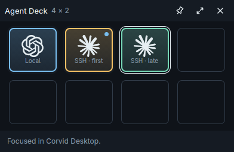
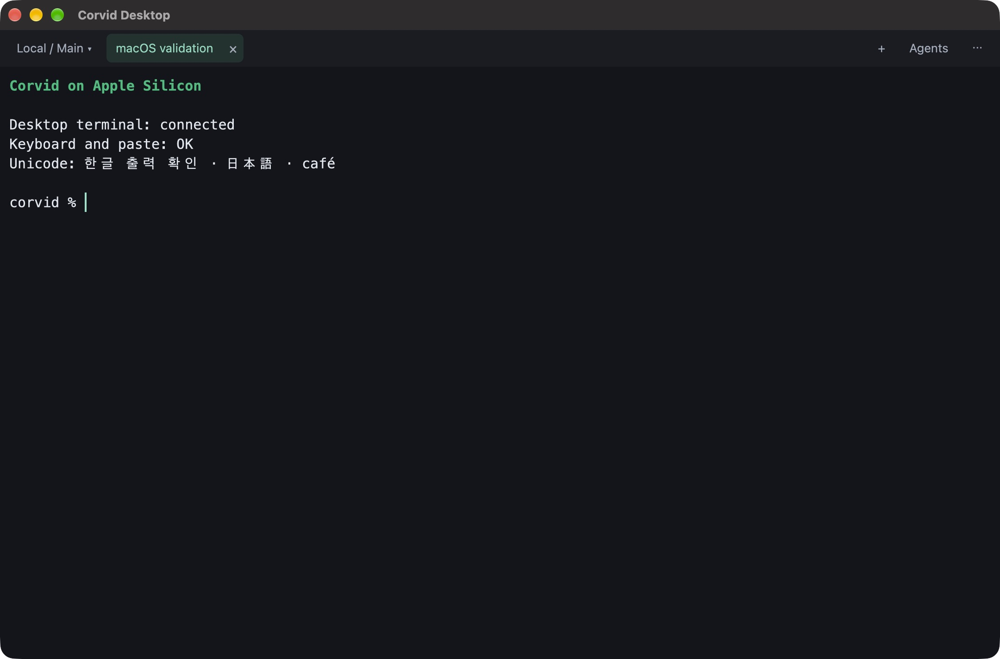
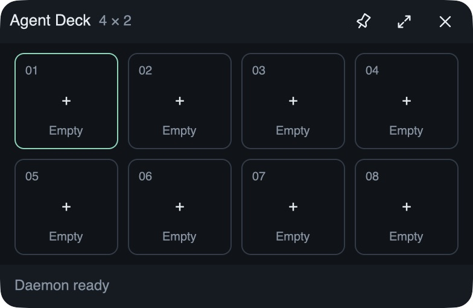
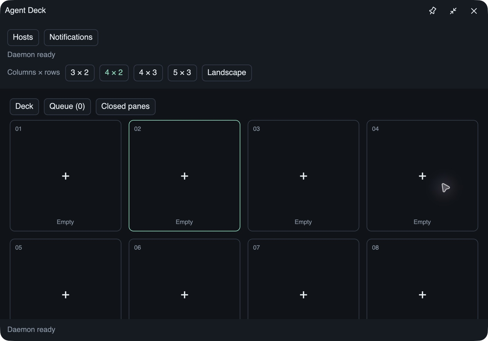
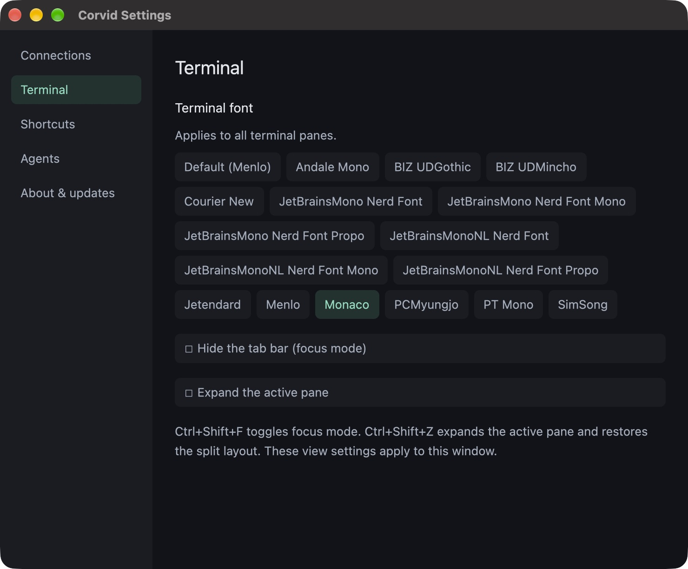
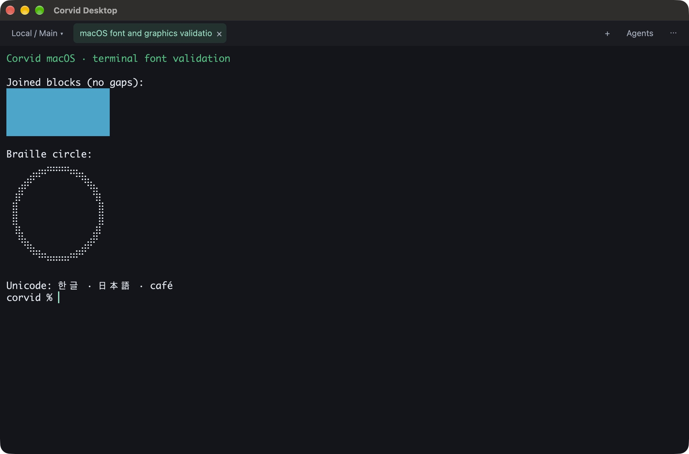

# Platform Verification and Qualification

> Consolidated verification logs, ARM64/release validation boundaries, and remaining device qualification.

## Desktop and Companion Verification

The workspace integration test verifies separate placements for two managed
agents with the same working directory, followed by exit and slot reuse.
The Claude Code 2.1.318 fixture verifies pairing, companion restart, exact
question focus and acknowledgment, and rejection of a stale click after
`/clear`. The OpenSSH 10.6p1 loopback fixture kills the companion's SSH process
and verifies full resync under the same daemon epoch while the separate TUI
and its PTY remain active. These checks ran on Linux.

The A10 wire fixture uses two attached TUIs and a real companion. A focus
request with no registrations returns `NoAttachedClient`. Two registrations
without an explicit choice return `AmbiguousClient`. A wrong revision or
retired capture returns `StaleBinding`. After one TUI detaches, a request
still needs an explicit choice. These failures leave the daemon's snapshot
and sequence unchanged.

The A25 offline restart fixture holds a question open in Claude Code 2.1.318
while the control socket is unavailable. A new companion restores the slot,
badge, counts, and observation time. Attempts to focus or acknowledge return
`ConnectionRequired`. The original TUI selection and pending question survive.
After the control socket returns, a fresh capture focuses the same question.

```sh
PYTHONDONTWRITEBYTECODE=1 python3 crates/corvid-tui/tests/claude_qualification.py \
  --corvid target/debug/corvid --scenario offline-restart
```

Linux desktop verification used Xvfb 21.1.25 with a synthetic Protobuf companion.
The GUI retained the captured run and revisions above 2^53 across a slot
replacement during a mouse press. A fresh click used the replacement's
revision. Dropping the IPC connection during a press produced no replay
after reconnect. A desktop pin also persisted through the real Linux companion.
The A29 version-skew fixture sent an unknown focus activation result and
then an unknown run availability. The desktop kept the last valid snapshot
as a cache and disabled actions. A compatible snapshot restored the link,
and the user had to select the terminal again before focusing.
`cargo test --locked -p corvid-agent-deck -p corvid-agent-deck-ui -p corvid-presentation` checks capture, connection fencing,
and input-frame behavior without a display. The Windows desktop binary
cross-linked for `x86_64-pc-windows-gnu`. Wine 11.21 ran its four tests and
rendered the offline window.

The CLI and companion tests cross-link for `x86_64-pc-windows-gnu` with
Rust 1.93. Wine 11.21 ran CLI help, private pipe I/O, and rejection of default
pipe and state-directory ACLs. Its pipe implementation accepted a duplicate
first instance, and reopening a freshly created state directory returned a
DACL with an extra ACE. The storage tests fail closed in that environment.

Windows PE build `10.0.26100.9457` from the Windows 11 Enterprise 26H2
evaluation ISO ran these cross-built tests in QEMU 11.1.3. With the
temporary directory on a dedicated NTFS volume, both named-pipe integration
tests and all four slot-storage tests passed. The tests covered exclusive
pipe ownership, two presentation clients, private directory ACLs, and state
replacement and recovery. The library passed nine tests, including exact
file identity and cross-process registry restore, with `SystemTemp` on the
NTFS volume for the SYSTEM account. The Windows PE image lacked
`afunix.sys` and the peer PID test returned socket error 10047. The desktop
test executable exited before running its tests with `0xc0000135`.

The three registration tests also passed in Windows PE after the schema
update. A new process restored both explicit manual and WezTerm records.
The tests checked legacy WezTerm records, exact revisions, and rejection of
missing pane fields and unsupported versions.

Wine read a protected registry key prepared by the test and cleared it on
session restart. Wine discarded the security descriptor when creating a new
key, so the companion rejected the key.

On 2026-11-09, Windows x64 build `26300.9711` (26H2) ran 66 tests across the
CLI, client, companion, core, desktop, and protocol packages using MSVC Rust
1.93.1 and `protoc` 36.1. A non-elevated account used an NTFS temporary
directory. Named-pipe ownership and client access, private state ACLs, slot
replacement and recovery, and same-logon registry restore across processes
passed. The AF_UNIX test also passed after accounting for Winsock reporting
zero output bytes while writing the peer PID.

The WezTerm adapter follows the per-process socket layout and CLI options in
WezTerm `20240203-110809-5046fc22`.
[WezTerm GUI socket source](https://github.com/wezterm/wezterm/blob/20240203-110809-5046fc22/wezterm-gui/src/main.rs)
[WezTerm CLI option source](https://github.com/wezterm/wezterm/blob/20240203-110809-5046fc22/wezterm/src/cli/mod.rs)

On an interactive Windows desktop, point the native WezTerm fixture at the
installed GUI executable and record the Windows and WezTerm versions. Use its
absolute path if `wezterm-gui.exe` is outside `PATH`.

```powershell
$env:CORVID_WEZTERM_GUI = (Get-Command wezterm-gui.exe -ErrorAction Stop).Source
& (Join-Path (Split-Path $env:CORVID_WEZTERM_GUI) 'wezterm.exe') --version
Get-CimInstance Win32_OperatingSystem | Select-Object Caption,Version,BuildNumber
cargo test --locked -p corvid-companion --lib native_wezterm_activation_keeps_exact_gui_and_pane -- --ignored --nocapture
```

The fixture starts separate WezTerm instances with its own test panes and
checks that a colliding pane ID in another GUI keeps its selection. It checks
rejection after a pane move, closure, or GUI replacement and the foreground
fallback when the registered GUI owns multiple windows. On Windows build
`26300.9711` the fixture passed with WezTerm `20240203-110809-5046fc22`. It
reported `Activated` for the single-window case and
`PaneSelectedForegroundUnknown` for the multiple-window case.
[WezTerm new-process option](https://wezterm.org/cli/start.html)

Windows system OpenSSH `9.5p2` reached the expected host and epoch on an
Ubuntu 26.04.1 WSL daemon over loopback SSH. A WezTerm SSH TUI with a
synthetic agent paired successfully. `focus-slot` selected the original
Corvid tab and reported `Activated`. Restarting the companion restored the
pin and exact WezTerm registration, and fresh captures still focused the
original terminal. The old captures were rejected. After the WezTerm pane
moved, focus returned `LocalTerminalUnavailable` before changing the remote
selection. The desktop board opened against the same named pipe. Desktop
button interactions and the Windows reboot case remain open.

The desktop pairing request also passed against the loopback SSH fixture
using a test client and a live WezTerm pane. `companion doctor` verified the
original registration, reported it unavailable after the pane moved, and
verified the new revision after re-pairing. The packaged startup script
created and removed the expected shortcut in an isolated Startup directory.
The packaged `companion open` command also pinned the loopback daemon's
HostId on first use, reused the saved configuration, and opened the board
against a separately running companion. A mismatched pipe and state
identity was rejected.

### Local PC reboot reproduction

Use a dedicated Linux daemon on a separate machine and a Windows companion
with its own state directory and pipe instance. Leave a verified Claude Code
question pending in the only attached TUI. Create a second Corvid tab with
Ctrl-] then t and return to the question with Ctrl-] then p. Pair that TUI
to its WezTerm pane and pin the question's slot using `companion pin --slot`.
From another shell in that WezTerm GUI, capture the starting state. Use
the actual slot number and put the checkpoint outside the repository.

```powershell
$checkpoint = Join-Path $env:LOCALAPPDATA 'corvid-a25-reboot.json'
wezterm --version
& "$env:SystemRoot\System32\OpenSSH\ssh.exe" -V
py -3 crates/corvid-tui/tests/local_reboot.py before $checkpoint --ssh-alias work-host --pipe-instance a25 --slot 1
```

Restart Windows manually. From PowerShell, start the same companion with
the same pipe instance and state directory. Keep WezTerm closed and run
`recovered` with the same checkpoint, alias, and pipe instance. The fixture
checks the new local boot time, the saved pin and slot, the unchanged remote
daemon and pending request, and rejection of the retired registration.

Open WezTerm and run `ssh -tt work-host corvid attach`. Pair the new TUI to
its pane. If the question is visible, switch to the existing second tab
with Ctrl-] then n. From a shell in that GUI, run `repaired` with the same
arguments. The fixture checks that the old identity cannot change the TUI
and the new registration selects the original run, terminal, and WezTerm
pane. It checks the pane inventory and pending request again after focus.
Record the reported activation outcome and the Windows build and boot times
from the checkpoint. Keep the checkpoint local.

On a Linux controller, use `python3` and `--socket-dir` in place of the
Windows launcher and pipe option. Pair the TUI without a WezTerm target.
A25 recovery case C passed with a Debian 13.7 controller in QEMU 11.1.3
using OpenSSH 10.0p2. Only the controller guest rebooted. The separate
Linux execution host used OpenSSH 10.6p1 and Claude Code 2.1.318. The saved
pin, slot revision, agent PID, and pending RequestId survived. A newly
paired SSH TUI selected the original question. The request resolved after
the answer was entered in that TUI.

## Deferred Platform Verification

### Installed Windows

Use the desktop board with a paired SSH TUI to verify focus, held-gesture
fencing, overflow, and restart recovery. Capture the activation outcome and
confirm that focus preserves the open terminal inventory and a pending remote
provider question. Follow the [local reboot procedure](#local-pc-reboot-reproduction)
with a separate Linux execution host to confirm that a new Windows logon
restores slots and requires a new pairing.

### macOS

Apple Silicon runtime, workspace, installer, and app/DMG CI runs on
`macos-latest`. Packages target macOS 15 or later.
See [macOS support](../guides/desktop.md#macos) for commands and default paths. Manual
qualification should record the OS build, CPU architecture, terminal emulator,
and SSH version, and exercise the terminal compatibility suite (A19). Native
permission prompts, login/reboot behavior, multiple displays, and non-Latin
IME interaction remain separate manual checks.

## ARM64 and Release Validation

## ARM64 validation

Linux and Windows ARM64 assets are produced by `ubuntu-26.04-arm` and
`windows-11-arm` runners. They run runtime and workspace tests, Clippy,
installer lifecycle checks, and native package assembly. Linux ARM64 also runs
the PTY, SSH reconnect, and Xvfb Desktop checks. Release assembly requires both
architectures and checks daemon manifests and Setup provenance.

Desktop probes the execution host's architecture before selecting a daemon for
installation or upgrade, including ARM64 WSL. Existing working connections do not
need a new architecture probe. Windows installers detect the native OS architecture
even from an emulated PowerShell process. Updates preserve the installed package's
architecture; `install.ps1 -Target` supports that choice explicitly.

This support applies to builds from this revision and future releases. It does not
add assets to already published releases. Physical ARM64 GPU rendering and interactive Windows ConPTY behavior still
need device qualification.

## Validation boundary

The Settings screenshots above use synthetic release metadata in an isolated
Linux Xvfb session. On 2026-11-12, UI checks verified closing and reopening Settings
during a check and installation, retrying after a failed check or corrupted archive,
minimum-width layout, deferred restart, and restart failure with the same retained
shell PID. The real Linux installer ran with verified local fixture assets in a
private installation directory containing spaces. A replacement-process fixture
verified restart dispatch while the daemon and original shell remained alive;
this does not establish compatibility between two published Desktop versions.
The Windows updater also rejected a corrupted fixture archive before mutation,
then ran the real PowerShell installer successfully with verified local assets
and an installation path containing spaces. Desktop, updater, and CLI checks
passed on Windows (30 tests, one WSL-profile test ignored) and Linux (49 tests),
along with builds, Clippy, formatting, and whitespace checks.
On 2026-11-19, a Linux Xvfb test with a local release fixture verified that
**Later** closed Settings while the same Desktop PID and selected package stayed
active. Reopening Settings preserved the prepared update. **Restart to apply**
then ran the fixture installer, opened the replacement Desktop, and closed the
previous process. The available and prepared screenshots show this test.
An isolated Windows integration test used the published 0.3.2 and 0.3.4 runtime
binaries. After handoff, the host ID, terminal ID, and PowerShell PID survived.
The old package was collected after the last shell exited.

On 2026-11-13, the Windows Settings screenshots above were captured using
local release fixtures in a separate Setup installation. The app rejected a
checksum mismatch, then verified and ran the real Setup. Restart opened the
updated Desktop and restored the existing terminal screen.

`deploy/test_install.py` exercises the actual installers with isolated paths,
including spaces, a synthetic older version, repeat installation, concurrent
installation rejection, corrupted downloads, and a running foreground daemon.
The older executable is a version-probe fixture: this tests installation
transactions, not historical daemon compatibility. Existing daemon handoff tests
cover the protocol. Every subsequent release should also qualify an upgrade from
the previous published release with live terminal sessions.

`deploy/test_native.py` checks Windows Setup install, upgrade from a synthetic earlier
version with a running daemon, and uninstall with retained user state.
`tests/ui/run.py` exercises the packaged Desktop and Agent Deck on Linux,
Windows, and macOS before publication. See the
[UI test commands](../contributing/ci-and-validation.md#desktop-and-agent-deck-ui).
On WSL, run Unix integration tests from a Linux filesystem checkout: fixtures
under a Windows mount can fail the runtime's parent-directory permission checks.

## Agent Deck Qualification

Automated coverage includes retained completed responses, FIFO compaction, persisted
pane ownership, stale slot captures, off-page attention and bounds, request metadata,
notification deduplication and snooze, cross-host rejection, Desktop reconnection,
and activation without replacing an existing registration. The Linux routing fixture
exercises real process exit with the shell still open, relaunch in the same pane,
and explicit pane closure.

The Linux Deck focus fixture clicks cards for two live agent tabs. It verifies
that Desktop comes to the foreground, including from a minimized window, and
that typed input reaches the selected agent's terminal.

On an interactive Windows desktop, run
`cargo test -p corvid-agent-deck-ui --features ui-tests --test windows_tray -- --nocapture`
to check tray reopening. The fixture launches a separate Deck and delivers
the Win32 icon and menu messages. It measures the native window bounds and
styles before and after reopening the mini, moved and resized expanded, and
pinned views.

Windows tests invoke the WinRT activation delegate to verify that it preserves
each toast's notice and that summary clicks open settings for both a visible
and tray-hidden Deck. The background routing test delivers clicks for two
hosts in reverse order and checks exact routing, stale-epoch rejection, and
persisted failure when Desktop is disconnected.

Native popup/click behavior, Explorer restart, startup after login, and installed
package behavior require interactive OS qualification. They must not be inferred
from unit tests. To qualify pane focus on Windows and macOS, generate individual
notices from two agents, hide Deck, minimize Desktop, and activate the notices
from the OS while another app is active. Check that Desktop restores the correct
window and that a typed marker reaches only the selected pane. With Desktop
closed, click another retained notice and check the entry in Agent Deck history
after opening it manually. The explicit native test
`native_notification_reaches_windows_history` verifies delivery through WinRT into
Windows notification-center history and removes its temporary notification and
shortcut. It passed on the development Windows host; visual popup/click behavior
remains unverified because the UI tool could not access its cursor or capture its
monitor. Windows notification architecture follows the
[desktop toast sample](https://github.com/microsoft/Windows-classic-samples/tree/main/Samples/DesktopToasts).

Desktop provides [terminal selection, scrollback, and search](../guides/desktop.md#desktop-terminal-selection-and-history).
Windows observes [native agent processes](../guides/desktop.md#windows-quick-start)
launched directly by Corvid or from a Corvid shell.
Desktop's workspace picker watches verified hosts while their terminal views are
detached. In Agent Deck, **Hosts** lists configured monitors and their connection
states. The Deck checks the host identity and limits concurrent inventory
requests to eight. Newly connected hosts contribute their existing agents as
soon as the initial snapshot is ready.



A card requests the exact run from Desktop through its private, controller-scoped
focus endpoint. If the pane is already open in a Desktop window, that window is
activated. Otherwise Desktop opens the pane and connects to the registered host
if needed. Switching hosts releases the previous pane's writer and keeps its
connection ready for reuse on daemons that support parking. If the focus
endpoint is unavailable or reports a writer conflict on the opening host, Deck
can pass the same request to the Desktop window that opened it.

Windows supports [opt-in provider hooks](../guides/providers.md#windows-hook-setup-and-fixture-coverage).
Desktop and the TUI support read-only attach and explicit writer handoff.
Agent Deck is bundled in [Windows Setup](../guides/release-and-install.md#windows-setup).

## macOS Interactive Validation

On Apple Silicon with macOS 27, the packaged application was exercised with the
local GUI fixes applied. Desktop rendered ANSI colors and Korean, Japanese, and
accented Latin output; keyboard input, paste, Command-F search, and window creation
worked. Quitting and reopening Desktop reattached to the daemon-owned terminal.
The screenshots below contain synthetic terminal output and an empty controller.



Before the menu bar panel was introduced, Desktop's **Agents** button launched the
nested Agent Deck application in a floating window. Compact
and expanded views rendered, pin/unpin controls worked, and the expanded window
stayed inside the display's visible area after resizing near its bottom edge.
Hiding the window and reopening it from Desktop preserved the running controller.
Notification permission prompts, multiple displays, and non-Latin IME
composition were not exercised by this session.





After integrating the terminal font and artwork changes from #64, local workspace
tests and lints passed. Native tests verified the Menlo default, selecting
and reloading an installed font, restoring the
default, and recovering from an unavailable font. GUI checks exercised Monaco
selection, private preference storage and restoration across an app restart,
joined solid blocks, Braille dots, and Unicode output. Captures in this session
required a window resize to refresh; they establish the rendered result rather
than continuous redraw behavior.





## Remaining Device Qualification

WSL installation/reconnection still requires the explicitly ignored isolated-WSL
fixture. Real reboot and last-login tests need dedicated machines/accounts.
IME composition, accessibility permissions, notifications, multiple displays,
and hardware GPU behavior require separate device qualification. Synthetic
Unicode input does not validate an OS input method editor.
